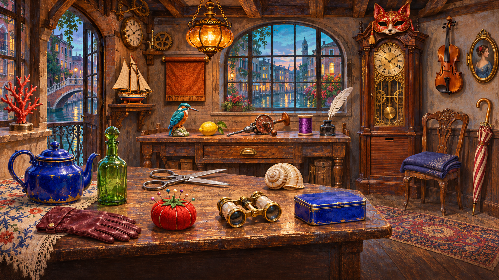
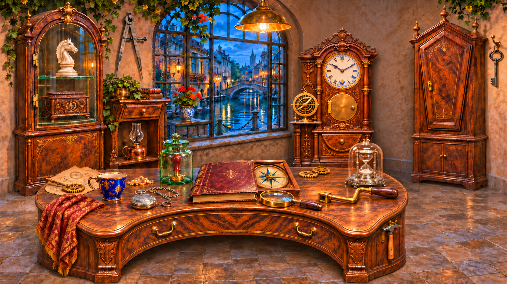

# HO-01/G0 — просмотр Max / Slava

19.11.2026 · `cto-r4d-game-art-01` · **`WAITING_FOR_MAX_SLAVA_G0_REVIEW`**.

Два независимых концепта прошли внутреннюю Visual QA и рекомендованы к человеческому просмотру. **Художественное принятие ещё не состоялось.** Нужны решение по каждому master, утверждение его художественных инвариантов и ответы на два вопроса ниже. Единственного победителя выбирать не требуется.

## F — свободная постановка, v01

**24 находки, 18 видимых + 6 скрытых, шесть разных раскрытий.** F сам придумал набор, размещение и механизмы; конкретика S ему не передавалась. После исходной сдачи F не возобновлялся и не генерировался заново. Q1 проследила все 24 находки; Q2 подтвердила неизменность всех 31 входного файла F.

[Desktop-показ 1920×1080](F/F_MASTER_DESKTOP_QA_v01.png) · [раскрытый кадр](F/F_OPEN_STATES_v01.png) · карты [закрытого](F/F_MAP_CLOSED_v01.png) / [раскрытого](F/F_MAP_OPEN_v01.png) кадра · листы [A–B](F/F_STATE_SHEET_AB_v02.png), [C–D](F/F_STATE_SHEET_CD_v02.png), [E–F](F/F_STATE_SHEET_EF_v02.png) · [полный обзор](F/F_G0_v01.md).

**Семь предложенных инвариантов:** три плана; источник янтарного света; прохладный дальний канал; разные материалы; раздельные насыщенные цветовые пятна; крупные узнаваемые силуэты; управляемая плотность и свободная нижняя полоса. [Точные признаки и способы проверки](F/F_ART_INVARIANTS_v01.md) требуют человеческого утверждения, с решением F-01 ниже.

## S — строгая постановка, C1/v001

**20 заданных находок, два отдельных инструмента и восемь узлов.** Q1 проследила все 20 идентичностей. После неё выполнена только адресная C1: погашена лампа в master и добавлен ясно узнаваемый остаток горлышка в открытом кадре. Q2 независимо подтвердила оба исправления и не обнаружила смысловой регрессии находок, конструкций или перекрытий. Исходный пакет Q1 сохранён без изменений.

[Текущий открытый кадр A](S/C1/images/A-C1-v001.png) · актуальные desktop-карты [M](S/C1/review/output/map-M-C1-1920-v002.png) / [A](S/C1/review/output/map-A-C1-1920-v002.png) · доказательства 1:1: [лампа](S/C1/evidence/S01-LAMP-C1-native.png), [горлышко](S/C1/evidence/S03-NECK-C1-native.png) · [отчёт C1](S/C1/REPORT.md).

**Семь предложенных инвариантов:** тёплый интерьер и холодный канал; три плана с вогнутым столом; узнаваемость двадцати находок в нужных состояниях; различимость материалов; разные формы трёх ящиков и трёх дверец; физически понятные перекрытия и остатки банки; читаемые цветовые/предметные акценты. [Полные формулировки I1–I7](S/REPORT-v001.txt) остаются предложением для G0, не доказательством готового игрового поведения.

## Два решения человека

**S-02 — принять текущую композицию часов/стола или вернуть на коррекцию?** По авторской оценке, стол занимает примерно `x7–80%, y59–99%`, часы `x57–75%, y10–60%`, низ часов закрыт столом. В утверждённом S0 коридоры: стол `x8–76%, y60–96%`, часы `x45–70%, y20–78%`. S0 допускает художественное согласование смещения на G0 до производства. CTO и QA эти отклонения не переутверждали; C1 их намеренно не меняла. Просим оценить фактический кадр и явно принять эту композицию либо указать коррекцию.

**F-01 — оставить подвесной фонарь находкой или постоянным декором?** Сейчас он №15 в наборе из 24 и одновременно главный световой акцент инварианта №2. Его исчезновение не показано. Рекомендация CTO: оставить фонарь постоянным декором и сохранить 23 находки, что по-прежнему выше минимума 20. Это предложение для решения человека; список, карты и инварианты F сейчас не изменены. Если фонарь остаётся находкой, потребуется согласовать сохранение света после подбора на отдельно открытом этапе.

## Проверка и точная версия

- [Q1 REPORT](qa/q1/REPORT.md): полный независимый осмотр исходных F/S; F рекомендован к просмотру, S возвращён на две адресные правки.
- [Q2 REPORT](qa/q2/REPORT.md): обе причины возврата S закрыты; F-рекомендация перенесена при неизменных входах. Q2 завершена в ходе `01a1f18f-6826-7642-88e3-7675f5b41518`.
- Текущий пакет: **`ho01-g0-f-v01-s-c1-q2-20261119`**. [Manifest Q2](qa/G0_INPUTS_2026-11-19_Q2.json), SHA-256 **`6cc12d4365ab9b43b1670cdb7552d515db5dd15ead455994d58c7a9149dc5df7`**. **112/112 файлов, 185624448 байт**, несовпадений нет. Включены неизменные 71 вход Q1, 35 файлов C1 и шесть результатов Q1.
- Исходники этого просмотра опубликованы в commit **`49df7acbc0a632ba653701d563f39f876ccce20e`**. Версия определяется manifest, а не последующим состоянием main.
- Канон: R4D `54fe24b280c835ace0cca372fbbafbff58b97fb2`, заказ rev2, handoff clarification2, S0/программа rev3. Текущий GO Max через ДотМакса — `Sentinel_ac8b923181588191b318eebb82802f00`.

Это концептуальные растры и карты. Зарегистрированные игровые слои, runtime, клики 20/20, анимация, полная обратимость и последовательности G1/G2 не проверялись. Небольшой дрейф companion F и локального L1 в S отмечен. Старые S B/C — исторические локальные исследования, не эталон текущей мебели и не доказательство сохранения нового горлышка после подбора. Эти пределы не скрыты и не подменяются таблицей покрытия.

## Фактический процесс и ресурсы

| Работа | Встроенный ImageGen | Ожидание инструмента | Известный календарный интервал |
| --- | --- | --- | --- |
| F, исходный пакет | 2 вызова: master + раскрытия | 110,7 с | 20 мин 32 с до записи пакета |
| S, исходный пакет | 12 вызовов: master + 11 правок/вариантов | 418 с | 32 мин 49 с до самопроверки |
| S, адресная C1 | 2 правки, по одной на замечание | 89 с | 11 мин 28 с до упаковки; весь ход 12 мин 56 с |
| Независимая Q1 | 0 | — | весь ход 9 мин 13 с |
| Адресная Q2 | 0 | — | весь ход 3 мин 45 с |

Всего **16 встроенных генерационных вызовов** по существующей подписке. Новых покупок, платных API, ключей, бонусов или деплоя не было. Цена отдельного вызова и отдельная ImageGen-квота не раскрыты; нулевая себестоимость не заявляется. Чистое активное время отдельно не измерено. Интервалы включают чтение, осмотр, записи и инструменты; их нельзя складывать как общее календарное время параллельных потоков. F использовал первый master без художественной отбраковки; S потребовались итерации по строгим требованиям. Один опыт с разными заданиями не доказывает превосходство метода F по скорости или качеству.

Оба художника и QA завершили свои ходы. Проверка процессов 19.11.2026 02:22:05 UTC не обнаружила связанных HO-контроллеров/рендеров. F не будили; чужой WIP и временные профили сохранены.

**STOP — `WAITING_FOR_MAX_SLAVA_G0_REVIEW`.** До решения Max/Slava новых художественных правок и генераций нет. HO-02/P, G1–G3, ART-UI/FX и старые Q/P/Q3C не открыты.
