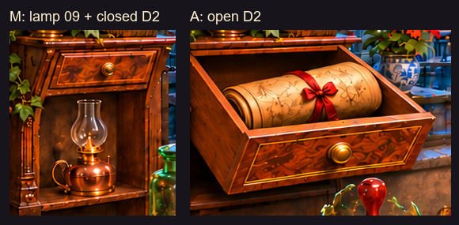

# HO-01/G0 — независимая Visual QA Q1

19.11.2026 · `visual-qa-r4d-ho01-01` · заказчик `cto-r4d-game-art-01`.

**Осмотр завершён. F рекомендую к человеческому G0-просмотру. S можно показать как промежуточный художественный кандидат, но полное соответствие S0 не подтверждено: №09 изображён горящим, остаток горлышка J1 не опознан, композиционные отступления требуют решения человека.** Это рекомендация готовности к просмотру, не художественное принятие и не разрешение следующего этапа.

## Версия и способ проверки

- Exact package: `ho01-g0-f-v01-s-v001-q1-20261119`.
- [Входной manifest](../G0_INPUTS_2026-11-19_Q1.json), SHA-256: `4fe39651c9c1ea87aae871cbb5c01a2cd2a2b0cde3fd306a1704cdeec3013299`.
- Проверены доступность, размеры и SHA-256 **71/71 файлов, 142489417 байт**. Несовпадений нет. Источники относятся к commit `ed6d9d5dca2731e447c67bf0925c900bfb6c935a`; локальная ссылка `origin/main` указывает на него. Канон требований остаётся `54fe24b280c835ace0cca372fbbafbff58b97fb2`, заказ rev2, S0 и программа rev3.
- Фактические параметры текущего `turn_context`: `gpt-6.1-sol`, `xhigh`, `D:\dev\R4D`.
- Использован только локальный `view_image`. Осмотрены исходные F master/companion, desktop master, обе карты, листы AB/CD/EF **v02**; S master **10**, открытый **12**, локальные **08/09**, обе desktop-карты, обзорные PNG и действующий pickup-лист. Для проверки существенной коррекции процесса дополнительно осмотрены S **01/03**.
- Полный кадр сопоставлялся по геометрии 1920×1080: у F — desktop master и художественная область карт, у S — художественная область карт M/A. Их подписи находятся вне кадра. Исходники около 1672×941; увеличение до desktop не создаёт деталей. Это визуальное суждение агента, не испытание человеческой узнаваемости на физическом мониторе.
- Три доказательных PNG рядом с отчётом — только подписанные **кропы 1:1 исходных пикселей**, без ретуши, увеличения или дорисовки. Они поясняют наблюдения, не заменяют оценку целого кадра.

Обзорные `S/review/output/playwright/overview-1920-v001.png` и `overview-A-map-1920-v001.png` обрезают нижнюю часть сцены из-за верхнего блока страницы. Исторический `studies-1920-v001.png` пуст; автор уже отметил его замену в `QA-v001.json`. Для полноты кадра использованы карты и исходные PNG, для локальных изъятий — действующий `pickup-studies-1920-v001.png`. Пустой снимок не засчитан как доказательство и не принят за отсутствие самих состояний.

## F — что подтверждено

[Master](../../F/F_MASTER_v01.png) содержит три плана: передний стол, отдельный верстак, дальний канал с мостом. Тёплый фонарь и прохладные проёмы разделяют световые среды. Древесина, эмаль, прозрачная бутылка, металл и матовая ткань различаются. Это полноценная интерьерная композиция, не одинаковые ячейки фронтального шкафа.

**Все 24 заявленные находки прослежены в арте**, по собственному списку F: 01–18 в master, 19–24 в [companion](../../F/F_OPEN_STATES_v01.png). Малые брошь, печать, компас и груша различимы по силуэту и месту в полном кадре; это не счёт по JSON. Карты ведут к соответствующим предметам. Писчее перо различимо над чернильницей; чернильница не посчитана отдельной находкой. Инструментального инвентаря ветка не заявляет.

Шесть раскрытий имеют разный смысл: крышка коробки, выдвижение ящика, жалюзи часов, тканевая шторка, портрет на петле и снятая со стула ткань. На [листах AB](../../F/F_STATE_SHEET_AB_v02.png), [CD](../../F/F_STATE_SHEET_CD_v02.png), [EF](../../F/F_STATE_SHEET_EF_v02.png) скрытые вещи действительно возникают за прежними непрозрачными препятствиями. Выдвинутый средний ящик остаётся за передним столом; груша имеет опору на сиденье; открытый портрет не дублируется на стене. Видимого противоречия, требующего отклонить эти G0-раскрытия, не обнаружено. Это не проверка траекторий или игровых слоёв.

**Открытый вопрос F-01:** находка 15 — тот же фонарь, который назван главным источником света в художественном инварианте 2. Его подбор ещё не показан. Перед фиксацией концепта нужно явно определить, как трактуется этот инвариант после исчезновения фонаря. Сейчас это противоречие будущих состояний не проверено; новое освещение или runtime этим замечанием не заказываются.

Небольшой дрейф раковины и фактур между master/companion виден и честно заявлен автором. Он ограничивает использование кадров как геометрического эталона слоёв, но сам по себе не отменяет показанные концептуальные раскрытия. Семь предложенных инвариантов конкретны и сопоставимы с изображением; принятие остаётся за человеком.

Адресные замечания без чужой конкретики: [F_FEEDBACK.md](F_FEEDBACK.md).

## S — покрытие и конструкции

[M — master 10](../../S/images/10-master-v005.png) и [A — раскрытый 12](../../S/images/12-state-A-v005-open.png) сохраняют узнаваемую мастерскую, глубину канала, богатство дерева/латуни/стекла и предметные цветовые акценты.

| Осмотренное состояние | Фактически видимые находки |
|---|---|
| M | 01–09, 14, 15, 19, 20 — 13 предметов |
| A | 01–05, 07, 08, 10–20 — 18 предметов |

Объединение покрывает **20 разных находок**; T1/T2 и восемь узлов показаны отдельно. Циркуль, компас, вороток, ключ и молоток не смешаны. Маятник имеет стержень и круглый груз; труба — самостоятельный медный цилиндр с линзой; белый конь, шкатулка, сова и механическая птица различимы. №10 — заметный треугольный зелёный осколок перед остатком банки. При этом наличие всех идентичностей не означает выполнения каждого свойства S0 — замечания ниже сохраняются.

Карты M/A соответствуют положениям видимых вещей. В M прозрачные DR1/J1/L1 позволяют видеть содержимое; их игровую доступность по картинке не подтверждал. В A корпус D2 закрывает исходное место лампы и показывает карту, сплошная круглая створка DR3 закрывает астролябию и показывает маятник. Торчащего остатка астролябии в финальном A не обнаружено.

Вогнутость D1 читается реальной кромкой и полостью, не одним орнаментом. D2 имеет объём и скошенный фасад; D3 — полукруглый контур и открытую полость с трубой. Арочная стеклянная DR1 и пятиугольная DR2 различаются в обоих положениях. Круг DR3 сопоставим с отверстием, петля читается. [Сравнение геометрии 1:1](S_GEOMETRY_NATIVE.png) показывает эти формы. Колпак L1 отставлен перед/слева от D3; прозрачность сохраняется. В A он выглядит меньше исходного, а часы с подставкой смещены вправо. Это заметный локальный дрейф; смысл снятия понятен, но сохранность одной геометрии не доказана. Столкновение D3 с колпаком по этим двум ракурсам не установлено; траектория и физический зазор не проверены.

## S — существенные замечания

**S-01 · подтверждённое несоответствие:** №09 в master горит. Над фитилём виден оранжевый язычок пламени, хотя S0, раздел 2, требует погашенную масляную лампу; исходный промпт также просит `unlit`. Это состояние самой находки, не вкусовое предпочтение к тёплому свету. Полное соответствие S0 нельзя заявить без адресного исправления либо явного изменения требования Максом. Исправление QA не выполняла.

**S-02 · решение человека:** автором заявлены и видны отступления от композиционных коридоров: более высокая/компактная группа часов, стол шире и ниже предписанного коридора. В отчёте автора ориентиры часов `x57–75%, y10–60%`, стола `x7–80%, y59–99%`; это его приблизительные оценки, не новые точные измерения QA. S0 задаёт иные коридоры и разрешает согласовать смещения на G0. QA их не переутверждает; до производства нужно явное решение Макса/Славы по представленному расположению.

**S-03 · существенное неподтверждённое:** у J1 уверенно видны дно, рваные стенки и отдельные обломки, но узнаваемый остаток именно **горлышка** в A/B/C не удалось опознать. S0, раздел 4.2, требует сохранить и его; `REPORT-v001.txt` заявляет фрагмент горлышка. Нужен указатель на существующую узнаваемую форму либо адресное уточнение рисунка по решению CTO. Не утверждаю абсолютное отсутствие любого такого фрагмента, но текстового заявления недостаточно для закрытия свойства.

В B сняты книга и №10, при этом компас, печать и остальные остатки стекла остаются. В C сняты компас и печать, книга и №10 остаются. Это реально разные изображения, а не подписи к одной картинке. [Исходные участки A/B/C](S_J1_PICKUP_NATIVE.png) подтверждают смысл независимого изъятия. Они не подтверждают сохранение каждого осколка пиксель в пиксель; сами B/C имеют заявленный дрейф мебели и не использованы как её эталон. Отсутствие кадра с четырьмя одновременно снятыми вещами не принято за отсутствие G0-концепта или требование выполнить G2 сейчас.

Адресный список: [S_FEEDBACK.md](S_FEEDBACK.md). Семь инвариантов пригодны как предлагаемые ориентиры, но формулировки об узнаваемости, геометрии и следах J1 ещё не равны подтверждённому контракту по всем деталям.

## Процесс, ограничения и передача

F сохранил план, два промпта, исходные выходы, самопроверку и журнал коррекции кадрирования; документированы 2 вызова, 110,7 с ожидания и 20 мин 32 с общего интервала. S сохранил 12 выходов/промптов и журнал причин переходов; документированы 12 вызовов, 418 с ожидания и 32 мин 49 с общего интервала. Реальная смена выпуклого D1 на вогнутый видна между осмотренными S 01/03. Существенные отбраковки и дрейф обозначены, неизвестная стоимость не объявлена нулевой. Эти числа сверены по переданным записям, **не независимо измерены QA**; сырые журналы контроллера не входят в пакет. Чистое активное время не измерено у обеих веток. Разница числа вызовов не доказывает универсального преимущества F или S.

Субъективное впечатление: F легче читается отдельными цветными силуэтами; S выглядит более парадным и орнаментально плотным. Это не дефекты и не основание назначить единственного победителя. Красоту и приятность принимают Макс/Слава.

Не проверялись клики, маски, удаление запечённых копий, runtime, траектории движения, все последовательности, анимация списка и физическое пользовательское восприятие. Это остаётся вне выполненной G0 VQA; будущие требования не отменены и не исполнялись досрочно.

Входы, manifest и канонические документы не изменялись. Созданы только этот отчёт, два раздельных feedback-файла и три поясняющих PNG в `qa/q1/`. Генерации, платных вызовов, сообщений авторам, найма, commit/push/deploy не было. Следующие HO-этапы и другие очереди не открыты.

**STOP CTO.** Передан независимый результат осмотра exact-пакета; исправления, повторный запуск авторов и человеческое художественное решение не выполнялись.
