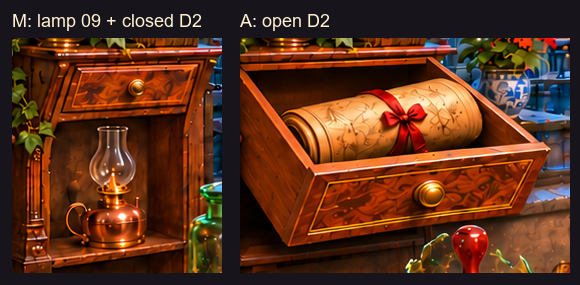

# HO-01/G0/S v001 — независимые замечания Q1

Для CTO. Авторам не отправлено. Проверены master `images/10-master-v005.png`, открытый `images/12-state-A-v005-open.png`, карты M/A и локальные исследования 08/09 по S0 pin `54fe24b280c835ace0cca372fbbafbff58b97fb2`.

**Кандидат пригоден для промежуточного художественного обсуждения; полное соответствие S0 не подтверждено.** В объединении M/A опознаны все 20 находок, отдельно T1/T2 и восемь узлов. Но наличие всех предметов не закрывает следующие свойства.

## S-01 — лампа горит вместо погашенного состояния

В master №09 на наружной полке под D2 имеет различимое пламя над фитилём. S0, раздел 2, требует **погашенную** масляную лампу. В первом промпте также указано `unlit`. Это подтверждённое несоответствие состояния предмета, а не предложение изменить палитру.

Для заявления полного соответствия нужен адресно исправленный рисунок либо явное решение Макса изменить требование. QA не выполняла исправление и не запускает автора.

## S-02 — композиционные отступления требуют человеческого решения

Группа часов поднята и компактнее коридора S0; стол шире и ниже. Эти отступления честно указаны в `REPORT-v001.txt`. Они допускают обсуждение на G0, но ещё не утверждены. До производства нужно решение Макса/Славы по представленному расположению; QA не делает его новым каноном.

## S-03 — остаток горлышка J1 не подтверждён по рисунку

На [участках A/B/C](S_J1_PICKUP_NATIVE.png) видны дно, рваные стенки и отдельные зелёные обломки. Узнаваемый остаток именно горлышка, требуемый S0, раздел 4.2, и заявленный в авторском отчёте, не удалось уверенно опознать. Нужен понятный указатель на уже нарисованную форму либо адресное уточнение по решению CTO. Это недостаток подтверждения, а не утверждение, что любой такой фрагмент физически отсутствует.

Крупный треугольный №10 и печать различимы отдельно. В B после снятия №10 остаются печать и другие обломки; в C после снятия печати остаются №10 и другие обломки. Эти свойства подтверждены концептуальными изображениями.

## Геометрия и границы

- D1 сохраняет настоящую вогнутую кромку; в A есть полость и колокольчик. D2 имеет глубокий корпус, закрывающий место лампы. DR3 сплошной створкой скрывает астролябию, в отверстии читается маятник; торчащего остатка астролябии не обнаружено.
- D3 читается полукруглым открытым ящиком с трубой. Арочное стекло DR1 и пятиугольная DR2 не подменены одинаковыми прямоугольниками. [Сравнение 1:1](S_GEOMETRY_NATIVE.png).
- L1 отставлен слева от часов перед D3; в A колпак выглядит меньше исходного, часы с подставкой смещены вправо. Смысл снятия читается, но неизменность геометрии не доказана. Столкновение с D3 по этим изображениям не установлено; зазор и траектория не проверены.
- B/C пригодны как локальные концепты изъятия; их заявленный дрейф мебели не принят за эталон закрывания D2/DR3.
- Обзорные PNG с шапкой страницы обрезают низ сцены. Для полного кадра использованы карты M/A и исходники. Исторический пустой `studies-1920-v001.png` уже заменён автором действующим pickup-листом и не засчитан как доказательство.

Это G0-концепты. Клики, слои, анимация списка, полная обратимость и стресс последовательностей не проверены и сейчас не требуются как уже выполненная работа. Художественное принятие — только Макс/Слава. QA входы не исправляла, не генерировала, с автором не связывалась. **STOP CTO.**
