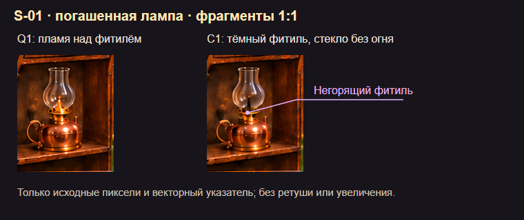
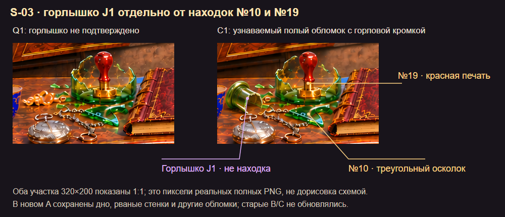

# HO-01/G0 — адресная независимая повторная проверка Q2

19.11.2026 · `visual-qa-r4d-ho01-01` · заказчик `cto-r4d-game-art-01`.

**S-01 и S-03 закрыты для предъявленных концептуальных кадров C1. Смысловой регрессии ранее подтверждённого содержимого S не обнаружено. Рекомендую exact-пакет F v01 / S C1 к человеческому G0-просмотру с явными вопросами S-02 и F-01.** Это рекомендация готовности к просмотру, не художественный PASS и не открытие следующего этапа.

## Exact-вход и целостность

- Package: **`ho01-g0-f-v01-s-c1-q2-20261119`**.
- [Manifest Q2](../G0_INPUTS_2026-11-19_Q2.json), SHA-256: **`6cc12d4365ab9b43b1670cdb7552d515db5dd15ead455994d58c7a9149dc5df7`**.
- Проверены доступность, размеры и SHA-256 **112/112 файлов, 185624448 байт**, 112 уникальных путей. Несовпадений нет. Версия определялась этим manifest, не последним HEAD.
- Все **71 вход Q1**, включая **31 файл F**, совпадают с прежним manifest и текущими файлами. Сам manifest Q1 сохраняет SHA-256 `4fe39651c9c1ea87aae871cbb5c01a2cd2a2b0cde3fd306a1704cdeec3013299`. Шесть выходов Q1 также совпали с хешами Q2.
- Канон требований прежний: R4D `54fe24b280c835ace0cca372fbbafbff58b97fb2`, заказ rev2, S0 и программа rev3. Основание — адресная Q2 и текущий GO Max `Sentinel_ac8b923181588191b318eebb82802f00`, только G0.

F повторно художественно не осматривался и не запускался. Его [рекомендация Q1](../q1/F_FEEDBACK.md) переносится без изменения: 24 находки прослежены в Q1, концепт рекомендован к человеческому просмотру, F-01 остаётся вопросом.

## Что фактически осмотрено

Через локальный `view_image` сначала просмотрены **полные raw PNG без стрелок**: [M-C1-v001](../../S/C1/images/M-C1-v001.png), 1672×941, и [A-C1-v001](../../S/C1/images/A-C1-v001.png), 1670×942. Затем — актуальные [карта M v002](../../S/C1/review/output/map-M-C1-1920-v002.png) и [карта A v002](../../S/C1/review/output/map-A-C1-1920-v002.png), обе 1920×1200 с художественной областью полного desktop-кадра. После самостоятельного осмотра прочитаны и сопоставлены два авторских before/after 1:1.

У обеих SVG-карт дополнительно проверено: SHA-256 встроенного PNG совпадает с соответствующим новым raw C1. Указатели карт сопоставлены с реальными предметами. Coverage сохраняет прежние 20 ID находок, 2 инструмента и 8 узлов; среди записей узлов изменено пояснение J1. Таблица использована для сверки, не как доказательство нарисованного.

Браузер, рабочий стол, видимые окна, фокус, дополнительные рендеры и новые кадры не использовались. Это ограниченная повторная проверка новых S-кадров, не повтор всей Q1.

## S-01 — закрыто в новом M

На полке под D2 осталась узнаваемая масляная лампа с прежними стеклянной колбой, ручкой и медным основанием, в прежнем месте и сопоставимом масштабе. Над горелкой различим **тёмный негорящий фитиль**, оранжевого языка пламени больше нет. Тёплые блики на меди и стекле остались отражениями; они не образуют собственного огня над фитилём. Исправление видно и в полном raw M, независимо от авторского указателя.

В A место лампы по-прежнему закрыто выдвинутым корпусом D2; отсутствующая видимость там соответствует требуемому перекрытию, а не служит отдельным доказательством погашения.

## S-03 — закрыто в новом A

Слева от остатка J1, рядом с синей чашкой, появился **отдельный полый короткий обломок горлышка**: читаются круглая горловая кромка, стенка и рваный край. Он опознаётся по форме в raw A, а не только по подписи. Это остаток банки, не дополнительная находка.

Треугольный поисковый №10 остаётся отдельно впереди J1; красная печать №19 — в остатке банки. Дно, рваные стенки и другие отдельные зелёные обломки сохранены. Новая деталь не подменяет №10/19 и не увеличивает двадцатку.

Закрыт прежний недостаток подтверждения **наличия горлышка в открытом G0-концепте**. Его сохранение после изъятия №10/19 этим не проверено: старые B/C не обновлялись и не использованы как доказательство новой детали. Новые последовательности не требовались и не выполнялись.

## Ограниченная проверка регрессии

В новом M прослежены прежние 13 находок: 01–09, 14, 15, 19, 20. В A — прежние 18: 01–05, 07, 08, 10–20. Их объединение по-прежнему покрывает 20 разных предметов; ключ T1 и молоток T2 остаются отдельными видимыми инструментами.

Сохранены вогнутый фасад/полость D1 с колокольчиком, объёмный трапециевидный D2 с картой, полукруглый D3 с трубой, арочная стеклянная DR1, пятиугольная DR2 с совой и механической птицей, круглая DR3 с маятником. D2 по-прежнему закрывает место №09; сплошная створка DR3 закрывает №06 без видимого торчащего остатка астролябии. Прозрачность целых J1/L1, частичное перекрытие компаса книгой и различимость находок сохранены. Карты ведут к этим предметам и состояниям.

Дальний канал, разделение планов, тёплый интерьер и различия материалов сохраняются. Нового пропуска, подмены находки или смыслового разрушения конструкции при осмотре полных кадров не обнаружено. Пиксельная неизменность внешних областей и геометрическая регистрация слоёв не заявляются.

## Что остаётся и передача

- **S-02 открыт для человека:** композиционные отступления часов/стола намеренно не исправлялись. Q2 не утверждает новые коридоры. Макс/Слава должны явно решить этот вопрос на G0 до производства.
- **F-01 сохранён:** подбор фонаря как находки и трактовка инварианта главного источника света после его исчезновения остаются вопросом концепта. Целостность F позволяет перенести Q1-рекомендацию, но не закрывает этот вопрос.
- Прежний локальный дрейф L1, отсутствие зарегистрированных production-слоёв, траектории, клики, полная обратимость и последовательности G1/G2 не объявлены проверенными. Новое горлышко в старых B/C не предполагается автоматически.

Новых адресных замечаний, требующих отдельного `S_FEEDBACK.md`, в пределах Q2 не выявлено. Две причины адресного возврата устранены; оставшиеся человеческие вопросы явно сохранены.

Создан только `qa/q2/REPORT.md`; доказательные ссылки ведут к неизменённым входам C1. Q1/C1, manifest и канон не редактировались. Генерации, художественных правок, сообщений авторам, найма, новых расходов, commit/push/deploy не было.

**STOP CTO.** Человеческое художественное принятие остаётся только за Max/Slava; HO-02/P и G1–G3 не открыты.
