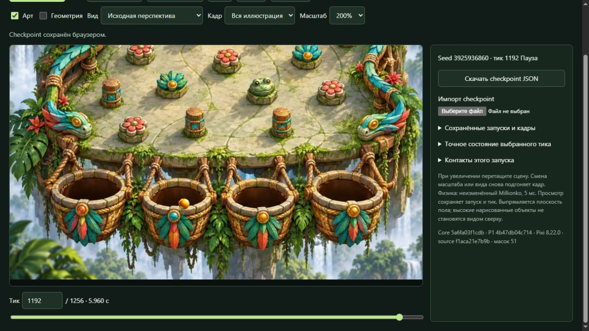
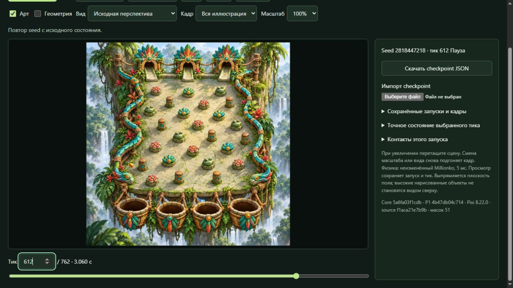

# P3 — цельная Jungle и маски перекрытия

**Частичный исследовательский результат.** На неизменённой Jungle собрана
проверочная демка PixiJS с настоящим Millionko, собственными объёмным
шариком и тенью. На просмотренной выборке работают частичное скрытие,
проходы перед объектами и за ними, высокий столб, борта и края корзин.
Техническая QA завершена; полный визуальный PASS не выдан.

Остаётся видимый ранний отскок перед левым бортом: принятый общий маппинг
P1 помещает сегмент `left-5` на свободный нарисованный пол. Обе независимые
QA подтвердили источник. Общий config и проекция сохранены; исправление
не скрывалось маской и не подменялось другой траекторией.

**Доставка:** exact-кандидат опубликован в существующем защищённом
[Review](https://superflight.space/review/r4d/p3-masks/) 28 октября 2026,
07:28:49 UTC. Серверные bytes и права всех 550 файлов release проверены,
прежнее дерево сохранено. Проверены 95 HTTPS-ответов и прежние защитные
заголовки; nginx active после успешных проверок конфигурации и graceful reload.
Без существующей авторизованной сессии ресурсы возвращают auth303:
**post-auth JavaScript MIME/body и работа интерфейса на сервере не проверены**.
Локальная предметная QA и проверка серверных файлов этого пробела не заменяют.

Точные серверные проверки, хэши и rollback pointer сохранены в
[отчёте доставки](release/DELIVERY_FROZEN_01.md), commit
`390e178ecc044cadb9b67f4a2506d5efdc171fef`. Все разрешённые записи завершены;
Release вернулся в `server_write=false`. Локальный preview завершён,
собственные процессы и вкладки участников закрыты, исходные материалы сохранены.

**Приёмка CTO:** 28 октября 2026, 07:47:59 UTC, P3 принят как завершённая
ограниченная частичная исследовательская попытка. CTO явно освободил token
`CTO-P3-F01-20261028T064706Z-ddfe257b6856`, окно публикации и слот P3.
Права записи по token закончены; новые записи или rollback требуют нового
конкретного разрешения. Приёмка сохраняет MAP-01 и ограничение post-auth
и не означает полного visual/art PASS или полного достижения визуальной цели.

## Как выполнен способ

Вся исходная картинка остаётся неподвижной основой. Artist самостоятельно
разметил 51 source-aligned alpha-маску: 25 препятствий, участки бортов,
дальние спуски, переднюю кромку платформы и составные края четырёх корзин.
Consumer восстанавливает исходные пиксели внутри нужных областей поверх
шарика и его тени по реальному native-положению и глубине основания.
Нарисованные падающие тени не принимаются за непрозрачное тело.

Шарик и отдельная тень сгенерированы для P3; маски, anchors и размеры
сохранены с происхождением и хэшами. Подготовка контуров выполнена агентом
по исходнику; ручного вмешательства Max не требовалось. Общие P0/P1 и
обычные библиотеки использованы в разрешённых границах, продукты соседних
методов не использовались.

Весь принятый config P1, native core и PRNG сохранены. Обычный новый бросок
меняет только `rng.seed`. Маски не привязаны к seed, времени или тику.
Есть повтор, pause/+ticks/seek, скачивание и импорт checkpoint JSON,
независимые «Арт»/«Геометрия», исходный и выпрямленный виды. Отключённый
арт снимает невидимые маски с диагностического пути.

## Проверенная версия

| Часть | Exact identity |
| --- | --- |
| Кандидат | `P3-frozen-01` |
| Код | `f1aca21e7b9ba19001e7e8762fcaf2511bf9bf74` |
| Арт | `f899a308aed156a11e2a1013292ed68c6669959d` |
| Manifest SHA256 | `e2e9f7d837b3d05f484f75a877af6992a70ee88363add783d80f3c6e206f431f` |

76 payload-файлов / 3388537 bytes; с manifest — 77 файлов / 3401352 bytes.
Точные native/P1/toolchain, лицензии и способы воспроизведения — в
[передаче Builder](builder/FROZEN_CANDIDATE.md).

Независимая [техническая QA](technical-qa/TQA_REPORT_FROZEN_01.md),
commit `c0db64fe4a0204d77be0d3ab61ffe21331d9c90a`: 11493 native-состояния,
51 browser/export snapshot, воспроизводимость, реальный import/download,
управление тиками и статическая загрузка. Новых технических дефектов P3
в проверенном объёме не найдено.

Независимая [визуальная QA](visual-qa/REPORT_FROZEN_01.md),
commit `0f282b89a5d58f6613153ceb385657c8fb761b1d`: визуальный результат
частичный, новых конкретных mask/renderer-дефектов P3 не выявлено.

| Наблюдение | Сохранённое воспроизведение |
| --- | --- |
| Частичное скрытие и выход из-за листьев | seed0, leaf01, тики65–75/94–95/150 |
| Высокий столб и боковой выход | seed0, wood01, 570–660 |
| Силуэты лягушки и цветка | seed0, frog02/441 и flower02/890 |
| Входы в корзины03 и01 | seed0/1956 и1199311181/1367 |
| Передний край корзины02 | seed3925936860,1191–1195; исход LOST |
| Плохой контакт общего входа | seed2818447218, left-5,611–613 |

Сохранены удачные и LOST-примеры без отбора красивых seed. Проход через
край02 не объявляется попаданием02. Для повторения использовать тот же
bundle/manifest, импортировать сохранённый JSON из отчётов либо выбрать
обычный saved run в интерфейсе и перейти к нужному тику.

Передний край02, реальный тик1192:

## Ограничения и точка остановки

MAP-01 остаётся дефектом видимого результата. Его не относим к новому
коллайдеру или маске P3; причины всех проигрышей этим не установлены.

Тень различима на светлом полу в обычном масштабе, слабее — на тёмном
пёстром фоне. Scalar pin-depth, coarse rail depth и мелкие края не получили
универсальной гарантии. Все 51 маска во всех достижимых состояниях,
попадания02/04 и мобильные размеры не исчерпаны проверкой. Наблюдение
агентами не выдаётся за человеческое испытание.

До freeze исправлены захват пустого пола нижним бортом, швы полос корзин,
масштаб тени и ошибки управления/первого кадра. Первые версии, существенные
правки и provenance сохранены в материалах Builder/Artist. После обеих QA
нового конкретного дефекта P3 для исправления не получено. Следующий
осмысленный шаг для MAP-01 требует отдельного решения об общем входе;
подгонять его внутри независимого P3 нельзя. Это обоснованная остановка
ограниченной попытки, не доказательство предела метода и не объявление
исчерпанного бюджета или полного исполнения визуальной цели.

**Решение Lead:** передать этот опубликованный exact частичный результат
с явным MAP-01, сохранёнными воспроизведениями и ограничением post-auth
проверки. Выпуск выполнен по отдельному single token CTO, frozen продукт
не менялся. Полный visual PASS и полное исполнение визуальной цели не
заявляются. CTO принял этот bounded handoff и явно закрыл окно публикации;
Lead завершает работу после финального административного checkpoint.
P4–P6 этой передачей не запускаются.
