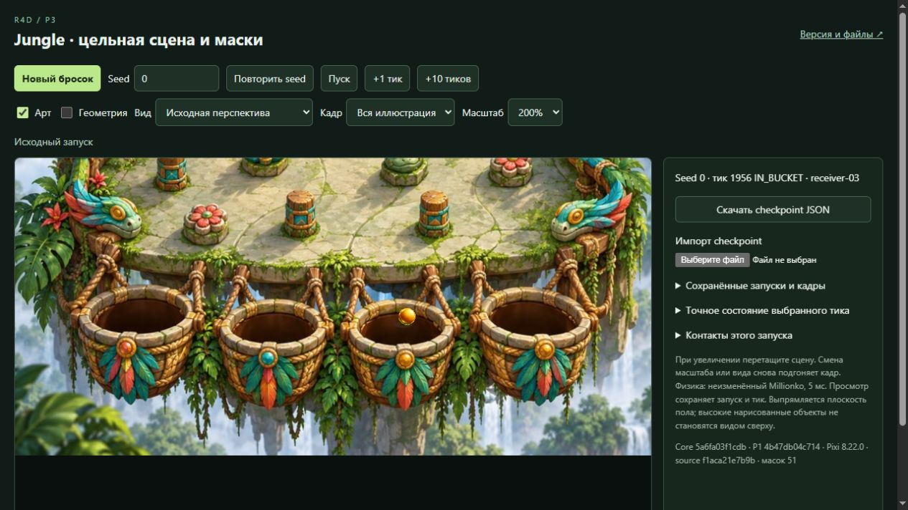
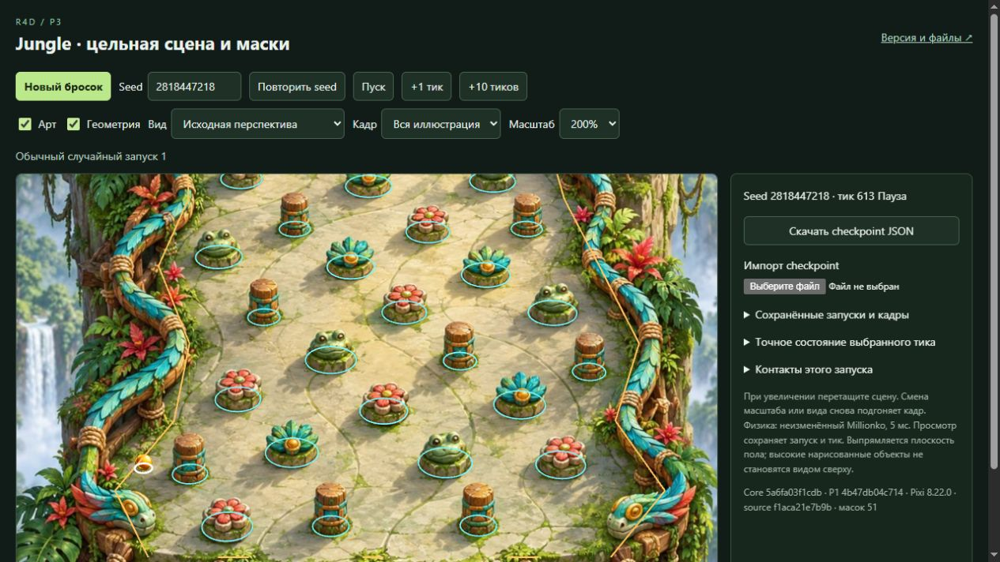

# Technical QA — P3-frozen-01

28 октября 2026, Europe/Kyiv. `technical-qa-r4d-p3-masks-01`.

## Вывод

Порученная техническая QA завершена. В проверенном объёме подтверждены
неизменённый native, общие входы, воспроизводимость и действия просмотра.
Новых воспроизводимых технических дефектов P3 в этих сценариях не найдено.
Сохраняется **M1 — расхождение общего маппинга left-5 с нарисованным бортом**.
Это не общий художественный PASS, не приёмка всего заказа и не разрешение
серверной публикации. Художественную оценку даёт отдельная VQA.

## Проверенная версия

| Источник | Exact identity |
| --- | --- |
| CODE | `f1aca21e7b9ba19001e7e8762fcaf2511bf9bf74` |
| ART | `f899a308aed156a11e2a1013292ed68c6669959d` |
| Handoff | `4603d99a5904d10924f55416e36100b2c470b534:experiments/p3-masks/builder/FROZEN_CANDIDATE.md` |
| Frozen file-manifest SHA256 | `e2e9f7d837b3d05f484f75a877af6992a70ee88363add783d80f3c6e206f431f` |
| Native | `5a6fa03f1cdb3de88a2d9c7dbe795eb8e2a7f023` |
| P1 | `4b47db04c7140ebf88f69b91faa0b790d46f22ec` |
| native-core.js SHA256 | `af8e6dea9ee5c46759f99ba3b68f4afa91c740b4fd2aba2d2d3f65bfa66753fa` |

Bundle: `E:\R4D\perspective\p3-runtime\builder\full-checkpoint-06`;
preview: `http://127.0.0.1:6866/review/r4d/p3-masks/`.
Заказ — ORDER/P3 на `64061757802dc60770ab156ef5672af741d65d03`.
Кандидат и чужие реализации не исправлялись. P2/P4/P5/P6 не читались.

## Независимые машинные доказательства

До паузы сверены все 77 local/HTTP файлов: 76 payload / 3388537 bytes,
с manifest — 77 / 3401352 bytes, лишних файлов нет. 62 файла совпали с
exact CODE/ART Git objects. Целые config/manifest/projection/view-math
побайтно совпали с P1; sourceToNative/nativeToSource/translation/domains
не переопределены. Jungle SHA256 и PixiJS 8.22.0/MIT совпали с входами.
Counts 25/16/4/1, r16, tick5ms, g980, speed2000, noise2deg/0.02,
lcg32 и quantize7 сохранены; в новом запуске меняется только rng.seed.

Native самостоятельно пересобран из 14 exact Git blobs по закреплённому
Node24.15.0/stripTypeScriptTypes/rolldown1.2.15 recipe и побайтно совпал с
compiled runtime. Дополнительно использован отдельный **unbundled oracle**
из exact native modules, без Builder makeRun как источника истины.
Проверка включает полные состояния и object_hit events, не только endpoints.

| Seed | Источник запуска | Последний tick | Native outcome | Состояний |
| --- | --- | ---: | --- | ---: |
| 0 | Исходный saved run | 1956 | IN_BUCKET receiver-03 | 1957 |
| 2818447218 | Saved ordinary | 762 | LOST | 763 |
| 2099436614 | Saved ordinary | 747 | LOST | 748 |
| 3925936860 | Saved ordinary | 1256 | LOST | 1257 |
| 1199311181 | Saved ordinary | 1367 | IN_BUCKET receiver-01 | 1368 |
| 4002564341 | Первый новый TQA | 1999 | LOST | 2000 |
| 892542836 | Второй новый TQA | 1814 | LOST | 1815 |
| 1061109253 | Третий новый TQA | 1584 | LOST | 1585 |

Итого **11493 состояния** восьми полных трасс. Три новые seed получены
первыми обычными кнопками без отсева; все три неудобных LOST сохранены.
Их trace hashes различаются. Проверены семь supplied checkpoint JSON
и **51 browser/export snapshot**, включая config, start/drop, state,
result, tick и rngU32. После resume проверены только оставшиеся случаи:
77 файлов, native build и пять уже сверенных saved traces не повторялись.

Факты: [первый проход](FROZEN_01_WIP_VERIFICATION.json),
[три новые трассы](RESUMED_SAMPLES_VERIFICATION.json),
[итог browser snapshots](BROWSER_FINAL_VERIFICATION.json).

## Фактические действия в отдельной IAB-вкладке

| Сценарий | Наблюдение |
| --- | --- |
| Ordinary/replay | Все три собственных запуска реально дошли до terminal в браузере. Третий после import продолжен с1367 до1584, затем повторён от0; render changes во время replay не изменили итог/native state. |
| Pause/+ticks | Третий seed: пауза1356, +1→1357, +10→1367. Удержание и переключения не изменили state/rngU32. |
| Seek | Реальные Home→0/End→1584 и числовой seek назад500/вперёд1367 восстановили exact native states. |
| JSON | Реальная кнопка download; file chooser после fresh reload; восстановлен1367, затем +1→1368 и дальнейшее завершение. |
| Просмотр | Четыре Art/Geometry комбинации, source/flat, whole/floor, zoom200% и настоящий drag сохраняют полный checkpoint при одинаковом tick. |
| Диагностика | Art-off убирает фон/ball/shadow/occlusion; диагностический шарик остаётся видимым. Геометрия из фактического config — незалитая и выше арта. |
| Перекрытия | Seed0/leaf-01 t60/65/70/90/94/110; flower-03 t1503–1505; seed2099436614/frog-02 t487–489. Частичный вид/последующее скрытие leaf и боковые переходы просмотрены, поп в этих кадрах не обнаружен. |
| Корзина | Seed0/receiver-03 t1945/1950/1956: реальный вход и IN_BUCKET. Перекадрирование сохраняет ранее сверенные checkpoints. Придуманного sinking нет. |

Пример окончания входа в receiver-03, seed0/t1956:

## M1 — общий маппинг left-5

Seed `2818447218`, ticks `611/612/613`, source/whole/200%, Art-on;
на613 включена Geometry. Native object_hit left-5 происходит на612,
затем движение отскакивает, хотя нарисованный борт ещё дальше слева.
Контур принятого сегмента сам проходит по видимому полу перед бортом.
Проекция и конфигурация совпали с exact P1; состояния и событие — с oracle.
Следовательно, в этом воспроизведении источник раннего контакта — общий
входной маппинг, не новый collider/remap или подмена траектории P3.
Это видимое ограничение результата, не исправленное и не скрытое маской.
Причины всех LOST этим единичным наблюдением не установлены.

## Статическая загрузка и границы результата

Fresh nested-route reload завершил инициализацию 51 маски. В root browser
network stream: 13 HTTP requests/responses под нужным route, все GET/200;
все пять JS modules имеют JavaScript MIME. Ещё два response — встроенные
image-format data probes. Root loadingFailed и console error/warn — 0.
Backend/POST при выполненных действиях не наблюдался.
[NETWORK_SUMMARY.json](NETWORK_SUMMARY.json) прямо ограничен root stream:
PNG/JPG traffic в нём отсутствует и не выдан за захваченный. Отдельная
проверка всех payload HTTP bytes и завершённый await всех mask loads —
другие доказательства загрузки, а не подмена network capture.

Payload проверен на TS/maps/sourceMappingURL/private absolute C/D paths и
private-key markers; находок нет. Pixi distribution и LICENSE побайтно
сверены с разрешённой копией. Private native modules остаются только в
собственном E runtime; в Git и payload их нет.

Некоторые ранние captures не совпали с ожидаемым tick/controls либо не
включали интересующий объект из-за zoom/framing. Они не использованы как
доказательство соответствующего кадра. Итоговые viewport screenshots
сверялись с текущими controls/tick; повторные captures корзины/frog/left-5
имеют явное доказательство равенства уже проверенному checkpoint.
Raw data сохранены; конкретные исключения — в [EVIDENCE_INDEX.json](EVIDENCE_INDEX.json).

Все возможные seed/перекрытия не исчерпаны; scalar pin depth и coarse rail
depth не получили универсальной гарантии. Receiver02/04 не заявлены как
просмотренные успешные достижения; receiver01 подтверждён native trace,
receiver03 дополнительно просмотрен в browser. Тени и художественная
цельность не выводятся из hashes и технических checks и остаются предметом VQA.

## Evidence, повторение, остановка

[EVIDENCE_INDEX.json](EVIDENCE_INDEX.json) связывает 15 JPEG и пять
**готовых к UI import** checkpoint JSON с exact candidate/manifest и hashes.
Например, хорошее воспроизведение — seed0/t1956, mapping caveat —
seed2818447218/t613; собственные три LOST также сохранены. Полные raw
browser данные: `E:\R4D\perspective\p3-runtime\technical-qa\frozen-01\browser`.

[verify-frozen.mjs](verify-frozen.mjs) воспроизводит первый машинный проход
с явными параметрами `nativeRepo` и accepted dependencies.
[verify-resumed-samples.mjs](verify-resumed-samples.mjs) использует сохранённый
независимый oracle; `--pending-only` проверяет новые snapshots без повторения
уже законченного полного сравнения трёх ordinary traces. Это инструменты QA,
не обязательная инфраструктура продукта.

Перед browser: 05:49:21UTC RAM free11.341/31.907 GiB, CPU6%/24logical,
C/D/E free8.079/16.303/46.181 GiB; совместная добавочная оценка до3.3 GiB.
Перед финальной native сверкой: 06:03:48UTC RAM free10.682 GiB, CPU5%,
C/D/E free8.047/16.326/43.566 GiB; свой добавочный пик оценён до0.3 GiB.
Оценки не выдаются за измеренный резерв. Тяжёлые материалы и process-local
TEMP/TMP — только собственный E runtime; глобальные настройки не менялись.

Своя IAB-вкладка2 закрыта; собственных активных servers/exec sessions нет.
Shared Builder preview PID112732 не останавливался. Server writes,
публикация и следующий этап этой QA не выполнялись. Дальнейшее решение —
Lead/CTO по этому exact freeze совместно с отдельной VQA; активного ожидания нет.
