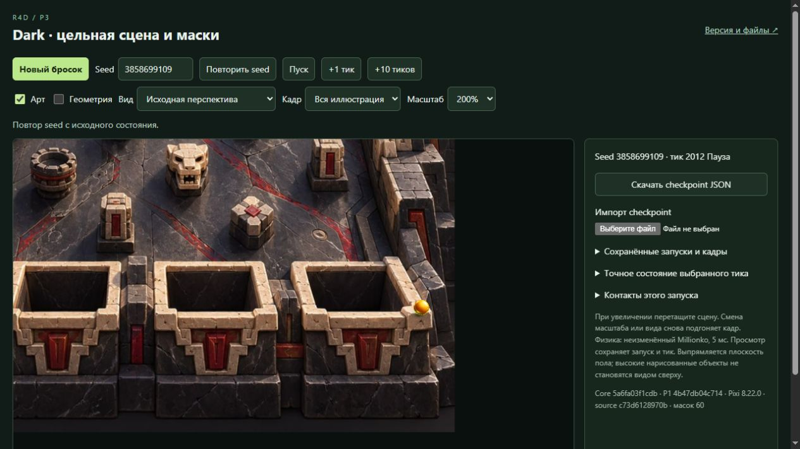

# Dark receiver-front-edge-04 — адресная независимая TQA

29 октября 2026, Europe/Kyiv. `technical-qa-r4d-p3-masks-01`.

**Targeted Technical PASS:** exact delivery/allowlist/provenance, scope12 lines,
деривация и выбранные checkpoint/state совпали. Нового технического нарушения
в назначенном объёме не найдено. Actual A/B воспроизводит старый D-POP-01
на03 и не показывает прежнего скачка2011→2012 на04. Это ограниченное наблюдение;
**formal visual closure — VQA/Lead**, universal art/mapping PASS не выдаётся.

## Exact handoff

Полностью прочитаны builder `STATE.md`/`RECIPE.md` на
`86d35d7af73883d83fd976eb4c0d5ef281048024` и actual freeze record.
Также прочитан исходный VQA03 REPORT: его результат — **D-POP-01 FAIL**.
Стартовый clean HEAD `c48236803b18ff2f15e7bead312dc5c0f8966e18`, прежняя ветка
`codex/r4d-p3-masks-technical-qa-01`, прежний собственный E-worktree.

| Поле | Pin |
| --- | --- |
| Candidate | `dark-receiver-front-edge-04` |
| SOURCE | `d7eac5d7d76127e3138480f1f16eaf28aac0f15a` |
| ART | `e5d3e1f44c112e483ff2a23fbd169cb119390865` |
| ART prefix | `experiments/p3-masks/transfer/dark/asset-artist/variants/receiver-front-edge-01/` |
| assets.json |18591 bytes / `2b02dcde6c07266b67285700040e4ae0342f06fb760ae6ed0cf1fdcdc9b6cbad` |
| file-manifest |15737 bytes / `d180e5a63bb1dec7c510507fc2ce990e7cb10927b337a19c4bb9effc67e4ed1b` |
| Immutable root | `E:\R4D\perspective\p3-runtime\builder\transfer-water-dark\dark\receiver-front-edge-04` |
| NEW preview | `http://127.0.0.1:6870/review/r4d/p3-masks-dark/`, Builder PID15752/session31501 |
| Freeze |2026-10-29T12:23:43.716Z |

Это новый Dark6870, а не прежний Water на этом порту. Old Dark03/6869 с
manifest `b3923f4ccab57a8361a9dc8f64de73fcee9b70fb38c87aac5e9623fbc62d0307`
сохранён. Его HTTP-manifest независимо совпал перед A/B. Source03
`c73d6128970b2b022d5313b08c34cafdec9a1bc3`, ART03
`17dc9fcdc261562acb581dd8590096819734c807`.

## Что новое и что ранее выполнено

| Объём | Действие этой проверки |
| --- | --- |
| Новое | Все93 local/HTTP bodies, MIME, точный allowlist, новый Artist handoff и14 copied CP provenance. |
| Новое | Строгий diff12 depthLineNative/48 records/62PNG и независимая деривация по4 front-полигонам. |
| Новое | Actual A/B D-POP2010–2019/2044–2047 в100%/200%, три назначенных близких входа, selected CP/native/source predicates. |
| **Ранее выполнено** | Полная bounded TQA03 `b327ae601a4962dd5826abfbfdeefaf77c090a55`: native traces/events, первые3 ordinary UI seeds, controls/negative/import/replay matrix. **Не повторено** на04. |
| **Ранее выполнено** | VQA03 `2d40b3f31341bbf57fd2df76aa6637a3f1a303e8`: D-POP-01 FAIL, не Visual PASS. Здесь использованы точные source CP и адресный A/B. |

Native не компилировался. Common runtime/input bytes доказанно прежние;
новая проверка не расширялась в общий полный QA. Water c482 и Jungle не менялись.

## Доставка, privacy и provenance

Независимо проверены **93 files /3510077 bytes**:92 payload/3494340 bytes
плюс manifest15737. Набор на диске точно равен curated allowlist и manifest;
нет лишних файлов. Каждый size/SHA256/local body и HTTP200 body совпал.
MIME проверен у каждого JS/JSON/HTML/CSS/PNG/JPG/TXT.

Allowlist включает consumer runtime/data/vendor,63 Artist consumer files,
публичный `assets/artist/handoff.json`, replay index и14 CP. Authoring Python,
NATIVE_TRACE/diagnostic packet, private TS/maps, sourceMappingURL/sourcesContent,
private-key markers и неожиданные absolute paths исключены. Только два
объявленных P1 reference к исходному JPG диска K: допускаются в manifest/
projection; exact значение из собственного INPUT_PREFLIGHT. Публичный Artist
handoff отдельно проверен: commit/prefix/variant, полный набор63 paths/sizes/hashes.
Pixi/MIT bytes совпали с ранее проверенным03, notice обслуживается в93-file matrix.
Это проверка доставки/явных маркеров, не полный security audit.

Все14 public CP побайтно совпали с `replay-sources.json` exact SOURCE:
5 predeclared ends +3 первых VQA ordinary ends +6 frames, без исключения LOST.
9 источников — сохранённый03 с ранее проверенными hashes;5 — exact VQA Git blobs.
Board/core/P1/config/projection/full config/seed/tick/result metadata
проверены, новое воспроизведение всех14 не запускалось. Build replay provenance
сверен с source refs. [static-verification.json](evidence/static-verification.json)
содержит для каждого CP sourceKind/ref/path/bytes/SHA.

## Scope и независимая деривация

Ровно12 receiver records изменяют только `depthLineNative`. Все48 остальных
records целиком совпали;60 rect/прочие поля,62PNG и ball/shadow/top-level metadata
неизменны. Идентичные PNG+rect сохраняют alpha input; новый decode/resave не делался.

Для каждого `receiver-NN-front` взят исходный polygon из **базового17dc
regions.json**. Собственный JS применил accepted `sourceToNative` к концам
каждого последовательного ребра, выбрал max mean nativeY, упорядочил концы
по sourceX. Во всех4 случаях получилось ребро11→12; общая линия front/left-rim/
right-rim совпала с ART точно, max coordinate error0. Tolerance1e-8 указана
в helper, byte checks и state equality остаются точными. Seed/tick/radius в
деривации не участвуют. Producer Python/DERIVATION не использовались как oracle.

**12 common files** (app/run-model/index/style/view-math/core, P1 config/
manifest/projection, JPG, Pixi/license) побайтно совпали с03 и hashes TQA03.
SOURCE Git copies и P1 exact `4b47db04c7140ebf88f69b91faa0b790d46f22ec`
Dark02/trial01/candidate01 также сверены. App SHA
`760c9bada40cb3ecb944f332f6efa91bb3c1340ce7f1ad9c2cabeda4dca0a3e6`;
compiled core
`af8e6dea9ee5c46759f99ba3b68f4afa91c740b4fd2aba2d2d3f65bfa66753fa`.
Native provenance,14 consumed blob IDs, core
`5a6fa03f1cdb3de88a2d9c7dbe795eb8e2a7f023`/package
`008d16a80a26bb77d562a45218b01da09b0d9ff0` прежние. Нет новой sorting/physics.

## State/source evidence отдельно от raster observations

Cached независимый direct Sim oracle переиспользован. Сравнены только
**25 unique selected states** четырёх seeds: target14 + close entries11.
Для получения этих точек выполнено5341 native step до max требуемого тика
каждого seed; не сравнивалась полная trace matrix. **68 browser CP samples**
(67 public snapshots + один actual download) совпали по full config/state/
rngU32/identity. D-POP CP одинаковы old/new и в обоих scales. Actual new2012
download побайтно равен исходному VQA03 JSON2012.

Исходное условие depthAt/clamp, не GPU flags: new2044 ball/shadow3ON;
2045 ball3ON/shadow0;2046 оба0. Расчёт по собственным выбранным native states,
отдельному штатному shadow offset и точным lines. Координаты/исходные и новые
predicates — [selected-native-verification.json](evidence/selected-native-verification.json).
Эта таблица не объявляется измерением alpha или визуальным доказательством.

| Actual browser observation | Предел вывода |
| --- | --- |
| Old03:2011→2012 abrupt unmask воспроизведён на100%/200%. New04:2012 остаётся partial,2013/2015/2017/2019 показывает постепенный выход у того же угла. | Ограниченный A/B данного seed3858699109/receiver04. Полные28+28 paused actual frames сохранены, общий Visual PASS не выдан. |
| New2044–2047: sphere уже справа за JPG; заметного нового sphere jump не найдено. | На тёмном фоне shadow малоконтрастна; универсальное качество тени/точное pixel-overlap не сертифицированы. |
| Receiver01 seed0:880/884/887/888; receiver02 seed1551806092:965/968/970/971; receiver03 seed3238915631:1430/1434/1435. Все11 actual frames осмотрены, внезапное новое скрытие не найдено; native terminal states совпали. | Эти WIN-входы кончаются до overlap передней фасадной кромки; не доказывают правильность всех front/side-rim подходов четырёх receivers. |

Настройки кадров: source/whole, Art ON, Geometry OFF.100% без pan;
200% target — left250/up300 CSS px, close entries — up300. Перед каждым
снимком zoom refit, затем pan; после pan heading не нажимался. Одинаковая
camera old/new. Все screenshots настоящие, paused HUD совпадает с CP,
пиксели не реконструировались/не редактировались. Непрерывная FPS-серия здесь
не повторялась. Допустимость LOST-пути через нарисованный камень — отдельная
2D/P1/source-height граница, не объяснение старого pop и не устранена этим diff.

Один и тот же seed3858699109/t2012,200%, одинаковая camera:

Old03 — резкое раскрытие шара поверх угла:

New04 — сохранённое частичное перекрытие:

## Packet, завершение и ресурсы

[Index](evidence/index.json):34 выбранных полных JPEG,8 checkpoint artifacts
(один actual download,7 extracted public snapshot objects), hashes всех facts.
Полные67 JPEG/raw остаются на E, каждый файл SHA-индексирован в
[raw-index](evidence/raw-index.json). Runtime:
`E:\R4D\perspective\p3-runtime\technical-qa\transfer-water-dark\dark\receiver-front-edge-04`.
[verify.mjs](verify.mjs) проверяет static/provenance/scope, `--selected` —
только назначенные saved browser selections; [collect.mjs](collect.mjs) собирает packet.

Own old tab3/new tab4 закрыты. **Old6869 read-complete после A/B сообщён Lead**;
new6870 read-complete. Ни один сервер не изменён. `server_write=false`,
Release/SSH/staging/upload/token/lock/service действий нет. TEMP/TMP только
process-local в собственном E-runtime; global settings/чужие процессы не тронуты.

Перед old browser12:44:51Z RAMfree15.682/31.907GiB, CPU8%,
C/D/E15.932/16.252/11.454GiB. Перед new12:49:09Z:15.335GiB/CPU4%,
C/D/E15.887/16.252/11.376GiB. После12:57:54Z:14.955GiB/CPU3%,
C/D/E15.763/16.252/11.224GiB. Own≤0.9GiB/64MiB E и две QA+три previews≤2.3GiB —
оценки/ориентиры, не резерв и не измеренный peak. Фактические own raw/curated
bytes — в index. После commit+push и точного handoff — idle.
