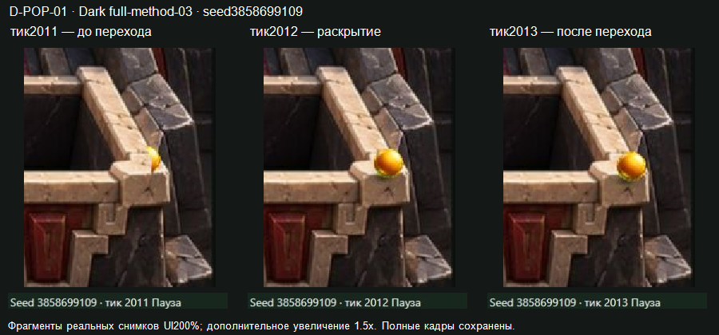

# Dark full-method-03 — независимая визуальная QA

**Вердикт:** кандидат не проходит критерий непрерывного частичного перекрытия: самостоятельно воспроизведён **D-POP-01** у переднего правого угла `receiver-04`. Проверка всех разделов матрицы завершена, покрытие отдельных экземпляров частичное. Общий художественный PASS, исправность всех60 масок или всех приёмников не заявляются. Это отдельный результат Dark на указанных ниже байтах.

Проверка выполнена 2026-10-29 ролью `visual-qa-r4d-p3-masks-01`, ветка `codex/r4d-p3-masks-visual-qa-01`, рабочее дерево `E:\R4D\perspective\p3-worktrees\visual-qa`. Начальный HEAD `26295340cafa78ea8bffe09e8005badda220d731`, дерево было чистым. Прочитаны оба документа handoff на `cd1f7ada0c4789b0d512d0a9c47d513c036ee31f`, фактический freeze record и своя [русская матрица](../PREPARATION.md). Jungle и ранний Water не переоткрывались, их результаты не использованы как доказательство дефекта Dark.

## Точная версия

| Вход | Закрепление |
| --- | --- |
| Кандидат | `dark-full-method-03`, `E:\R4D\perspective\p3-runtime\builder\transfer-water-dark\dark\full-method-03` |
| SOURCE | `c73d6128970b2b022d5313b08c34cafdec9a1bc3` |
| ART | `17dc9fcdc261562acb581dd8590096819734c807` |
| SHA256 assets.json | `ef5eb34be622f5ce6356d6fa51d7902c334a1f1f3c95acce225d7340928bbc29` |
| Предпросмотр | `http://127.0.0.1:6869/review/r4d/p3-masks-dark/`, процесс Builder не изменялся |
| SHA256 file-manifest.json | `b3923f4ccab57a8361a9dc8f64de73fcee9b70fb38c87aac5e9623fbc62d0307`,14842 байта |
| P1 | `4b47db04c7140ebf88f69b91faa0b790d46f22ec`, Dark02/trial-01/candidate-01 |
| SHA256 JPG | `7ceff71bd0a871fecd725527dff5522450c8e75a74eb99c107b5d8624bf8fa3a` |
| SHA256 config | `14be2a023833d266d1e333bf582af5fd5885deb445698c10ebd846ef0cc080b2` |
| SHA256 манифеста P1 | `3fab422bd1f74d477d1648620c97ad6d7b8b0a55a70a1102d6e6885def564d81` |
| SHA256 проекции | `4dfa46589bb3fdfc8e2ad8ff2554737697e3ce9172c5b8d5c5583577df0c8c48` |
| Нативное ядро / дерево пакета | `5a6fa03f1cdb3de88a2d9c7dbe795eb8e2a7f023` / `008d16a80a26bb77d562a45218b01da09b0d9ff0` |
| SHA256 скомпилированного ядра | `af8e6dea9ee5c46759f99ba3b68f4afa91c740b4fd2aba2d2d3f65bfa66753fa` |
| SHA256 app.js / Pixi | `760c9bada40cb3ecb944f332f6efa91bb3c1340ce7f1ad9c2cabeda4dca0a3e6` /8.22.0 |

До наблюдений независимо совпали локальный и HTTP-манифесты, SHA256 и размеры всех87 файлов/3383383 байт. С манифестом:88 файлов/3398225 байт. Страница показала Dark,60 масок и соответствующий SOURCE. Подробности: [version-verification.json](version-verification.json), неизменённые входы в `inputs/`, включая [freeze record](inputs/dark-full-method-03.freeze.json). Самопроверки Builder не объявляются результатами этой QA.

## Непрерывное движение и сохранённые исходы

Сначала нажаты первые три обычных «Новый бросок» при100%, исходная перспектива, вся иллюстрация, Арт включён, Геометрия выключена. Плеер работал непрерывно до окончания каждого запуска. Ни паузы для постановки нужного исхода, ни выбора выигрышного seed не было. Во время движения снимались последовательные реальные JPEG; после окончания через интерфейс скачаны полные checkpoint JSON. Порядок и все исходы сохранены в [ordinary-runs.json](ordinary-runs.json).

| Порядок | Seed | Фактический исход | Снимки во время движения |
| --- | --- | --- | --- |
| UI1 | 3858699109 | LOST/t2083 | 111 |
| UI2 | 3238915631 | IN_BUCKET receiver-03/t1435 | 74 |
| UI3 | 1771307888 | IN_BUCKET receiver-01/t1692 | 89 |

Дополнительно в непрерывном режиме при100% просмотрены заранее объявленные seed0→receiver-01/t888 (47 снимков) и seed2→LOST/t1812 (90 снимков): [fixed-motion.json](fixed-motion.json). Ещё три заранее объявленных повтора проверялись контактными ориентирами, конечными состояниями и выбранными кадрами: seed1→receiver-01/t884;1189667321→LOST/t1470;1551806092→receiver-02/t971. Для них отдельный непрерывный просмотр всей траектории не заявлен; все конечные JSON сохранены, [predeclared-ends.json](predeclared-ends.json).

Первые снимки непрерывных серий получены примерно с тика46 из-за задержки съёмки; исходные seed/конфигурации для восстановления с0 сохранены. Это выборка кадров живого плеера, а не измерение FPS браузера и не запись каждого5ms-состояния. Нельзя исключать короткий эффект между двумя такими снимками только по непрерывной серии. Поэтому реальные перекрытия далее проверялись отдельными соседними тиками. На обычном масштабе в просмотренных открытых участках золотой шар различим и читается объёмным, с отдельной сопровождающей тенью; все тёмные участки сцены этим не сертифицированы.

## D-POP-01 — скачок на правом переднем углу receiver-04

**Воспроизведение:** тот же frozen candidate; seed3858699109, «Повторить seed», исходная перспектива/вся иллюстрация, Арт включён/Геометрия выключена. При100% сравнить2011 и2012. Для диагностики200% после подгонки кадра сместить сцену вверх220 и влево80 CSS-пикселей, чтобы целиком видеть правый приёмник. Реальные соседние кадры сохранены на2007–2016 и2020;100% —2010–2014. Повтор с регенерацией того же seed дал тот же видимый переход; [JSON2011](replays/D-POP-01-seed3858699109-t2011.json) и [JSON2012](replays/D-POP-01-seed3858699109-t2012.json) реально скачаны браузером.

До перехода камень закрывает большую часть шара, остаётся узкая золотая часть у угла. На2012 почти весь шар сразу рисуется поверх каменного угла; на2013 он остаётся открытым. Изменение видно при100%, при200% контур различим лучше. Это реальное перекрытие нарисованного камня, а не один численный переход глубины рядом с объектом.

Лист — фрагменты настоящих снимков UI200% с дополнительным увеличением1.5x и исходным HUD. Полные кадры: [100%/2011](evidence/random01-receiver04-neighbors-z100-t2011.jpg), [100%/2012](evidence/random01-receiver04-neighbors-z100-t2012.jpg), [200%/2011](evidence/random01-receiver04-neighbors-z200-pan-up220-left80-t2011.jpg), [200%/2012](evidence/random01-receiver04-neighbors-z200-pan-up220-left80-t2012.jpg). Повторные кадры сохранены с префиксом `repeat-defect-random01-`. Видимый HUD основных доказательных кадров соответствует тику; более позднее значение DOM не использовалось для подтверждения устаревшего снимка.

| Тик | Нативные x,y | Порядок мешей над шаром по проверенному коду/данным |
| --- | --- | --- |
| 2011 | 33918.9018545,34699.484191 | front/right-rim включены |
| 2012 | 33921.7476886,34704.4149515 | front/right-rim выключены |

Нативное состояние непрерывно, `rngU32=30669445` сохраняется. В проверенном `app.js:54–56,100–107` видимость всего меша над шаром задаётся `pos.y<depthAt(item,pos.x)`; x линии ограничивается её концами. В `assets.json` порог `receiver-04-front` равен34702.18106608216; при данном x ограниченная линия `receiver-04-right-rim` даёт34700.947287431554. За шаг2011→2012 отключаются оба восстанавливающих меша над шаром. Альфа файлов не меняется. Состояния и контекст: [D-POP-01-states.json](D-POP-01-states.json).

**Отнесение:** подтверждённый артефакт бинарного порядка/согласования данных масок P3 на конкретном углу. Он не доказывает неправильность всех масок или новую ошибку физики. Допустимость самой LOST-траектории сквозь нарисованную каменную область относится к отдельному вопросу2D-модели/привязки; она не изменялась и не использована как объяснение видимого скачка. Проход тени использует отдельное смещение и условие; её одновременное переключение на2012 здесь не утверждается.

**Действие:** Lead передать Builder/Artist разбор `receiver-04-front/right-rim` с этим seed/тиками и новой именованной версией для повторной проверки. Если нужен существенный пересмотр способа, сначала отдельно зафиксировать его по поручению. Не скрывать симптом изменением конфигурации/траектории. Замороженные байты VQA не исправлял. Существенное наблюдение и владельцы разбора опубликованы в чате сразу после подтверждения, незатронутая проверка продолжена.

## Покрытие матрицы и пределы

| Раздел | Что фактически установлено | Что остаётся непроверенным |
| --- | --- | --- |
| D-OBLIQUE-CORNER | UI1/`block-04`,1700,1708,1710–1712,1714,1720: подход к косой передней границе и отскок,100%/200%; [лист](evidence/block04-front-contact.png). В этом локальном контакте дополнительный скачок не воспроизведён. | Полный обход угла с переходом между обеими гранями и все остальные повёрнутые блоки. |
| D-FRONT | Передняя сторона `block-04`; UI2/`skull-06`,975,980–982,987: шар остаётся спереди у нижней части силуэта. | Все передние грани всех экземпляров. |
| D-SIDE | UI3/`block-02`,755,765,770–772,780: реальное скрытие корпусом при подходе сзади и появление после отскока. Seed0/`pillar-02`,360,364–368,372: частичное перекрытие у правого контура. | Все боковые грани и их стыки. UI1/`block-06`,1900–1925 оказался проходом рядом/выше силуэта; не засчитан как проверка боковой маски. |
| D-UPRIGHT | `pillar-02` проверен указанной серией. UI3/`pillar-03`,1390,1405,1408–1410,1412,1420 осмотрен у левой стороны. | У `pillar-04`/seed0,832,836,839–841,844,848 шар в основном вне силуэта: численный контакт840 не подтверждает смену перекрытия. Остальные колонны/высокие капители не покрыты полностью. |
| D-CURVED | Seed0/`bowl-01`,60–120: скрытие за чашей и выход слева; `bowl-02`,484,490,493–496,500,504,510: частичное закрытие слева. UI1/`skull-06`,1835–1880: скрытие и постепенное появление справа; [лист](evidence/skull06-alpha-sequence.png). | Остальные чаши/черепа и все направления вокруг них. Декоративные тёмные полости не трактовались как физические входы. |
| D-BORDERS | Seed0/левый борт,452,459–461,468: реальное скрытие у нарисованной стены и выход/отскок. В UI1 осмотрены правый нижний край и область receiver04,1960–2020. | Отдельная достаточная серия частичного перекрытия каждого участка длинного правого борта и всех ступенчатых стыков. |
| D-RECEIVERS | Receiver01: непрерывный seed0 и кадры860,875,880,884–888,100%/200%, [лист входа](evidence/receiver01-entry.png). Receiver03: второй UI-бросок,1430,1434,1435. Receiver02: ранее объявленный1551806092,957,965,968–971,100%/200%. У receiver04 LOST-путь дал реальное перекрытие угла/передней кромки и D-POP-01. | WIN01/02/03 заканчивается до фактического перекрытия передней кромки — их входы не подтверждают эти маски. Все стенки/края четырёх корзин не проверены универсально. |
| D-BALL-SHADOW | В открытых участках живых серий при100% видны свет/затенение шара и отдельная тень. У выбранных чаш и черепа маски скрывают соответствующие части; отдельно воспроизведён D-POP-01. | Читаемость тени во всех чёрных колодцах/самых тёмных участках, все направления света/все положения. Отдельного нового дефекта запечённой тени как непрозрачного корпуса в просмотренных случаях не установлено. |
| D-CONTROLS | Seed2/t896: семь комбинаций Арт/Геометрия, исходный/обратный вид и кадр поля/всей иллюстрации сохранили точно одинаковые полные состояния, включая PRNG, позицию и скорость: [controls.json](controls.json). При Арт-off нет растра/масок/растровой тени; остаётся штатное нативное обозначение шара. | Это проверка конкретного состояния, не всех возможных сочетаний/тиков или всех ресурсов. |

Привязка задних опор и круговые приближения высоких объектов остаются принятыми ограничениями P1. Искажения рисованных объёмов в обратном виде не объявлялись восстановленной3D-геометрией. Кандидат не перенастраивался, скрытые коллайдеры не добавлялись. Изменения глубины без настоящего перекрытия не засчитывались ни как дефект, ни как PASS. Ручная приёмка Максом или другим человеком не выдумывалась.

## Доказательства, ресурсы и завершение

Сохранено613 исходных полных JPEG:411 выборок пяти непрерывных серий,5 их конечных кадров и197 приостановленных кадров. Все raw остаются в `E:\R4D\perspective\p3-runtime\visual-qa\transfer-water-dark\dark\full-method-03\raw`; SHA256 точных исходных байтов каждого файла — [raw-manifest.json](raw-manifest.json). Журнал с точными видимыми состояниями: [paused-captures.json](paused-captures.json). В репозитории58 выбранных полных JPEG без изменения пикселей,4 поясняющих листа, входы, журналы и реально скачанные JSON в `replays/`. Производные листы помечены как фрагменты с дополнительным увеличением, оригиналы сохранены.

Перед браузером2026-10-29T10:32:44Z: RAM свободно16.024/31.907GiB, CPU2%, C16.224/D16.277/E11.875GiB. Перед упаковкой2026-10-29T11:12:11Z: RAM16.461GiB, CPU3%, C16.126/D16.275/E11.774GiB. Собственный бюджет ≤1GiB RAM/128MiB E; исходный каталог занимал70532492 байта, до упаковки выбранных доказательств. Сводная консервативная оценка ≤5GiB RAM/2.125GiB E не являлась резервом. Подробности — [resources-end.json](resources-end.json).

Своя IAB-вкладка закрыта, чтение VQA6869 завершено: [browser-closed.json](browser-closed.json). Другие вкладки, процесс Builder и frozen bundle не менялись. Серверных записей/публикации нет, `server_write=false`. Результат отдельной TQA не подменён этим отчётом. После commit/push этот Dark-участок завершён; следующая выданная Water-проверка выполняется отдельно и последовательно.
