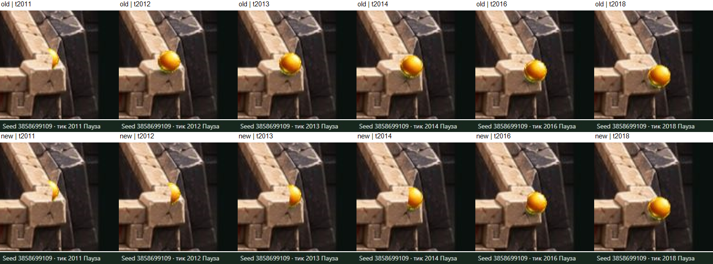
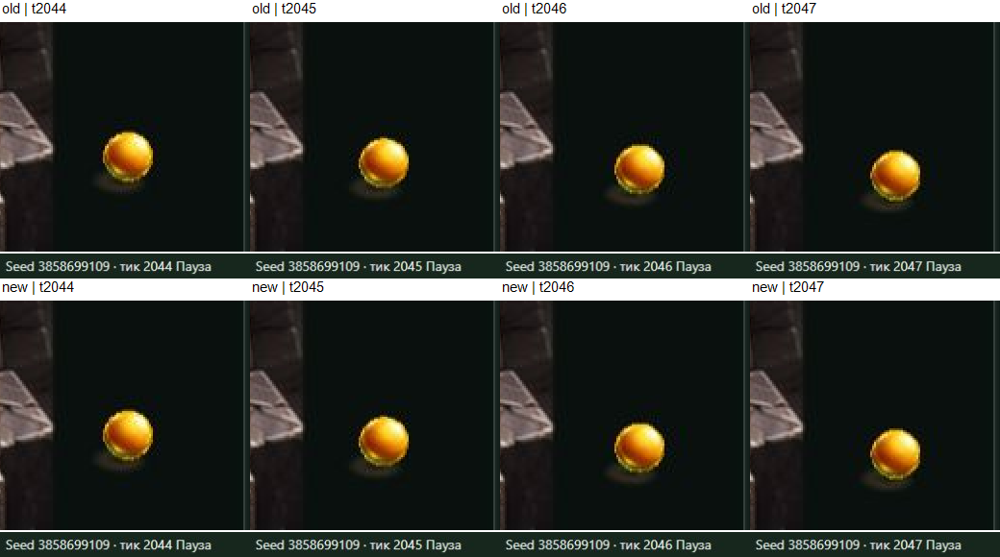
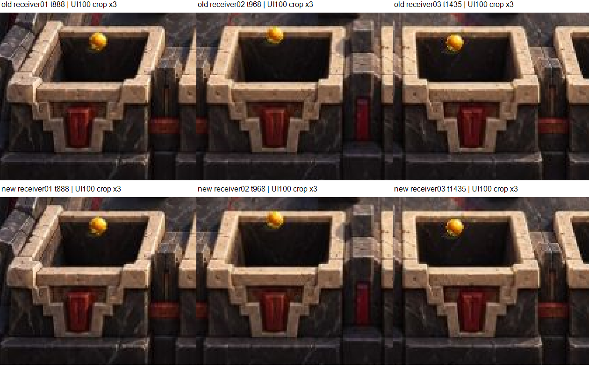

# Dark receiver-front-edge-04 — адресный независимый retest

29 октября 2026 · `visual-qa-r4d-p3-masks-01` · `server_write=false`

**D-POP-01 локально закрыт на NEW04 для исходного seed3858699109.** На свежем OLD03 воспроизведено раскрытие почти целого шара поверх каменного угла на 2011→2012. На NEW04 при тех же полных native state и камере шар остаётся частично скрытым и постепенно выходит на 2012–2018. Проверены настоящий normal Play, соседние 2010–2019 и новый порог 2044–2047 в 100%/200%. Это исправление конкретного воспроизведения, а не переписывание исторического FAIL03.

**Общий ограниченный verdict: адресный retest пройден с указанными пределами.** Существенной новой регрессии в трёх прежних хороших входах и выбранном боковом подходе не обнаружено. Общий Visual/art PASS для Dark не выдан; все подходы к четырём приёмникам и художественное качество тени во всех условиях не сертифицированы. Прежняя полная матрица автоматически не повторялась.

## Exact candidate и изоляция изменения

Полностью прочитаны Builder STATE.md/RECIPE.md на handoff `86d35d7af73883d83fd976eb4c0d5ef281048024` и actual freeze record, frozenAt `2026-10-29T12:23:43.716Z`: [копия freeze](inputs/dark-receiver-front-edge-04.freeze.json).

| Поле | NEW04 | OLD03 |
|---|---|---|
| Candidate | `dark-receiver-front-edge-04` | `dark-full-method-03` |
| SOURCE | `d7eac5d7d76127e3138480f1f16eaf28aac0f15a` | `c73d6128970b2b022d5313b08c34cafdec9a1bc3` |
| ART | `e5d3e1f44c112e483ff2a23fbd169cb119390865` | `17dc9fcdc261562acb581dd8590096819734c807` |
| assets.json SHA256 | `2b02dcde6c07266b67285700040e4ae0342f06fb760ae6ed0cf1fdcdc9b6cbad`,18591 байт | `ef5eb34be622f5ce6356d6fa51d7902c334a1f1f3c95acce225d7340928bbc29` |
| file-manifest SHA256 | `d180e5a63bb1dec7c510507fc2ce990e7cb10927b337a19c4bb9effc67e4ed1b`,15737 байт | `b3923f4ccab57a8361a9dc8f64de73fcee9b70fb38c87aac5e9623fbc62d0307`,14842 байта |
| Payload | 92 файла /3494340 байт | 87 файлов /3383383 байта |
| Preview | `http://127.0.0.1:6870/review/r4d/p3-masks-dark/` | `http://127.0.0.1:6869/review/r4d/p3-masks-dark/` |

NEW root: `E:\R4D\perspective\p3-runtime\builder\transfer-water-dark\dark\receiver-front-edge-04`. OLD root: `E:\R4D\perspective\p3-runtime\builder\transfer-water-dark\dark\full-method-03`. ART04 prefix: `experiments/p3-masks/transfer/dark/asset-artist/variants/receiver-front-edge-01/`.

Сейчас независимо совпали все 92 NEW payload size/SHA локально и по HTTP, сам manifest и Dark board guard. На OLD сейчас совпали manifest по HTTP и все 87 локальных payload; полная HTTP-сверка 87 файлов **ранее выполнена** в VQA03 и не повторялась: [NEW verification](journal/new-version-verification.json), [OLD verification](journal/old-version-verification.json). Конечный NEW manifest сохранил тот же SHA: [version-end](journal/version-end.json). Новый 6870 — Dark PID15752, не прежний закрытый Water-процесс; процессы QA не изменяла.

Собственная [сверка изменения](journal/byte-comparison.json) подтвердила ровно 12 изменённых `depthLineNative`: front/left-rim/right-rim каждого receiver01…04. Остальные 48 records, все 60 размещений/прочих полей records,62 PNG, ball/shadow/top-level metadata одинаковы. Побайтно равны app.js, run-model.js, view-math.js, native-core.js, Pixi, source JPG, config, `data/manifest.json` и projection. assets.json дополнительно совпал с **raw Git blob ART04**: [проверка](journal/git-assets-verification.json).

Опорное ребро независимо выведено из старых сохранённых P3 front-полигонов [regions](inputs/baseline-regions.json) через неизменную accepted sourceToNative. Среди последовательных рёбер выбрано максимальное mean nativeY; у всех 4 front это polygon0/edge11→12. Концы упорядочены по sourceX и совпали с каждой из 12 новых линий, ошибка координат≤1e−8: [деривация](journal/independent-derivation.json). Seed/tick/radius в выборе не участвовали. Это проверка данных, не визуальная оценка GPU.

Неизменные pins: core `5a6fa03f1cdb3de88a2d9c7dbe795eb8e2a7f023`, P1 `4b47db04c7140ebf88f69b91faa0b790d46f22ec`, Dark02/trial01/candidate01; compiled core `af8e6dea9ee5c46759f99ba3b68f4afa91c740b4fd2aba2d2d3f65bfa66753fa`, renderer `760c9bada40cb3ecb944f332f6efa91bb3c1340ce7f1ad9c2cabeda4dca0a3e6`. Config `14be2a023833d266d1e333bf582af5fd5885deb445698c10ebd846ef0cc080b2`; P1 manifest `3fab422bd1f74d477d1648620c97ad6d7b8b0a55a70a1102d6e6885def564d81`; projection `4dfa46589bb3fdfc8e2ad8ff2554737697e3ce9172c5b8d5c5583577df0c8c48`; JPG `7ceff71bd0a871fecd725527dff5522450c8e75a74eb99c107b5d8624bf8fa3a`. Все значения также в freeze.

## Что выполнено сейчас, что ранее

| Статус | Проверка |
|---|---|
| Новое | Точные bytes/scope12lines, деривация из прежних front-полигонов, actual A/B D-POP и новых порогов, три good-entry участка, ограниченный receiver04-side, пять UI downloads, текущий report/evidence |
| Ранее выполнено на 03 | Основная TQA03 `b327ae601a4962dd5826abfbfdeefaf77c090a55`: bounded Technical PASS, не новый Visual PASS |
| Ранее выполнено на 03 | Полная VQA-матрица с частичным покрытием экземпляров, ordinary outcomes, controls, positive import и прочая техническая/negative/native проверка согласно прежним артефактам и freeze. [VQA03](../full-method-03/REPORT.md), commit `2d40b3f31341bbf57fd2df76aa6637a3f1a303e8`, содержит **FAIL D-POP-01** |

Полная native/browser/controls/negative/import матрица, новая random-серия и native build сейчас не запускались. Неизменность renderer/core/config/PNG проверена отдельно; прежние проверки не выдаются за выполненные на 04. В обычном UI воспроизводились только закреплённый D-POP seed и три заданных good-entry seed, без поиска выигрышного исхода. Сам обычный replay-интерфейс применяет настоящее ядро к выбранному запуску.

## Метод actual A/B

Собственные скрытые IAB tab6 OLD и tab5 NEW. Art on, Geometry off, source/whole. При 100% — default fit; при 200% для target/side одинаковый drag `[600,600]→[440,380]`, вверх 220/влево 160. Дополнительное место справа оставлено, чтобы новый порог был виден за границей JPG. Native tick и состояние не менялись от камеры.

В каждом из OLD/NEW настоящий Play начат на 2006 и дошёл до исходного **LOST/t2083**, один раз при 100% и один при 200%. Сохранены 60 композиторных JPEG в четырёх сериях, включая начальные паузы; первый frame был ACK до Play. Скорость не менялась. Это реальное движение целевого участка, не повтор полного старого random/fullpass и не FPS-бенчмарк. Frame index и wall time не заменяют native tick: [live.json](journal/live.json).

Затем сняты все соседние 2010…2019 и 2044…2047 при 100%/200% на обоих candidates. Для точного сравнения использовался видимый state panel, HUD и controls. Всего 43 парных paused состояния:28target +11entry100% +4side200%; в каждой паре полностью совпали native state, controls и camera: [paired-state-check](journal/paired-state-check.json). NEW имеет дополнительно 11 диагностических entry200% кадров. Все 97paused JPEG сохранены целиком, не только crop.

Пять настоящих UI downloads: OLD2012 и NEW2012/2044/2045/2046, в [replays](replays/new-DPOP-t2012.json). **Оба полных checkpoint2012** совпали с исходным VQA03 JSON целиком, включая config/seed/tick/state, не только координаты: [equality](journal/checkpoint-equality.json). Новый import не выполнялся. Последующие source-предикаты рассчитаны из actual UI state и frozen metadata; это не выдаётся за GPU-измерение.

## D-POP-01: прямая видимость до/во время/после

На OLD03 между 2011 и 2012 узкий фрагмент за каменным углом сменяется почти целым кругом поверх угла. На NEW04 на 2012 остаётся частичное закрытие, затем видимый фрагмент увеличивается по 2013/2014/2015/2016; к 2017–2018 шар выходит из силуэта. Это непосредственное наблюдение настоящего перекрытия, а не численного контакта рядом с объектом.

Общее точное состояние 2012: position `[33921.7476886,34704.4149515]`, velocity `[569.1668154,986.1521075]`, rng30669445, done=false. На 2011: position `[33918.9018545,34699.484191]`. Все native state здесь совпадают с 03; причиной нового рисунка не является изменение траектории.

В прежнем бинарном renderer порог OLD front34702.18106608216 / зажатого right-rim34700.947287431554 проходился на 2012. NEW receiver04 имеет общую линию Y34884.351390113006; body predicate выключается на 2046. **Один более поздний номер не служит основанием closure.** Основание — сохранённое постепенное перекрытие 2011–2018 плюс реальная проверка окна нового выключения.

## Новый порог и отдельная тень

На 2044–2047 шар целиком виден справа от JPG на тёмном фоне. В actual кадрах нет повторного раскрытия поверх нарисованной каменной кромки. Для **каждого одного тика отдельно**, OLD-vs-NEW decoded RGB в crop `[790,610,115,100]`, охватывающем шар/тень/окружение, совпал:0 различающихся пикселей и maxΔRGB0 на 2044,2045,2046,2047. [Actual crop comparison](journal/actual-crop-comparison.json). Это сравнение уже полученных JPEG рендера; не alpha-модель и не утверждение, что соседние тики одинаковы друг другу.

Раздельная [source-проверка](journal/source-predicate-analysis.json):2044 bodyON/shadowON;2045 bodyON/shadowOFF;2046–2047 обаOFF. Это CPU-вычисление прежнего depthAt/clamp с actual state, своим offset тени и неизменным r16. Оно объясняет раздельные условия, но не заменяет изображение.

В увеличенном actual crop читается отдельная мягкая тень под/слева от шара; на обычном 100% тёмный фон ограничивает различимость её слабого края. В просмотренном окне не видно нового разрыва тени, и парные crop равны. Универсальное качество тени, точная её alpha или все переходы всех 60 масок этим не измерены. Shadow offset/PNG/alpha/root order не менялись.

**Локальная closure:** `D-POP-01 CLOSED_ON_dark-receiver-front-edge-04 / seed3858699109 / examined2010–2019,2044–2047`. Исторический frozen03 остаётся с воспроизводимым дефектом. Новая сортировка, radius tuning, seed/tick-dependent rule или исправление native физики не добавлялись.

## Близкие good entries и ограниченная side regression

| Кейс | Тики | Что проверено сейчас |
|---|---|---|
| receiver01 /seed0 | 880,884,887,888 | OLD/NEW actual100% при одинаковом state/view; NEW200% с panU220/R80. IN_BUCKET01/t888 сохранился, шар виден при входе |
| receiver02 /seed1551806092 | 965,968,970,971 | OLD/NEW100%; NEW200% с panU220. IN_BUCKET02/t971 сохранился |
| receiver03 /seed3238915631 | 1430,1434,1435 | OLD/NEW100%; NEW200% с panU220. IN_BUCKET03/t1435 сохранился |
| receiver04 /исходный LOST | 1960,1980,1995,2005 | OLD/NEW200% с одной камерой: подход над задней кромкой, реальная частичная видимость возле правого rim на 1995, затем скрытие. [Side A/B](evidence/receiver04-side-AB.png) |

Существенного нового исчезновения шара, внезапного полного раскрытия или изменения исхода на этих участках не обнаружено. Эти WIN заканчиваются до передних фасадов; их сохранение не доказывает прохождение всех передних кромок. Side-подход receiver04 не сертифицирует остальные направления и все углы четырёх приёмников.

Попиксельная эквивалентность good-entry JPEG **не заявляется**. В 11crop сравнениях 100% есть небольшие различия: maxΔRGB до 14/255, на осмотренных примерах они расположены также на статических частях кромок; величины/bbox сохранены в [entry-crop-comparison](journal/entry-crop-comparison.json) и [locations](journal/entry-difference-locations.json). По этим данным причина малых RGB-различий не доказана. Они не подменены выводом о новой физике, а визуально существенного нарушения на сохранённых old/new кадрах не установлено.

## Пределы, ресурсы и handoff

Прежний scalar/line метод остаётся бинарным. Проверка привязки 12 линий не доказывает пространственную правильность всех других путей. Физическая допустимость движения через нарисованный корпус, принятая 2Dпроекция и трактовка высот — прежние ограничения, не исправленные этим retest. Художественная проверка прочих 48records, всех семейств и обычных исходов 03 повторно не выполнялась.

157 уникальных raw JPEG /21.143MiB сохранены в `E:\R4D\perspective\p3-runtime\visual-qa\transfer-water-dark\dark\receiver-front-edge-04`:54NEW+43OLDpaused и 30NEW+30OLDlive. В Git105 полных выбранных JPEG (все 97paused +8live) и 4 диагностических монтажа: [индекс](evidence/INDEX.md), [побайтная выборка](journal/selection.json), [все raw SHA256](journal/raw-sha256.json). Монтажи не дорисовывают содержимое и не заменяют полные кадры.

Перед браузером system-wide: RAM free15.984/31.907GiB, CPU12%, C16.028/D16.252/E11.610GiB: [snapshot](journal/resources-before-browser.json). Оценка своего шага≤0.9GiB RAM/64MiB дополнительного E; обе QA+3 лёгких previews≤2.3GiB RAM — оценка, не резерв и не измеренный peak. Конечные ресурсы/размеры — [resources-end](journal/resources-end.json). Пороги E≤4GiB diagnosis /≤2GiB checkpoint-stop не достигались.

При read-only подготовке исправлены обычный отсутствующий путь к старому журналу и ошибка PowerShell-выражения; отказа approval не было. Старый journal найден в корне VQA03. Ни native build, ни серверных обходов/изменений из-за этих ошибок не выполнялось.

Своя OLD tab6 закрыта сразу после всех old A/B чтений, read-complete6869 явно сообщён в собственном чате: [лог](journal/old-browser-closed.json). Своя NEW tab5 также закрыта: [лог](journal/new-browser-closed.json). Серверы, процессы, frozen пакеты и старые evidence не менялись. Release/SSH/upload/staging/token действий не было. Water42dacf остаётся закрытым с PARTIAL/W-DIVIDER-01; Jungle и другие продукты не переоткрывались.

После commit/push этого отдельного адресного архива — handoff Lead и ожидание следующего прямого поручения. Никакой Max/human QA или общей художественной приёмки этим отчётом не утверждается.
