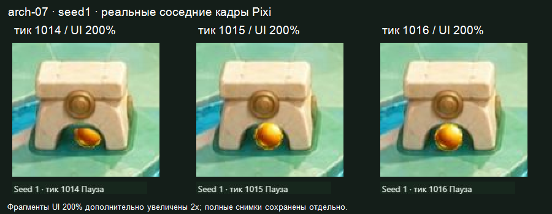

# Water early-art-02 — ранняя диагностика смены перекрытия arch-07

**Результат ограниченной диагностики:** воспроизведён видимый скачок раскрытия шара между тиками1014 и1015. Это не только постепенное раскрытие через альфа-проём: в этой точке бинарно меняется порядок восстанавливающих мешей трёх масок арки относительно шара. Наблюдение относится к раннему стыку глубины/масок P3. Итогового вердикта или PASS для Water, Dark, отдельных масок либо всего способа нет.

## Проверенная версия и границы задачи

Работа выполнена 2026-10-29 ролью `visual-qa-r4d-p3-masks-01` в своём рабочем дереве `E:\R4D\perspective\p3-worktrees\visual-qa`. Начальный HEAD `0ed5d4bae632e4fa3fd370ffeed193ab1d48c214`, дерево было чистым. Проверялся только ранний пакет из7 масок для `frog-01`, `arch-01`, `arch-07` с отдельно переиспользованными шаром/тенью; полный кандидат ещё не передан.

| Привязка | Значение |
| --- | --- |
| SOURCE | `f3b7ce8d94b0a9173c48d7ca6defb3837a10ed03` |
| ART | `4eb4001d8036048f716d9e7ab45bb560f3840cf6` |
| Каталог Builder | `E:\R4D\perspective\p3-runtime\builder\transfer-water-dark\water\early-art-02` |
| Предпросмотр | `http://127.0.0.1:6868/review/r4d/p3-masks-water/` |
| SHA256 file-manifest.json | `4221b9606f95304bde0862c74235e534573a7f1cfdada8c4b109320965f8ebcf` |
| SHA256 app.js | `760c9bada40cb3ecb944f332f6efa91bb3c1340ce7f1ad9c2cabeda4dca0a3e6` |
| SHA256 assets.json / размер | `6bda5c72cacf24a32555b720f42b72c335c180fca88525d809614d8b5bec3d7d` /2193 байта |
| SHA256 исходного JPG | `8da65c76c110b6ba7cefe113564fe12feed4428e84e84835f033e7da31d3b80d` |
| P1 | `4b47db04c7140ebf88f69b91faa0b790d46f22ec`, Water04/trial-02 |
| SHA256 конфигурации | `9048b28af2923c93d8be772367beeb828f1e4513a6298af1c803379f77d3e50c` |
| SHA256 манифеста P1 | `48c4fef26fd8c94f06c278851222ef285edda54ac14e53da8908f4ee663dc420` |
| SHA256 проекции | `ee0c6e429d4e0b1da6c342174d22369cd293c3fc4b18ccd7d09a4690f71da54f` |
| Нативное ядро / Pixi | `5a6fa03f1cdb3de88a2d9c7dbe795eb8e2a7f023` /8.22.0 |
| SHA256 скомпилированного ядра | `af8e6dea9ee5c46759f99ba3b68f4afa91c740b4fd2aba2d2d3f65bfa66753fa` |

До отнесения наблюдения к версии независимо совпали локальный и HTTP-манифесты, а также SHA256 и размеры всех30 перечисленных файлов, всего3210127 байт. Запись с временем проверки: [version-verification.json](version-verification.json). Страница сама показала Water,7 масок и соответствующий SOURCE. Это проверка идентичности ранней сборки, без повторной полной предметной TQA или пересборки ядра.

## Фактический просмотр и наблюдение W-EARLY-POP-01

В своей новой скрытой IAB-вкладке выбран обычный заранее заданный seed1, `board04-start`. Выполнен последовательный пошаговый просмотр реального нативного повтора на каждом тике1006–1018 при обычном UI100% и диагностическом UI200%, Арт включён, Геометрия выключена, исходная перспектива, вся иллюстрация. Это соседние состояния, отрисованные самой страницей Pixi; численный crossing не использован вместо кадров. Новые случайные seed не подбирались. Сохранён исходный checkpoint этого запуска, LOST/t1196; на выигрышный запуск он не заменялся.

На1006 шар скрыт корпусом арки; на1007–1014 его видимая часть постепенно появляется в проёме. Между1014 и1015 верхняя часть шара раскрывается резким шагом: до смены тика она срезана нарисованным корпусом над проёмом, после — почти полный круг выступает поверх этого участка. На1016–1018 уже открытый шар продолжает движение к левой стороне проёма. Смена видна при100%; при200% её легче отделить от малого размера шара. Возврат к1014 и повторная постановка1015/1016 с открытой панелью точного состояния дали тот же видимый результат.

Осмотрены обе опоры, перемычка и проём в этой последовательности. Она не даёт отдельного полного подтверждения корректности каждой опоры со всех сторон; полное покрытие обеих опор остаётся задачей полного кандидата. Отдельные дефекты тени, корректность `frog-01` и3D-высота прохода в этой диагностике не установлены.

Сравнение выше составлено из фрагментов настоящих снимков UI200% с дополнительным увеличением2x и полосами исходного HUD. Полные снимки сохранены отдельно: [100%/1014](evidence/normal-seed1-t1014.jpg), [100%/1015](evidence/normal-seed1-t1015.jpg), [100%/1016](evidence/normal-seed1-t1016.jpg); [200%/1014](evidence/diagnostic200-seed1-t1014.jpg), [200%/1015](evidence/diagnostic200-seed1-t1015.jpg), [200%/1016](evidence/diagnostic200-seed1-t1016.jpg). В каждом основном кадре видимый HUD соответствует заявленному тику. [Полная последовательность1006–1018](evidence/sequence-1006-1018.png) включает также подход и обе стороны проёма. Повторные полные кадры лежат в `evidence/repeat200-seed1-t1014.jpg`, `evidence/repeat200-seed1-t1015.jpg`, `evidence/repeat200-seed1-t1016.jpg`.

## Основание для отнесения причины

Из открытой видимой панели страницы сохранены точные состояния [visible-states.json](visible-states.json). Проекция на исходник ниже вычислена из этих состояний и закреплённой матрицы P1; координаты пола не подменяют наблюдение силуэта.

| Тик | Нативная позиция x,y | Проекция центра на пол исходника x,y | Условие включения меша над шаром |
| --- | --- | --- | --- |
| 1014 | 33030.4141769,34752.6197802 | 521.025122,956.120467 | true |
| 1015 | 33026.2101257,34756.6559934 | 516.269211,958.273664 | false |
| 1016 | 33022.0060745,34760.7167066 | 511.506553,960.442581 | false |

В проверенном `app.js`, строки54–56 и100–107, видимость всего меша восстановления над шаром задаётся `item.mesh.visible=pos.y<depthAt(item,pos.x)`. В проверенном `assets.json` обе опоры `arch-07-left-body`/`arch-07-right-body` имеют `depthNativeY=34755.12349268705`; у `arch-07-lintel` обе точки `depthLineNative` имеют тот же Y, поэтому линия даёт постоянный порог. На1014 условие истинно, на1015 ложно для всех трёх мешей над шаром. Положение шара меняется непрерывно, примерно на(-4.756,+2.153) пикселя исходника за этот шаг; сам альфа-проём в файлах между кадрами не меняется.

Обоснованный вывод: наблюдаемый дополнительный скачок совпадает с бинарным отключением восстановления корпуса арки над шаром, а не объясняется одним плавным раскрытием через статичную альфа-маску. Это артефакт согласования глубины/масок P3 данной ранней версии. Основания приписать именно этот скачок изменению физики или общих входных данных нет: их закреплённые файлы совпали, состояния непрерывны. Это не отменяет других известных ограничений привязки и2D-модели. Проход тени использует отдельное смещение и условие; одновременное отключение всех мешей тени на1015 здесь не утверждается.

Действие для Lead/Builder/Artist: до полного фриза разобрать порог и согласование масок `arch-07` с видимой частью шара; после исправления выдать новую именованную версию и повторить тот же seed1/1014–1016 с соседними кадрами. Требование — убрать наблюдаемый скачок, сохранив согласованный предмет переноса. Существенная смена способа требует отдельной фиксации состояния по поручению. VQA не менял рендерер, арт, геометрию, конфигурацию или траекторию.

## Сохранение и освобождение чтения

Все29 исходных полных снимков (13 тиков×2 масштаба и3 повторных кадра), журнал и видимые состояния сохранены в `E:\R4D\perspective\p3-runtime\visual-qa\transfer-water-dark\water\early-art-02\raw`. В репозитории находятся12 выбранных полных снимков без изменения пикселей,2 сравнительных листа и закреплённые входы в `inputs/`. [capture-log.json](capture-log.json) содержит порядок съёмки и имена исходных кадров. Поле HUD у1007 не записалось в журнал, но сам исходный кадр сохранён; его тик виден на сравнительном листе. Начальная попытка чтения HUD через регулярный селектор завершилась тайм-аутом после шага до1007; пропуска нативного тика в последовательности нет. Оценка плавности воспроизведения в реальном времени при заданной частоте кадров не заявляется.

Перед браузером: RAM свободно16.076GiB из31.907GiB, CPU0%/24 логических процессора, C16.245/D16.280/E11.915GiB свободно. Собственный бюджет ≤1GiB RAM/128MiB E. Консервативная сводная оценка дополнительного пика ≤5GiB RAM/2.125GiB E принята Lead как оценка с двойным включением QA, без резервирования; TQA/Release завершили тяжёлые пробы. На момент сохранения исходный каталог этой диагностики занимал3817447 байт. Новых серверов, сборок, полного TQA, загрузок или серверных изменений не было; `server_write=false`.

Собственная ранняя IAB-вкладка закрыта после чтения. В чате опубликованы краткое наблюдение и сообщение о завершении чтения6868; Lead может освободить удержание версии у Builder. Чужие вкладки и процесс предпросмотра не изменялись. Jungle не затронут. Полные Water/Dark QA остаются отдельным будущим этапом на полном замороженном кандидате.
