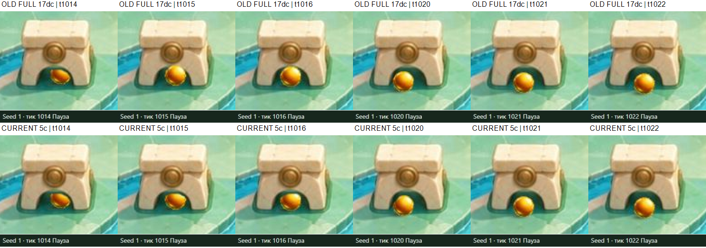

# Water front-edge-04 — независимая визуальная QA

2026-10-29 · `visual-qa-r4d-p3-masks-01` · только Water · `server_write=false`

**Локальный ретест W-EARLY-POP-01 пройден на текущем кандидате:** seed1, arch07, тики 1006–1022, обычное движение и соседние остановленные кадры, 100% и 200%. Старый FULL раскрывает почти весь шар на 1015; corrected сохраняет частичное перекрытие на 1015–1016. На 1020–1022 сопоставимого скачка поверх камня не обнаружено. Это закрытие конкретного воспроизведения в `water-front-edge-04`; исторический дефект раннего frozen пакета остаётся действительным.

**Общий результат Water — PARTIAL, полной художественной приёмки нет.** Все разделы семейной матрицы рассмотрены с приведёнными ниже пределами; не проверены все 71 маска, все экземпляры арок/колонн и все 4 приёмника. Независимо подтверждён видимый конфликт W-DIVIDER-01 на подходе seed2 к receiver02. Его граница между P3-порядком и принятой 2D-моделью требует решения Lead/Builder/Artist. Это отдельный вопрос от исправленного скачка arch07 и от Dark D-POP-01.

## Точные версии

| Поле | Текущий corrected FULL | Старый FULL для короткого A/B |
|---|---|---|
| Candidate | `water-front-edge-04` | `water-full-method-03` |
| SOURCE | `5196c0bd4981992c4e3d9678438aed1aa1c0d84c` | `c73d6128970b2b022d5313b08c34cafdec9a1bc3` |
| ART | `5c9ba8c640b344094e0ada7c4ed6c9ec076550e5` | `17dc9fcdc261562acb581dd8590096819734c807`, именно Water prefix |
| Builder handoff | `017c6d7756aa99ef13ec941ff1b86aaa36ec4455` | `d4a99ac1586fbc0c026c6d6150a91f153003a68b` |
| assets.json SHA256 | `4a5bc16f69146fe26a3e3893fcf3c1c8e5b943400bc65d5215cb41d58efeece6` | `e93e5cfb6fbfa3c4ca9e5c2eadbc46b628713e952fe033fa216e00598e2a849d` |
| file-manifest SHA256 | `de1344afcb197115b76cb4006ead3d96e7b2581a1a299df1100d7a552d2ce2c6` | `b3c697675ecd76af7848fa72367f943c1b9e4a27b325b098a9fef08135fe58d3` |
| Payload | 100 файлов /3561039 байт | 97 файлов /3470168 байт |
| Сам манифест | 17208 байт | 16695 байт |
| Preview | `http://127.0.0.1:6868/review/r4d/p3-masks-water/` | `http://127.0.0.1:6870/review/r4d/p3-masks-water/` |

Оба пакета независимо проверены по каждому локальному и HTTP-файлу: размер и SHA256 совпали. Board guard — Water. В конце проверки текущие HTTP/local manifest, assets.json и app.js остались теми же: [начальная проверка](journal/version-verification.json), [старый FULL](journal/old-full-version-verification.json), [конечная проверка](journal/version-end.json).

Текущий frozen root: `E:\R4D\perspective\p3-runtime\builder\transfer-water-dark\water\front-edge-04`. Старый A/B root: `E:\R4D\perspective\p3-runtime\builder\transfer-water-dark\water\full-method-03`. Freeze скопирован в [inputs](inputs/water-front-edge-04.freeze.json).

Неизменные входы: native core `5a6fa03f1cdb3de88a2d9c7dbe795eb8e2a7f023`, P1 `4b47db04c7140ebf88f69b91faa0b790d46f22ec`, Pixi8.22.0. Config — Water board04/trial02, SHA256 `9048b28af2923c93d8be772367beeb828f1e4513a6298af1c803379f77d3e50c`; projection candidate02 — `ee0c6e429d4e0b1da6c342174d22369cd293c3fc4b18ccd7d09a4690f71da54f`. Source JPG1536×1536 — `8da65c76c110b6ba7cefe113564fe12feed4428e84e84835f033e7da31d3b80d`. Trial01 не использовался. Native r16, шаг 5 мс и конфигурация физики/RNG не менялись.

## Что изолировано в A/B

Собственное [побайтное сравнение](journal/full-byte-comparison.json) подтверждает: все 73 PNG одинаковы; app.js, native-core, run-model, view-math, Pixi, source JPG, config, `data/manifest.json` и projection не изменились. В assets.json меняются только `depthNativeY` / `depthLineNative` у 24 частей 8 арок; остальные 47 occluder records, размещение crop, ball/shadow/schema одинаковы. Линии depth включают свои X-концы — речь не о 24 одиночных числах Y.

Ранний набор 7 масок ART4eb и FULL17dc не побайтно равны. В [Artist provenance](inputs/artist-provenance-731bad.md), commit `731bad21509b9a8f7022a4df4a2961ced8b49275`, описано 466 отличающихся source-пикселей суммарной alpha трёх частей arch07 из-за порядка масштабирования/отсечения. Это число здесь не пересчитывалось. Поэтому причинный вывод о depth опирается на собственную пару **FULL17dc ↔ FULL5c**, а ранний отчёт сохраняет историческое наблюдение отдельно.

## Наблюдение движения, random и replay

Браузер — собственный скрытый IAB; пользовательский Chrome/рабочий стол не использовались. Сначала наблюдался настоящий Play в обычном темпе. Затем через видимый Tick/Enter снимались соседние состояния с Art on, Geometry off, source/whole; увеличение 200% служило диагностикой. Никакого изменения скорости, скрытого состояния, физики, исходников или масок не было.

Первые 3 нажатия «Новый бросок» сохранены по порядку, без замены неудобных исходов:

| Порядок | Seed | Результат | Реальные JPEG движения | UI checkpoint |
|---|---:|---|---:|---|
| 1 | 1176389091 | LOST/t990 | 49 | [JSON](replays/ui-random-01-seed1176389091.json) |
| 2 | 756668326 | LOST/t591 | 29 | [JSON](replays/ui-random-02-seed756668326.json) |
| 3 | 3361762279 | LOST/t1476 | 37 | [JSON](replays/ui-random-03-seed3361762279.json) |

Дополнительно непрерывно просмотрены заранее заданные seed0→LOST/t1326, 69 кадров, и seed2→receiver02/t1275, 66 кадров: [журнал](journal/fixed-motion.json). Seed1→LOST/t1196, 3675989190→LOST/t934 и 2939425288→LOST/t984 имеют UI-seek конечного состояния и скачанный JSON; полного live-просмотра этих трёх запусков не заявляю: [журнал](journal/endpoint-runs.json). Новые seeds ради выигрыша не искались.

У обычных запусков первый доступный снимок был около t46; кадры получались с переменной частотой. Это наблюдение реального движения до терминала, не запись каждого native5 мс или каждого render frame. HUD до/после динамического снимка записан в [ordinary-runs](journal/ordinary-runs.json); имена `fNNN` не выдают его за точный тик. Последний динамический JPEG иногда ещё показывает «Движение», а терминальный результат подтверждается экспортом JSON. Частота UI-снимков не является измерением FPS.

Для короткого A/B дополнительно сохранены три прогретые композиторные серии Play: current100%, oldFULL100%, current200%, всего 43 JPEG вместе с начальными паузами. Первый кадр подтверждён до Play; native темп не менялся. Все метаданные — [live-retest](journal/live-retest.json). Предварительная current100% серия 18 кадров оставлена в raw, но не служит главным доказательством окна 1006–1022: начальный paused frame задержал начало потока и был сдвиг страницы. Композиторные JPEG1280×720 и обычные viewport JPEG1265×712 не смешиваются как попиксельно равные кадры.

Checkpoint [seed1/arch07](replays/seed1-arch07-AB.json) действительно импортирован обратно через UI. Интерфейс сообщил: «Checkpoint воспроизведён настоящим ядром; точное состояние совпало», восстановив seed1/t1021. Затем проверен соседний 1015 и независимые controls: [журнал](journal/ui-import-check.json), [видимый статус](evidence/controls-C07-restored-t1015.jpg).

## W-EARLY-POP-01 — локальное закрытие

Старый FULL проверен на 1006,1010,1014,1015,1016,1020,1021,1022 при 100% и 200%; текущий — на каждом тике 1006…1022 при обоих масштабах. На 16 уникальных парных сочетаниях tick/zoom совпали полные видимые native state и controls; [журнал](journal/paired-state-check.json) содержит также повторную запись 1006/100%. Все соседние raw сохранены; в Git выбраны ключевые полные JPEG.

| Тик | Native X | Native Y | Непосредственно видно |
|---:|---:|---:|---|
| 1014 | 33030.4141769 | 34752.6197802 | В обоих FULL шар частично закрыт аркой |
| 1015 | 33026.2101257 | 34756.6559934 | Старый FULL почти целиком раскрывает круг; corrected оставляет верхнюю часть перекрытой |
| 1016 | 33022.0060745 | 34760.7167066 | Corrected сохраняет частичное перекрытие в проёме |
| 1020 | 33015.4446206 | 34776.3540299 | Шар выходит к нижней части проёма; крупного скачка нет |
| 1021 | 33019.4940429 | 34779.8438391 | Нет раскрытия почти целого шара поверх всё ещё перекрывающего его камня |
| 1022 | 33023.5434652 | 34783.3581483 | Движение продолжается перед нижним краем арки |

Подтверждены обе отдельные опоры и реальный проём arch07 в этой серии, а не только contact labels1006/1012/1018. В текущем renderer остаётся прежнее бинарное условие целого mesh `pos.y < depthAt(item,pos.x)`. Старый порог 34755.12349268705 пересекается на 1015; новый 34778.551276666556 — на 1021. Изменение условия объясняет **механизм**, а исправление подтверждается реальным перекрытием в кадрах. Сам по себе новый номер перехода не считается PASS.

Тень оценивалась отдельно от шара: у неё собственная позиция/предикат, что подтверждается неизменным renderer и отдельным raster asset. На открытых участках читается мягкая тень рядом с объёмным шаром; на тёмном фоне узкого проёма её контур слабее. Совпадение всех переходов тени со всем набором масок не заявляю и не вывожу из одного body threshold.

## Остальная матрица: наблюдения и пределы

Видимые native-контакты сохранены в [contact-logs](journal/contact-logs.json) только как ориентиры. Точный HUD, state и controls каждого остановленного снимка — в [paused-captures](journal/paused-captures.json). Панорамирование отражено в имени `panD190` / `panU220` и/или cameraNote; оно не меняло tick/физику.

| Семейство / кейс | Реальные серии | Что проверено и чего они не доказывают |
|---|---|---|
| pillar05 | seed0,450/460/468–470/475/480,200% | Реальная частичная видимость слева, затем полное скрытие. [Монтаж](evidence/pillars-03-05-arch04.png) |
| pillar03 | seed0,570/580/584–586/590/600 | Шар у переднего основания, затем справа; это локальный foreground/tangent, не проверка скрытия за всей колонной |
| arch04 | seed0,670/680/690/696–698/700/705/710 | Шар действительно скрыт корпусом, на 710 виден фрагмент справа. Полный сквозной проход через отверстие этим seed не доказан |
| arch03, обе стороны | seed2,340–360;675–700;880–905 | В основном обход/касание внешних сторон опор; не засчитывается как глубокое перекрытие только по contact. [Монтаж](evidence/arches-03-07-08.png) |
| arch07, второй подход | seed2,1090/1100/1104–1106/1110/1120 | Шар сбоку слева от опоры; самостоятельного PASS проёма не добавляет |
| arch08 | seed0,1138/1144/1146–1148/1150/1160 | Реальный подход к передней левой опоре и отход; локальный foreground, без доказательства всей задней стороны |
| frog01 | seed0,90/100/104–106/110/120 | Левый край/касание; не глубокая окклюзия |
| frog02 | seed0,390/400/405/407–410/420 | Шар перед нижним краем корпуса и перед ним после отскока |
| frog04 | seed0,300/310/313–316/320/322/324/326/328/330 | Полное скрытие за лицом и постепенное появление у верхнего правого края. [Монтаж](evidence/frogs-05-06-emerge.png) |
| frog05 | seed0,980/990/995–997/1000/1010 | Настоящий частично скрытый шар справа, затем выход |
| frog06 | первый обычный UI-seed,850/860/868/870/872/880/890 | Обход справа, местами край; не полная задняя окклюзия |
| right4 | seed0,1025/1035/1037–1039/1042/1050 | Шар виден поверх кремовой архитектурной поверхности у принятого wall-contact; вопрос соответствия floor/art, см. ниже |
| left3 | seed2939425288,690/700–703/705/715 | Касание в области каскада рядом со стеной; не засчитывается как полное перекрытие стеной |
| left5 | seed2,1155/1163–1166/1170/1178 | Видимый контакт у светлой архитектурной грани; аналогичный предел соответствия floor/art |
| near-divider1 /3 | seed2,1070/1080–1083/1085/1090; seed0,1110/1120–1123/1125/1130 | Отскок происходит над зелёной площадкой. Число контакта не доказывает перекрытие вертикального корпуса разделителя. [Монтаж](evidence/borders-dividers.png) |
| receiver02 | seed2,1238/1245/1249–1251/1255/1260/1265/1270/1274/1275,100/200% | Реальный подход и IN_BUCKET/t1275, шар останавливается в воде раньше передней кромки. Её таким WIN не проверяли |
| receiver03 / передний бортик | обычный seed1176389091,910–990; соседние 938–946,100/200% | Реальный LOST-путь через область переднего бортика. На 941–944 нет сопоставимого с Dark большого раскрытия целого шара. [Монтаж](evidence/receiver03-941-944-review.png). Это не попадание в receiver03 |

Без отдельного динамического подтверждения остаются арки 01/02/05/06, колонны 01/02/04/06/07, frog03, несколько участков бортов, входы receiver01/03/04 и передние кромки receiver01/02/04. Наличие PNG/правильного contact не заменяет эти проверки. Временная старая FULL-вкладка использовалась только для короткого A/B, не для повторного полного QA.

## W-DIVIDER-01 — подтверждённый визуальный конфликт, причина не закрыта

Seed2/t1250: шар проходит поверх светлого наклонного корпуса разделителя между receiver01 и 02. Это видно при 100% и 200%, в окружении 1245/1249/1250/1251/1255/1260 и на последующем входе в receiver02. [Полный Art-кадр](evidence/seed2-receiver02-z200-panU220-t1250.jpg), [Art+Geometry](evidence/seed2-divider-approach-art-geometry-z200-panU220-t1250.jpg), [Geometry без Art](evidence/seed2-divider-approach-geometry-only-z200-panU220-t1250.jpg).

Точное состояние 1250: position `[32974.7486073,35057.0727538]`, velocity `[656.3655586,749.1370838]`, rng1581479664, done=false. Во всех трёх сочетаниях оно одинаково. Белый native-контур пола ложится на эту нарисованную поверхность. В видимой принятой геометрии здесь нет вертикальной грани корпуса ниже ближней горизонтальной границы; соседний 1250 не содержит нового отражения от такого корпуса.

**Наблюдение:** визуальный путь через каменную поверхность существует. **Отличие от W-EARLY-POP-01:** в рассмотренных соседних кадрах нет скачка, который внезапно раскрывает почти целый шар; W-DIVIDER-01 не закрывается исправлением 24 arch-depth records. **Вывод с ограничением:** связка floor-проекции, принятой геометрии и P3 depth/силуэта не даёт здесь однозначного пространственного чтения. Назначить это исключительно ошибкой сортировки или исключительно новой ошибкой физики по этим кадрам нельзя.

Связанные примеры на right4/seed0 t1038 и left5/seed2 t1165 показывают шар на светлой архитектурной поверхности; они сохранены, но не объявлены отдельными native-дефектами без проверки контракта отображения. Принятый P1 прямо сводит острова, воду, мостики/склоны к одной 2D-плоскости и не вводит отдельные высотные/shoreline colliders: [projection.json](inputs/projection.json), `planeCollapse` / `uncertainty`.

Статус W-DIVIDER-01 — **OPEN как вопрос визуального соответствия и границы P3/mapping**. Owner: Lead с Builder/Artist; изменение P1/native входов QA не выполняет. Для снятия вопроса требуется согласованное чтение этой поверхности и независимый повтор при том же native состоянии, а не смена seed/config. Наблюдение сразу сообщено в собственном чате; это независимая проверка подсказки TQA, не унаследованный готовый mapping verdict.

## Шар, тень и независимые controls

В обычном 100% Play шар читается отдельным объёмным оранжевым объектом с градиентом/бликом и собственной мягкой тенью на открытых участках; детали частичного закрытия проверялись при 200%. Это качественная оценка читаемости выбранных сцен, без универсального художественного PASS или FPS-бенчмарка. Неподвижные запечённые тени рисунка не трактовались как физическое тело.

Семь сочетаний на одном импортированном seed1/t1015: Art/source/whole; оба выключены; только Geometry; Art+Geometry; Art/flat/whole; Art/source/floor; возврат Art/source/whole. Все полные native state, включая rng4212701329, position/velocity/done, одинаковы: [controls.json](journal/controls.json). Выбранные полные JPEG — C01…C07 в [индексе](evidence/INDEX.md).

Art off убирает исходную иллюстрацию, художественный шар, тень и маски. При Geometry off остаётся белый native-контур шара — наблюдённое диагностическое поведение, а не оставшийся художественный raster. Geometry включается отдельно. Flat/whole выпрямляет плоскость всего исходника; высокие нарисованные объекты при этом не становятся настоящим видом сверху. Floor-framing меняет кадр при том же native состоянии.

## Доказательства, ресурсы и передача

В архиве 76 выбранных полных JPEG и 7 диагностических PNG-монтажей: [индекс](evidence/INDEX.md), [побайтная выборка](journal/selection.json). Монтажи увеличивают crop исходных JPEG, не дорисовывают шар/маски и не заменяют полные кадры. Неизменённые скачанные через UI checkpoint JSON находятся в [replays](replays/seed1-arch07-AB.json). Хеши всех 550 уникальных raw JPEG, всего 68.469MiB, — в [raw manifest](journal/raw-sha256.json).

Собственные raw и журналы сохранены в `E:\R4D\perspective\p3-runtime\visual-qa\transfer-water-dark\water\front-edge-04`: current252 ordinary JPEG (250 выборок live-просмотра +2 отдельных конечных),47 композиторных,221paused; oldFULL14 композиторных и 16paused. Raw, старый early-art-02 и Dark evidence не удалялись. Первая повторная запись одинакового ключа 1006/100% в A/B журнале ссылается на один итоговый raw-файл этого состояния; это не дополнительное независимое наблюдение.

Свежий ресурсный снимок перед браузером: RAM16.43/31.907GiB свободно, CPU1%, C17.033/D16.268/E11.754GiB. Перед полной матрицей: RAM16.118GiB, CPU3%, C16.177/D16.268/E11.690GiB. Консервативная оценка своего шага: до 1GiB RAM/128MiB дополнительного E; объединённая — до 5.1GiB RAM/2.125GiB E, это оценка, не резервирование. Финальный снимок и размер архива — в [resources-end](journal/resources-end.json). Пороги остановки E не достигались.

Во время UI был обычный timeout неточного имени поля Tick; исправлен по свежему DOM. Один слишком длинный пакет снимков достиг 30 с-лимита инструмента и сбросил REPL; продолжение началось с последнего сохранённого тика без повторения завершённых серий. Это не approval denial; frozen пакеты, серверы и native входы не менялись.

Своя старая tab4 закрыта после настоящего A/B в 11:46:13.763UTC; в чате прямо сообщено «Чтение 6870 завершено». Своя текущая tab3 также закрыта: [логи закрытия](journal/browser-closed.json), [старый FULL](journal/old-full-browser-closed.json). Preview6868/6870 и процессы принадлежат Builder; QA не останавливала их. Deploy/upload/staging, server locks и изменение сервисов не выполнялись. Никакого Max/human QA или разрешения на серверный этап этим отчётом не заявляется.

Dark завершён отдельным handoff commit `2d40b3f31341bbf57fd2df76aa6637a3f1a303e8`, с самостоятельным D-POP-01. Jungle, Dark и другие продукты этой Water-проверкой не переоткрывались. После commit/push этого Water-архива участок передаётся Lead; дальнейших изменений кандидата QA не делает.
