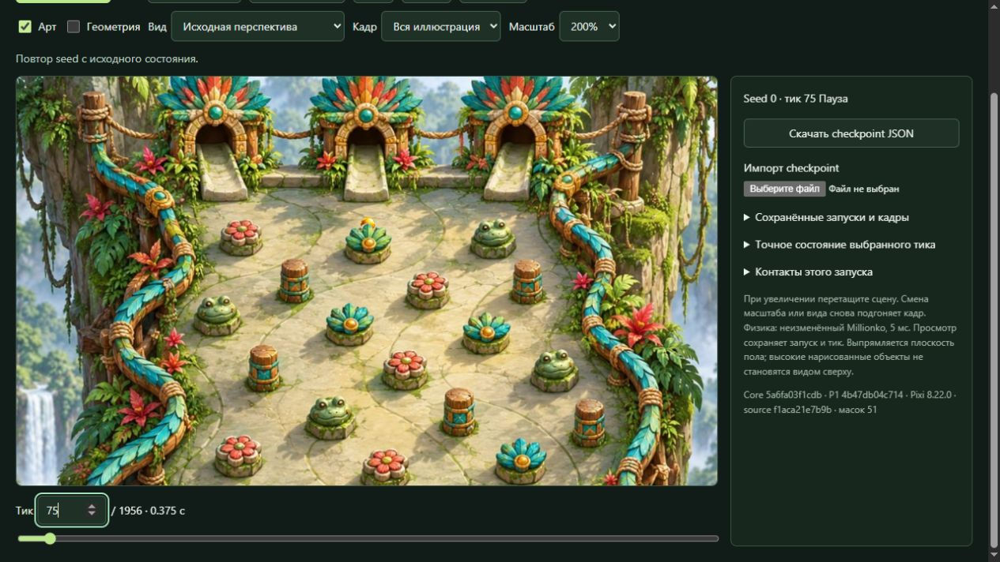
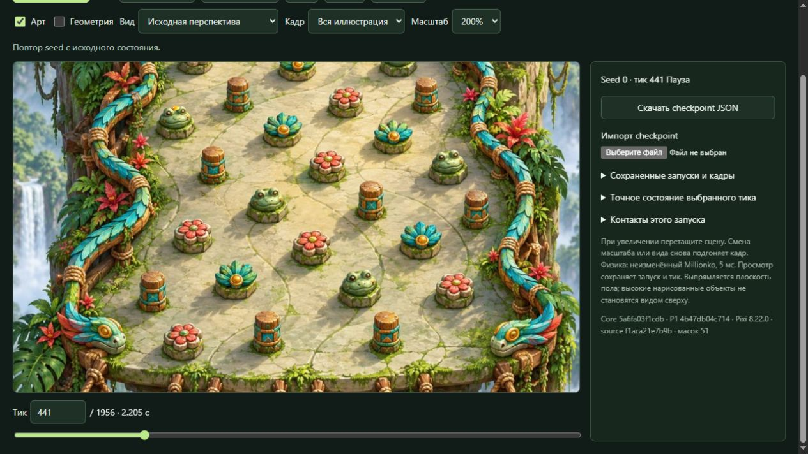
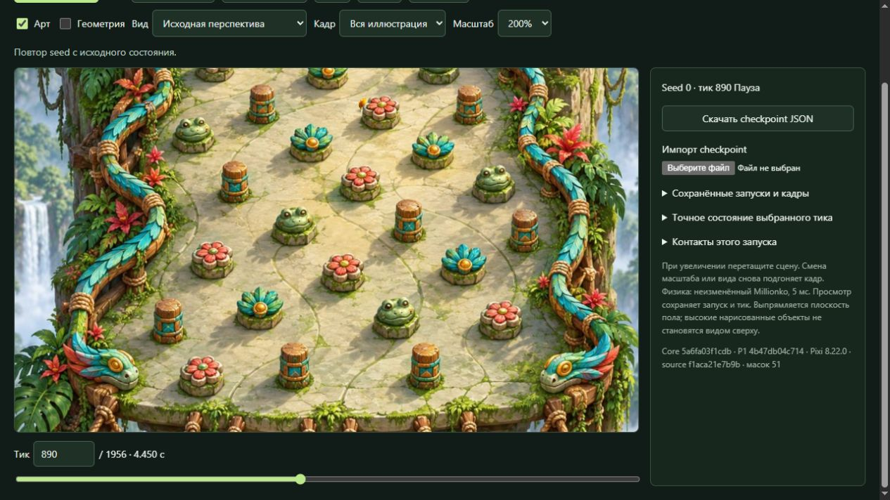
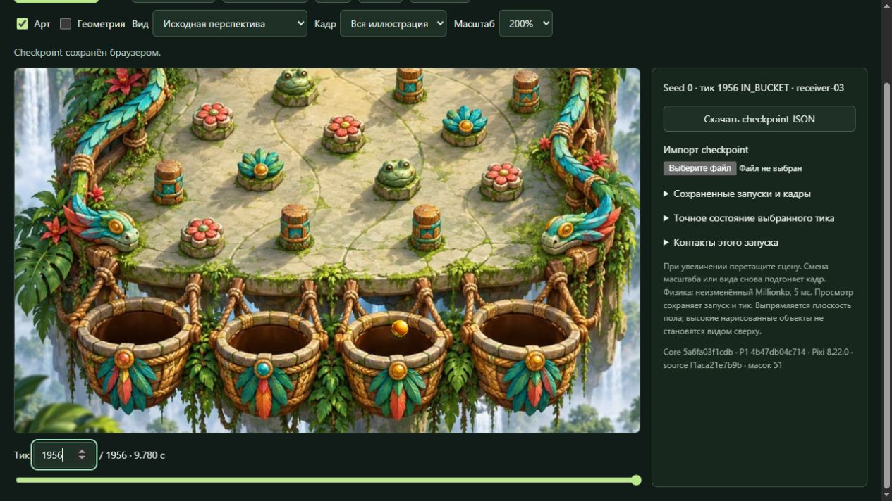
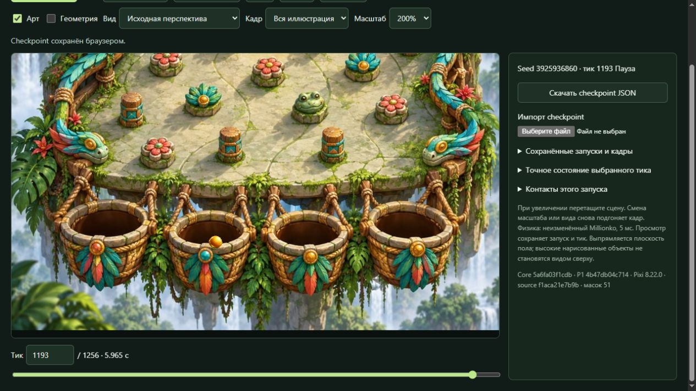
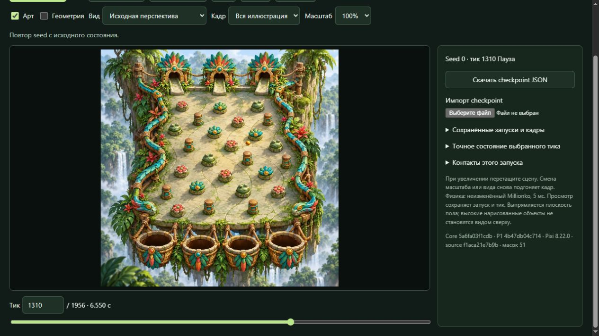
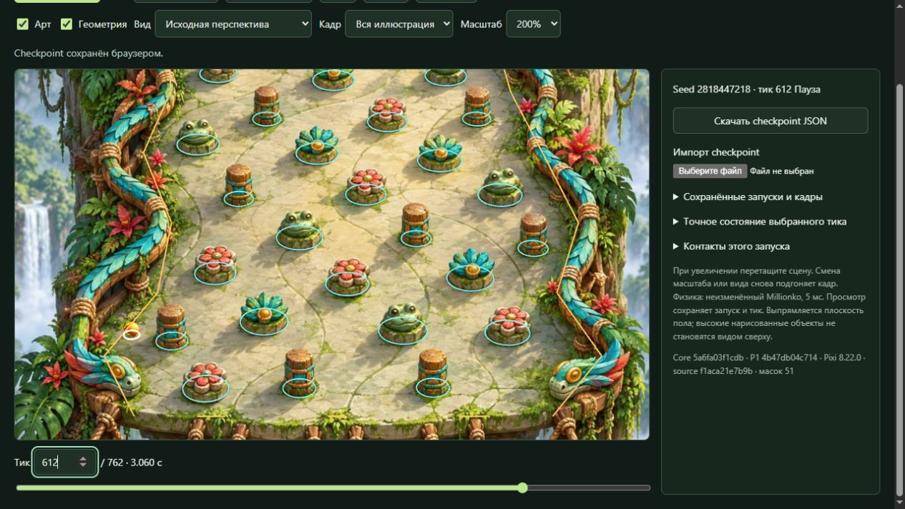

# P3-frozen-01 — независимая Visual QA

28 октября 2026, Europe/Kyiv. `visual-qa-r4d-p3-masks-01`.

## Вердикт

**Визуальный результат частичный; полный визуальный PASS не выдаю.**
На просмотренной выборке цельная Jungle, собственный объёмный шарик,
читаемая компактная тень и маски работают как одна сцена. Реально
проверены частичные перекрытия четырёх семейств препятствий, высокий
столб, боковые проходы, входы в корзины 01/03 и передний край корзины 02.
Новых воспроизводимых дефектов P3 masks/renderer, требующих исправления
Builder/Artist, эта выборка не выявила.

Однако обычный seed2818447218 даёт видимый ранний отскок от свободного
пола перед левым ограждением. Это подтверждённое расхождение общего
маппинга с артом, а не повод исправлять маску или подгонять config.
Оно остаётся дефектом видимого результата, хотя не доказывает неудачу
самого способа P3. Ограниченную исследовательскую попытку можно передать
Lead как частичную с этим явно показанным ограничением; это не приёмка
всего заказа и не разрешение публикации/следующего этапа.

## Точная версия и основание проверки

- CODE `f1aca21e7b9ba19001e7e8762fcaf2511bf9bf74`.
- ART `f899a308aed156a11e2a1013292ed68c6669959d`.
- Handoff `4603d99a5904d10924f55416e36100b2c470b534:experiments/p3-masks/builder/FROZEN_CANDIDATE.md`.
- Bundle `E:\R4D\perspective\p3-runtime\builder\full-checkpoint-06`.
- Manifest exact SHA256
  `e2e9f7d837b3d05f484f75a877af6992a70ee88363add783d80f3c6e206f431f`.
  До паузы независимо совпали размеры/хэши всех 76 payload files
  (3388537 bytes) на диске и HTTP. При resume manifest снова совпал;
  Lead отдельно подтвердил прежние bytes восстановленного preview.
  Полная техническая матрица повторно не запускалась.
- Native core `5a6fa03f1cdb3de88a2d9c7dbe795eb8e2a7f023`, P1 repeat
  `4b47db04c7140ebf88f69b91faa0b790d46f22ec`, PixiJS8.22.0.
  Предварительная сверка геометрии/проекции и технические self-checks
  не засчитывались как художественная проверка.
- Канон — ORDER и P3-masks на `64061757802dc60770ab156ef5672af741d65d03`.
  Проверка начата по отдельной frozen-выдаче Lead, остановлена по Max,
  продолжена после новой команды Max от 05:36 UTC. История паузы сохранена
  в [checkpoint](PAUSE_CHECKPOINT.md), её наблюдения относятся к тем же bytes.

Среда — собственные изолированные IAB-вкладки1 и2, viewport1280×720/DPR1,
без viewport override. Основная оценка — source perspective, whole-source,
100% масштаба стенда (полная картинка около500px), Art on/Geometry off;
дополнительно floor framing100%. Zoom200% и pan использованы для разбора
силуэтов, а не вместо обычного просмотра. Физика не замедлялась.

## Реально просмотренные запуски

| Seed | Объём независимого просмотра | Подтверждённый исход |
| --- | --- | --- |
| 0 | Целое движение до паузы; leaf01/wood01; frog02/flower02/flower03; отдельные реальные движения и точные кадры после resume; вход03 | receiver03/t1956 |
| 2818447218 | Целое движение и600–625; same-state geometry/t612 | LOST/t762 |
| 1126639243 | Единственный собственный обычный random, без отсева; затем полный повтор; после resume только нужный кадр659 | LOST/t2352 |
| 1199311181 | После resume концовка1260–1367 и точные1300/1330/1355/1366/1367 | receiver01/t1367 |
| 2099436614 | 487–489 и поздняя часть650–747, включая края корзин680–720 | LOST/t747 |
| 3925936860 | Поздняя часть1120–1256; передний край1170–1195 с шагом1 на1191–1194; реальное движение1100–1256 | LOST/t1256 |

Последние четыре исходных seed взяты из сохранённых обычных запусков
frozen bundle; они не объявляются моими новыми random. При resume новых
random не понадобилось. Неудобные LOST сохранены; выбор концовок служил
покрытию переднего края, а не поиску красивого попадания.

## Подтверждённые видимые свойства

**Препятствия и порядок.** У leaf01 seed0/t65–75 шарик частично закрыт
листьями, к94/95 скрыт, к150 снова виден. Wood01: узкий фрагмент сбоку
на570/571, скрытие590–610, выход620–660. Высокий объект может закрыть шар
до физического контакта; это не отнесено к дефектам.

Frog02 seed0:425 →440/441/442 →460. На441 видна только верхняя часть
шарика за головой. Flower02 seed0:880 →890 →910 — от целого шарика к
частичному скрытию за лепестками. В реальном движении850–1107 при100%
не увидел необоснованного исчезновения или скачка поверх тела.

Адресные flower03 seed0/1503–1505 и frog02 seed2099436614/487–489 реально
просмотрены: шар проходит сбоку, без достаточного наложения силуэтов.
Это полезная проверка отсутствия pop в этих кадрах, но не доказательство
качества маски. Одного numeric depth crossing для такого вывода недостаточно.

**Корзины и передний край.** Seed0/1914–1956 проходит переднюю кромку
платформы и входит в отверстие03;1199311181/1300–1367 — в01. Финальный
шар виден внутри отверстия, native capture сохраняет реальное состояние.
Выдуманного sinking не требуется и в проверку не добавлялось.

Seed2099436614/690–720 проходит снаружи левого края02, поэтому не был
засчитан как внутреннее перекрытие передним краем. Дополнительно сохранённый
LOST3925936860 проходит через видимое отверстие02: на1191/1192 нижний
край шара частично закрыт каменной кромкой;1193–1195 он выходит перед ней.
В соседних тиках не увидел скачка центра или полного исчезновения.
В normal100% просмотрено также движение1100–1256. Native02 не сработал:
этот случай не объявляется попаданием02 или доказательством её trigger.

**Шарик, свет, тени, опора.** Шар объёмный, по размеру согласован с
наблюдаемыми основаниями и меняется по принятой проекции без заметного
скачка масштаба в просмотренных движениях. Тёплый материал и блик не
выглядят инородными среди золотых деталей Jungle. Это визуальное суждение,
не восстановление точной камеры или направления света в градусах.
На светлом свободном полу seed0/t1310 и собственном1126639243/t659
отдельная мягкая компактная тень различима снизу-слева, в whole100%
и floor100%. На тёмном/пёстром baked shadow фоне она слабее различается;
постоянную одинаковую читаемость на всём поле не заявляю. Не увидел
заметных дублированных следов или превращения падающей тени препятствия
в непрозрачное тело в рассмотренных проходах.

**Диагностический режим.** На том же paused seed0/t94 Art-off снимает
невидимые перекрытия: белый контур шарика виден. Geometry поверх арта
остаётся незалитой и читаемой. Это реальная проверка UI/кадра, не только
наличие соответствующих флагов в коде.

## Конкретный дефект общего входа

**MAP-01: ранний левый отскок.** Seed2818447218,600–625, контакт left5/t612.
При обычном100% шар меняет направление на видимом свободном полу перед
нарисованным ограждением. При включении actual geometry того же paused612
boundary проходит внутри этого пола; наблюдение согласуется с принятым
config/projection. Маска не является источником физического отскока.
Классификация — общий маппинг; ни коллайдер, ни траектория не исправлялись.
Само наличие LOST этим не объясняет все остальные проигрыши.

Пакет Builder/Artist: новых доказанных mask/ball/shadow дефектов сверх этого
общего расхождения не возвращаю. Scalar pin-depth, coarse rail depth и
мелкая листва остаются границей выборки, а не автоматически найденными
ошибками. Рекомендация по MAP-01 — сохранить это воспроизведение и caveat
общего входа; исправление общей геометрии не относится к моей роли.

## Evidence, воспроизведение и ограничения

Ключевые actual JPG и пять новых browser-export JSON находятся в
[frozen-01](frozen-01/); ещё7 кадров/3JSON — в [WIP](frozen-01-wip/).
Для повторения открыть exact bundle, импортировать нужный JSON, сверить
seed/tick, затем +1tick или seek. Export содержит start/drop, config,
версии core/P1 и hashes config/projection. Зафиксированы, в частности,
seed0/t1310/1956,1199311181/t1367,2099436614/t747,3925936860/t1192 и
старый MAP-01/t612. Каждому нужен source/build/manifest этого отчёта;
одних core/config hashes для идентичности визуального кандидата недостаточно.

Полный raw сохранён на своём E без перезаписи:

- `E:\R4D\perspective\p3-runtime\visual-qa\frozen-01`:220 files/29246234bytes;
- `E:\R4D\perspective\p3-runtime\visual-qa\frozen-01-resume`:117 files/14257499bytes.

Motion-снимки — последовательные наблюдения работающей симуляции, не
запись каждого физического тика. `afterScreenshotStatus` читается позже
изображения; точный tick кадра берётся из его HUD. Несколько ранних
снимков после seek успели показать прежний HUD и исключены из выводов/
ключевой выборки; их raw не удалён. `paused-evidence.json` — журнал
действий/считанного UI, не самостоятельное доказательство pixels/tick.
Ключевые выбранные кадры сверены визуально по HUD. Первые full-page
снимки seed0 не использовались для сравнения обычного масштаба.

Не проверены все51 маска во всех достижимых состояниях, попадания02/04,
мобильные размеры и отдельная художественная пригодность inverse view.
Наблюдение агентом не выдаётся за человеческое испытание. Технический
native/network verdict остаётся отдельной работой TQA.

При resume перед браузером05:49:10 UTC: RAM free11.799/31.907 GiB,
CPU40%/24logical, диски C8.090/D16.303/E46.210 GiB free. Оценка VQA до2 GiB
дополнительно, совместная preview+двухQA до3.3 GiB — оценка, не резерв.
Новых серверов/сборок/установок не создавал. Свои вкладки1/2 закрыты,
активного захвата нет; общий preview112732 оставлен его владельцу Builder.
Продукт, общий config и shared frozen bytes не менялись; server_write=false.

Следующее решение — Lead/CTO по этому частичному визуальному результату.
Новый кандидат потребует адресной повторной проверки затронутых свойств;
этот отчёт автоматически на другую версию не распространяется.
