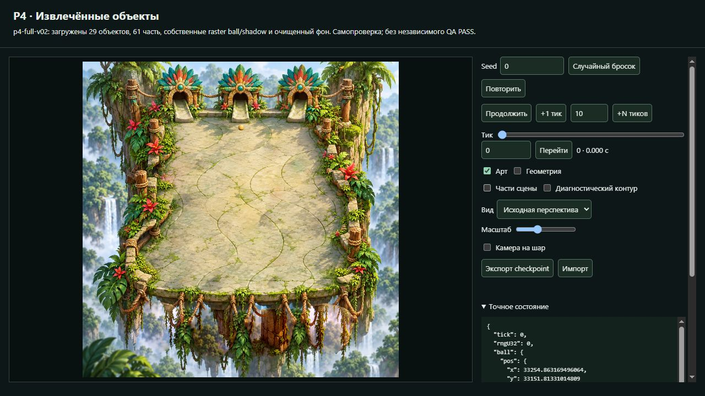
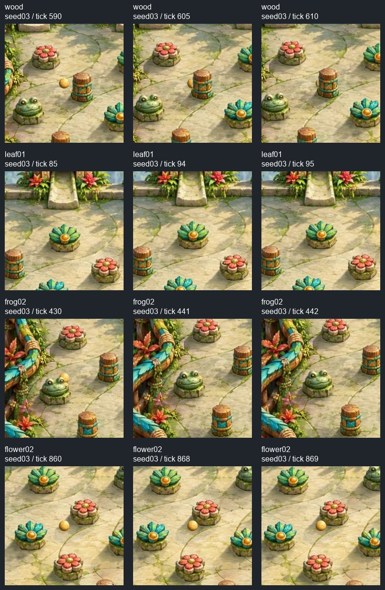
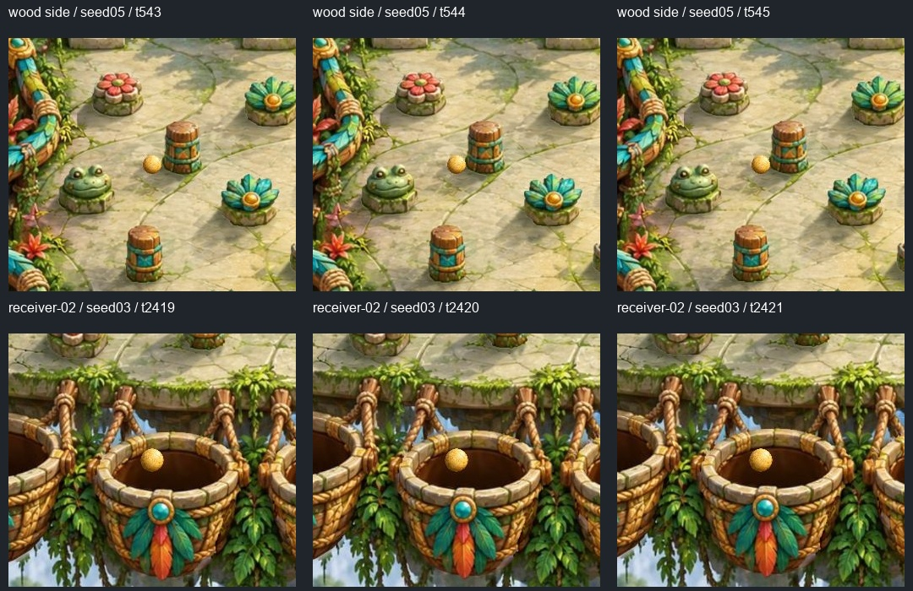
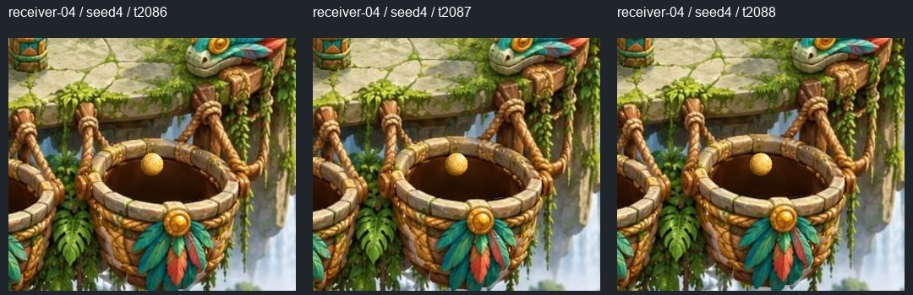
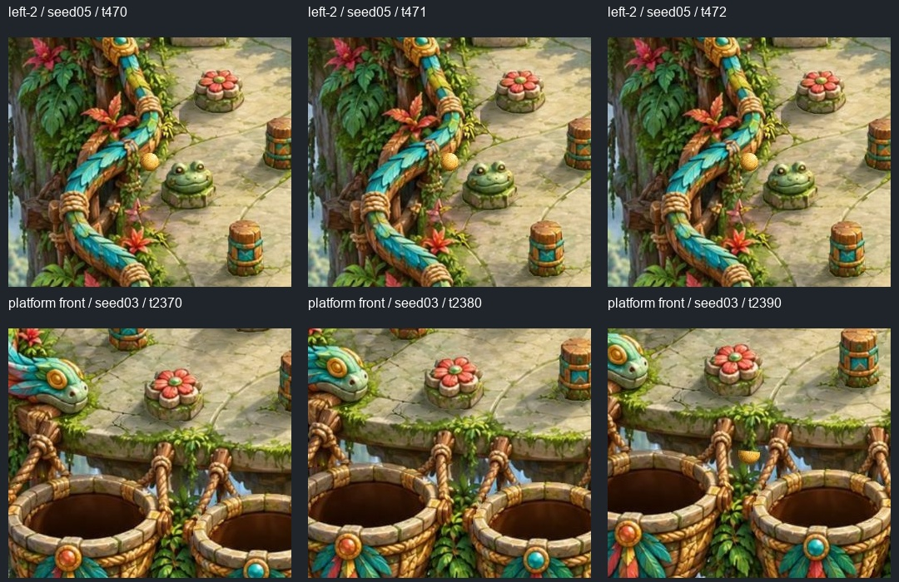
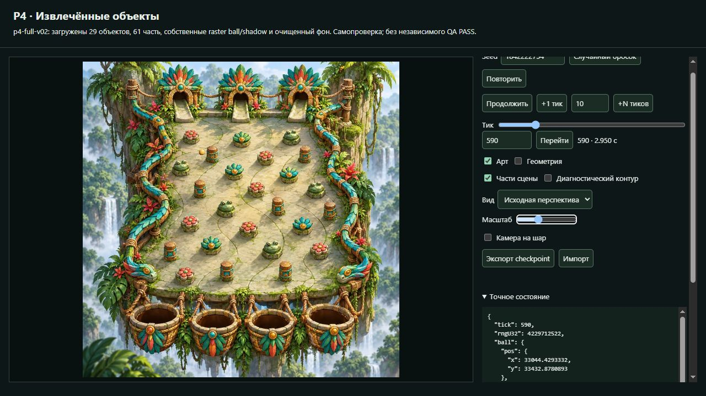
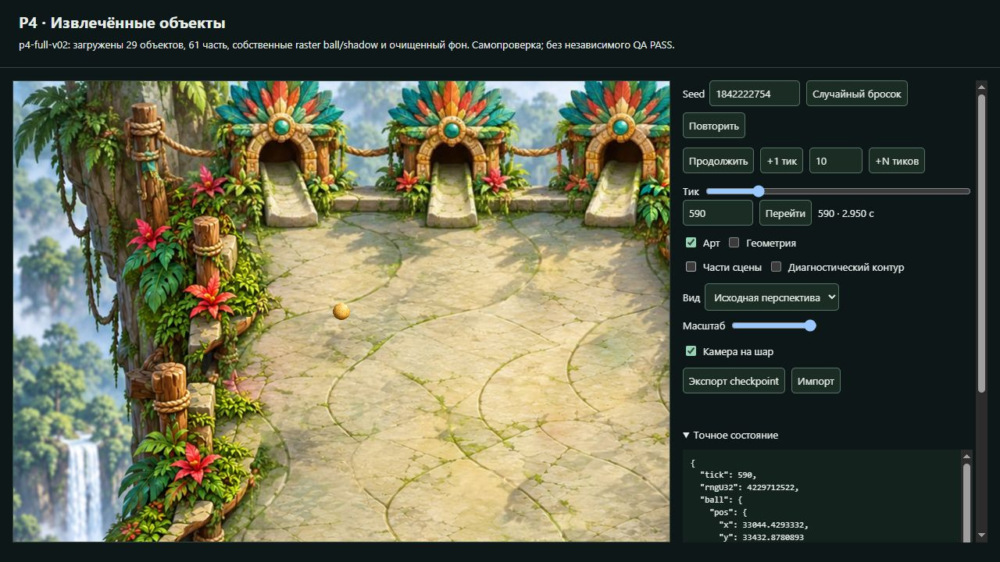

# P4 full-v02 candidate-02: независимая визуальная проверка

28 октября 2026. Visual QA `visual-qa-r4d-p4-extracted-01`.

**Art PASS не выставлен.** Извлечение и основные перекрытия работают в
проверенных состояниях, но тень шара не читается в обычном масштабе как
отдельная опора на пол. Дополнительно остаются непроверенные входы в
receiver-01/03 и частичное перекрытие передним ободом в момент захвата.
Это результат визуального QA ограниченной попытки, а не технический PASS
ядра, разрешение публикации или доказательство выполнения всей карточки.

## Точная проверенная версия

| Поле | Значение |
| --- | --- |
| Named frozen candidate | `p4-full-v02-candidate-02` |
| artifact.json SHA-256 | `c7815edc846749478e56e76d072233ae5a6fcd0ee86d2c14f9936379bff9b757` |
| Builder source commit | `b2db9e947ebf2213e725a66f1e778f9137b14d5f` — локальный, remote hold |
| Artist commit | `b2c0339704c9a6a86e4a1188b0022ba724aadd43` |
| art manifest SHA-256 | `209350371d807a879fef1ab61a2aff02868d4e24414892f4d50a17cee02c5543` |
| app.js SHA-256 | `994cead8ae6065b09e302934de545582289b3c350c8ad9312316b2ed947b94ca` |
| P1 / native | `4b47db04c7140ebf88f69b91faa0b790d46f22ec` / `5a6fa03f1cdb3de88a2d9c7dbe795eb8e2a7f023` |

До просмотра прочитаны RUN.md и README художественного пакета. Самостоятельно
сверены artifact SHA, frozen=true, builderDirty=false и SHA всех 100 payload
файлов immutable root. Через HTTP дополнительно сверены artifact, app.js,
art/manifest.json, index.html и background.png. После основного прохода и перед
дополнением seed4 identity сохранилась. Локальный адрес `127.0.0.1:4394` был
только текущим preview; владельцем процесса Visual QA не становился.

Корень проверенной передачи:
`E:/R4D/perspective/p4-runtime/builder/candidates/p4-full-v02-candidate-02/`.
Самостоятельные снимки/состояния:
`E:/R4D/perspective/p4-runtime/visual-qa/frozen02-qa-01/`.
[Индекс evidence](evidence/frozen02-qa-01/review-index.json) содержит hashes,
seed/tick, state/PRNG, controls, размеры и исходные имена кадров.

## Как смотрел и что действительно получилось

Своя фоновая вкладка встроенного браузера; личный Chrome и рабочий стол не
использовались. Обычный viewport 1280×720, DPR1; canvas 840×590 CSS px,
целиком видимый исходный квадрат 574×574 px, zoom=1, followBall=false.
Дополнительные детали: zoom=2 и камера на шар, около 0.747 CSS px на исходный
пиксель. Листы фрагментов ниже вырезаны из моих реальных JPEG без увеличения;
они не являются новым рендером или Artist preview.

Реальные play/pause, seek и +1 использовались в текущем Pixi consumer.
Точные события проверены на паузе: `event.tick` столкновения относится к шагу;
например, событие 616 видно в snapshot617 с уже изменённой скоростью.
Живой sample не выдаётся за атомарный снимок точного тика.

| Проверено на текущем 02 | Seed / ticks | Наблюдение |
| --- | --- | --- |
| Собранный кадр и очищенная plate при Parts off | 0 / 0; 1842222754 / 590 | Старые pins, их тени и корзины на подложке не видны; общая архитектурная светотень сохранена. Нет грубых прямоугольных заплат или двойных предметов. |
| Высокий wood-01 | 1842222754 / 590,605,610; 615–617 | Шар видим, затем частично скрывается и уходит за стойку; прямоугольник crop его не вырубает. Боковина, верёвки и основание сохраняют исходный вид. |
| leaf-01, frog-02, flower-02 | 1842222754 / 85,94,95; 430,441,442; 860,868,869 | За frog видно частичное скрытие. За листьями шар скрыт; перед flower виден боковой контакт. Не заявляю частичное перекрытие каждого семейства по одному признаку overlap. |
| Боковой контакт wood-01 | 2964851399 / 543–545, event544 | Изменение направления у видимого основания; значимого отскока от пустого места в этом окне не обнаружил. |
| Борт left-2, ближний left-6 | 2964851399 / 470–472; 1842222754 / 2334 | Контакт рядом с видимой опорой/краем. Нового подтверждённого дефекта общего P1 здесь не установил. |
| Передняя часть платформы | 1842222754 / 2370,2380,2390 | Шар проходит за передним краем и частично появляется ниже него; Art-off открывает геометрию без маски. |
| receiver-02 | 1842222754 / 2419–2421 | Вход виден, snapshot2421 даёт IN_BUCKET receiver-02. Сфера остаётся целиком видимой в отверстии. |
| receiver-04, дополнительный заранее существовавший обычный seed | 4 / 2086–2088; ещё +1 | На моём consumer IN_BUCKET receiver-04 в2088; +1 оставляет завершённый тик2088. Сфера в отверстии, обод не удвоен; погружение не показано. |
| Art-off и сохранность состояния | 2964851399 /545; 1842222754 /2390 | Путь/контуры доступны без невидимых масок, state/PRNG на выбранном тике при переключении совпали. |

На обычном целом кадре сохранены исходные материалы, масштаб, ракурс,
мох, лепестки, листья, перья и ободки. На просмотренных крупных участках
нет существенной светлой/цветной каймы или потери деталей. Тени препятствий
читаются и не выглядят повторно наложенными. Это визуальное наблюдение
собранных состояний, не попиксельная сертификация каждого alpha-края.

Очищенная подложка в реальном consumer, Parts off:

Wood / leaf / frog / flower, seed03 = **1842222754**:

Боковой контакт seed05 = **2964851399**; вход receiver-02 на seed03:

Дополнение по обычному сохранённому seed **4**, receiver-04:

Борт и передний план:

## Существенный дефект

### VQA-01 — тень шара недостаточно читается; блокирует Art PASS

**Где:** seed `1842222754`, tick `590`, обычный масштаб, Art on,
Geometry off, Parts on. Дополнительная изоляция того же состояния — Parts off,
zoom2/followBall, исходная перспектива.

**Видно:** золотая сфера хорошо отделена от пола, но её ground shadow
практически сливается с тёмным краем самой сферы. В обычном целом кадре не
получается уверенно прочитать отдельное мягкое пятно опоры; на диагностическом
увеличении остаётся очень слабый край. У соседних препятствий собственные
тени гораздо яснее связывают тела с полом. Из-за этого шар выглядит отдельным
наложенным элементом. Это оценка видимого результата, не утверждение, что
shadow PNG не существует или вовсе не рисуется.

Обычный целевой масштаб — основное доказательство:

Та же позиция на очищенной plate, без перекрывающих частей:

**Область/владелец:** artwork — художественный контракт ball/shadow;
Artist вместе с Builder проверяет его отображение consumer. Окончательная
причина между PNG, параметрами shadow и отображением здесь не изолирована.
Классифицирую как проблему P4, а не установленную ошибку P1 input.
Положение/радиус физического шара, anchors, геометрию и PRNG не менял и их
подгонку не предлагаю. Критерий коррекции — видимая согласованная тень в
том же обычном масштабе на том же сохранённом запуске.

## Не подтверждено и не подменяется предположением

- **Receiver-01 и receiver-03:** статически осмотрены в общей сборке,
  полноценный вход по обычному native run не проверен. Новую охоту за seed
  для всех корзин не проводил.
- **Передний обод в момент захвата:** в фактических конечных состояниях
  receiver-02 и receiver-04 шар полностью видим внутри отверстия. Поэтому
  эти два успеха не подтверждают частичное скрытие шара передним ободом при
  входе. Это непроверенное состояние consumer/artwork, не самостоятельное
  требование добавить height physics или погружение после конца native run.
- Реальных новых существенных ошибок общего P1 input не доказано.
  LOST сам по себе не считается дефектом P4. Для каждого места ниже сохранены
  наблюдавшиеся исходные состояния, а не подобранная красивая траектория.
- Экспорт/повторный импорт checkpoint и внутренности ядра не были предметом
  этого визуального вердикта; вывод TQA не заимствуется.

Все просмотренные законченные runs сохранены, включая неудобные:

| Источник run | Seed | Фактический конец |
| --- | --- | --- |
| Переданный ordinary03 | 1842222754 | IN_BUCKET receiver-02, t2421 |
| Переданный ordinary05 | 2964851399 | LOST, t1323 |
| Первый новый обычный Random UI | 4176331824 | LOST, t1319 |
| Второй новый обычный Random UI | 2149594954 | LOST, t1697 |
| Дополнительный ранее сохранённый ordinary seed, предложенный Lead | 4 | IN_BUCKET receiver-04, t2088 |

У seed2964851399 дополнительно просмотрены t1200/1250/1290: пересечение
ближнего края и перекрытие корзиной перед окончательным LOST. Их нельзя
переименовывать во вход receiver-04: результат этого run остался LOST.

## Учёт и границы передачи

Индекс сохраняет исходные hashes всех снимков и метаданных. Две сырые
подписи отражали намерение оператора, а не фактический тик: кадр с именем
`03-...t605...` фактически t65, `22-...t1250...` фактически t1290. Они сохранены
и исключены из соответствующих tick-утверждений. Live sample24 снят во время
движения и исключён из атомарных tick-доказательств. Ключевые кадры выше
проверены по фактическому state на паузе. Старые кадры candidate01 не используются.

Перед browser: свободно RAM16.42/31.91GiB, CPU0%/24 logical CPUs,
C/D/E14.50/16.29/16.35GiB. Одна собственная IAB вкладка и лёгкая обработка
JPEG не требовали сборки или копии native. Перед дополнением seed4:
RAM16.71GiB, CPU10%, E16.33GiB. Тяжёлых параллельных процессов Visual QA не
запускал; снимки ресурсов учитывали уже работающие чужие процессы.

Свои вкладки закрыты. Builder PID/сервер, immutable root, код/арт, чужие
checkout, системные настройки и credentials не менялись. В ветке QA только
отчёт, индекс и компактные итоговые evidence; Builder source/native не
перенесены. По текущему запрету public/server writes новый push не выполнялся.

**Вывод для Lead:** текущий02 получил независимую визуальную проверку;
VQA-01 вернуть связанным Artist/Builder одним пакетом с названными пробелами
покрытия. Ограниченную исследовательскую попытку можно описывать как частичный
результат; художественную цель выполненной и Art PASS объявлять нельзя.
