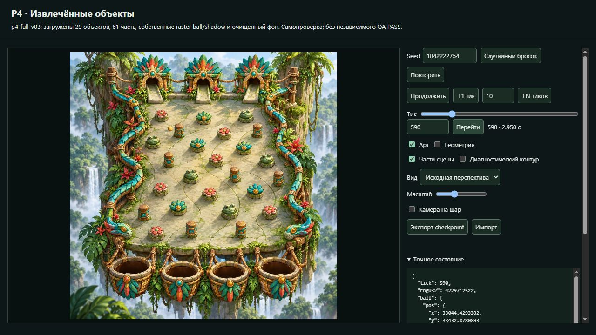
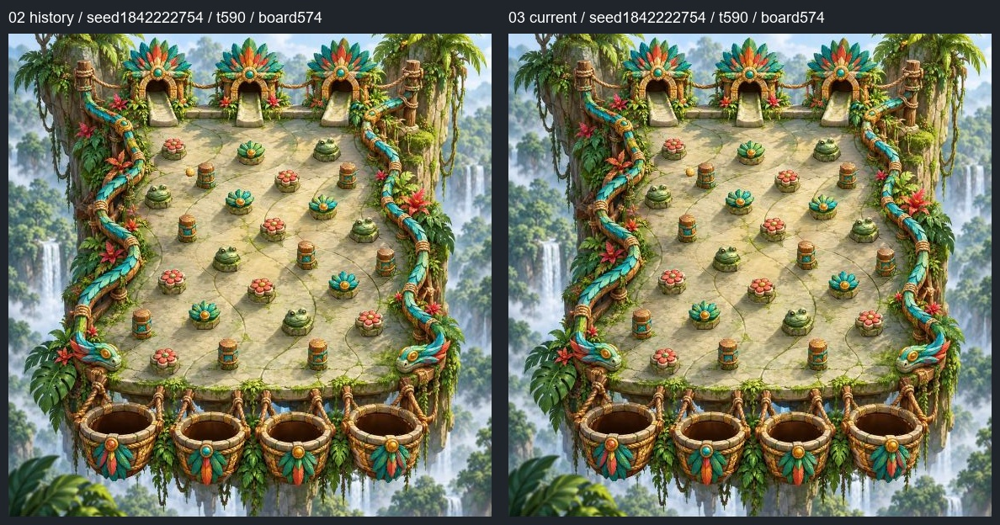
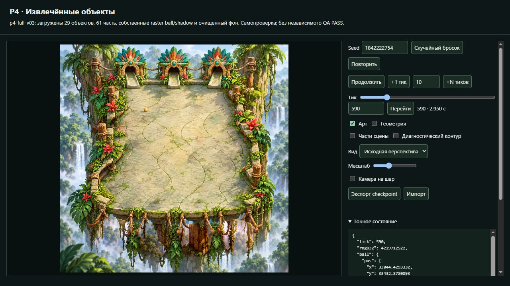
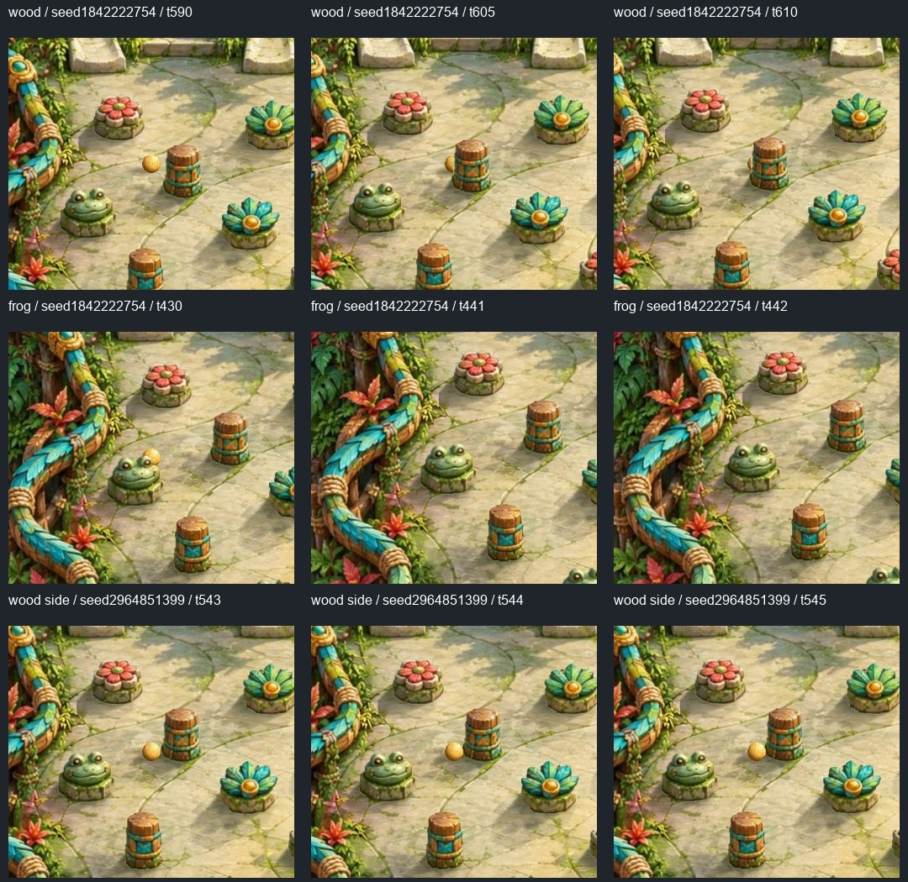
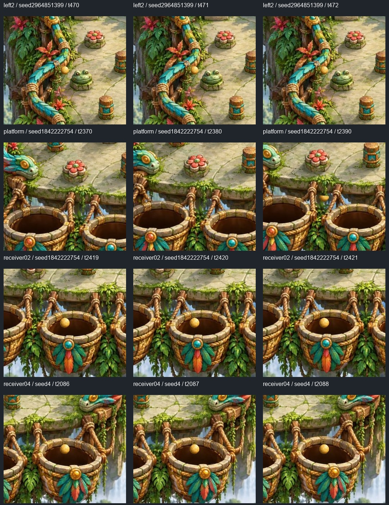

# P4 candidate-03: повторная независимая VQA по исправлению тени

28 октября 2026. Visual QA `visual-qa-r4d-p4-extracted-01`.

**VQA-01 — PASS / CLOSED на exact03. Визуальная регрессия дельты — PASS.**
Отдельная мягкая тень шара теперь читается в обычном масштабе и связывает
его с полом. Новых существенных художественных дефектов в проверенных
состояниях не обнаружил. Это подтверждение художественной дельты и
перечисленного покрытия, а не полный Art PASS всех обязательств P4:
входы receiver-01/03 и частичное перекрытие передним ободом при захвате
остались непроверенными.

## Exact target и независимость доказательства

| Поле | Проверенная версия |
| --- | --- |
| Named freeze | `p4-full-v03-candidate-03` |
| artifact.json SHA-256 | `298649ec518a13e8070201e822108005a6b5081454452f50243d18f2fde2d542` |
| Builder commit | `7d2344c1a8959f73ff26af5d3aba7dd02eb0e971` — локальный, source remote hold |
| Artist commit | `b7efff1e2f519812421829808e71a0d83154926d` |
| full-v03 manifest SHA-256 | `276dfdfd32f1f543ce39d72fe7e360523c6ec70387d1c44dd21acd47f9fb1a6a` |
| app.js SHA-256 | `855fd997a3f02629e924031841d9e3759d7d7f4008b1d8af034505dd12f76ece` |
| native-runtime.js SHA-256 | `8843446996582eaccbd9ff63d3147d74b7eca9a614d8e0df16851d1d89d46f50` |

Прочитаны RUN.md/FROZEN, HANDOFF и exact Artist README. Самостоятельно
проверены frozen=true, builderDirty=false, SHA artifact и **111 payload
файлов на диске и через фактический HTTP preview**. Все65 PNG побайтно
совпали с frozen02. Native, общий config, manifest/projection P1 и original.jpg
также побайтно прежние. Native build, prep и новая seed matrix не запускались.

Источник наблюдения — реальный Pixi consumer03 в собственной фоновой вкладке
IAB, первоначально проверенный по адресу `127.0.0.1:4394`. Порт не используется
как постоянная гарантия версии/владельца. Последняя HTTP сверка ключевых
bytes записана в [индексе](evidence/frozen03-qa-01/review-index.json).

Исходные собственные снимки и state/events03:
`E:/R4D/perspective/p4-runtime/visual-qa/frozen03-qa-01/`.
Снимки02 используются только как явно обозначенная история и источник
ранее сохранённых ordinary states. Artist reconstruction и Builder selfcheck
не подставлялись вместо нового осмотра.

## VQA-01: что видно в обычном масштабе

Условия fix-case: seed **1842222754**, tick **590**, viewport **1280×720**,
DPR1, canvas840×590, целая доска **574×574**, source perspective, zoom1,
followBall=false, ArtON / GeometryOFF / PartsON / DiagnosticContourOFF.
Положение, размер и объёмный body шара совпадают с02.

В03 вижу отдельное мягкое пятно слева-снизу от сферы. Оно не сливается
полностью с её тёмным краем; контакт с полом читается уже в целом кадре,
без необходимости увеличивать шар. Направление согласуется с тенями
препятствий. Край мягкий; плотность не превращает пятно в чёрную наклейку,
размер соразмерен сфере. В изученных последовательностях нет отдельного
отстающего пятна, второго следа или нового впечатления парения.

Основное доказательство — свежий целый кадр03:

Сопоставление с собственным кадром02 из QA commit
`4864087953cc47844d33ec24c0bee99027e3ea0b`. Обе доски сохраняют574×574
пикселей; из реальных кадров вырезана только область доски, без увеличения,
дорисовки или повторного рендера. Точные исходные hashes и crop — в индексе.

На current03 дополнительно отключены части сцены: прежних копий pins,
их теней и корзин на plate не видно. Остаются шар и его отдельная тень на
восстановленном полу. Это помогает отделить её от теней соседних объектов.

Дополнительное увеличение просмотрено; оно не заменяет решение по574².
Manifest/DOM показывают новые shadow offset[-.95,.86], half-size[1.55,.58],
opacity.65 и один видимый source shadow при скрытом flat counterpart.
Эти числа подтверждают подключение03, но PASS выше основан на кадрах.

## Соразмерная регрессия текущей сцены и движения

Новые кадры получены через paused seek / +1, а реальное движение — Play,
pause и resume. Состояния с точным tick сняты на паузе. Два live samples
сохранены отдельно и не выдаются за атомарную пару JPEG/tick.

| Сценарий03 | Seed / snapshots | Наблюдение |
| --- | --- | --- |
| Открытый пол → частичный wood → контакт | 1842222754 / normal570,590,605,615–617; detail590,605,610,615–617 | Тень следует за шаром; body частично/полностью скрывается за стойкой, ground shadow не прорисовывается поверх её тела. Hit event616 отражён в state617. |
| Frog-02 | 1842222754 /430,441,442 | Частичное скрытие и контакт сохранились, расширенная тень не создаёт дубля или нового вырезанного прямоугольника. |
| Боковой wood-01 и борт left-2 | 2964851399 /543–545 и470–472 | Нет новой видимой реакции от пустого места; направление меняется у прежней видимой опоры. |
| Передний край платформы | 1842222754 /2370,2380,2390 | Прежнее частичное перекрытие сохранено. На изученных кадрах нет нового заметного плавающего shadow-пятна в промежутке под краем. |
| Receiver-02 | 1842222754 /2419,2420,2421 | IN_BUCKET receiver-02 на2421; обод не удвоен, сфера целиком видима в отверстии. |
| Receiver-04 | 4 /2086,2087,2088; ещё +1 | IN_BUCKET receiver-04 на2088; +1 не продолжает завершённый run. |
| Art-off | 1842222754 /2390 | Геометрия/проверочный путь открыты без невидимых масок; state/events совпали с ArtON на том же тике. |
| Play/pause/resume после seek | 2964851399 /545→pause634→resume→pause720 | Реальный counter и raster scene продвинулись, зависания/ошибки в этом проходе не наблюдались; console errors0. Это короткий визуальный проход, не замена TQA clock tests. |
| Ранее сохранённый ordinary LOST | 2964851399 /1323 | В03 сохранён тот же LOST и то же конечное состояние. Не заменён удачным run. |

39 повторно наблюдённых paused state/events точно совпали с собственными
данными02 при тех же seed/tick. Новые паузы634/720 и snapshot570 не имели
своего старого снимка и не выданы за такое сравнение. Зависимости unchanged
проверены отдельно; старое совпадение не служило художественным PASS03.

Свежие wood/frog/side последовательности03, фрагменты без увеличения:

Свежие border/platform/receiver последовательности03:

Силуэты, тонкие края, исходные материалы, основания, свет, резкость и объём
в собранном кадре сохранились; PNG неизменны и новое наблюдение не выявило
их визуального ухудшения. Тени препятствий остаются читаемыми по одному;
шар с новой тенью лучше связан с тем же полом. Нового существенного дефекта
общего P1 input не доказано. Код/арт/входы не исправлялись.

## Границы вывода и доставка

- Входы **receiver-01/03** не проверены; охоты за удачными seeds не было.
- В захватах02/04 сфера целиком видна в отверстии. Поэтому **partial front-rim
  при capture** не подтверждён; отдельное погружение/height physics не добавлялось.
- Ранее полученные собственные ordinary LOST seeds4176331824/t1319 и
  2149594954/t1697 остаются в неизменном evidence02 как история, в03 заново
  не запускались. Все текущие outcomes сохранены; новых random runs0.
- Полная приёмка всех обязательств заказа и технический PASS ядра/clock
  не заявляются. VQA-01 больше не является открытым художественным дефектом
  этого freeze; известные пробелы покрытия не переименованы в пройденные.

Перед browser: свободно RAM16.70/31.91GiB, CPU7%/24logical CPUs,
C/D/E14.30/16.29/16.27GiB. Работа — одна собственная IAB вкладка и лёгкая
обработка JPEG, оценочный дополнительный пик менее0.6GiB; уже активные
чужие процессы учтены снимком ресурсов. Пороги4/2GiB не достигнуты.

Своя вкладка закрыта, Builder process/artifact и чужие checkout не менялись.
Полные raw/metadata лежат в своём E-runtime, компактные итоговые evidence
и индекс — в собственной QA ветке. **Разрешённый push относится только к QA
отчётам/evidence, включая прежний локальный QA02 commit.** Builder source,
native JS/maps и его commits не переносились и не доставлялись через QA.

**Итог: PASS по исправлению VQA-01 и проверенной художественной дельте03;
неподтверждённые сценарии перечислены выше.**
