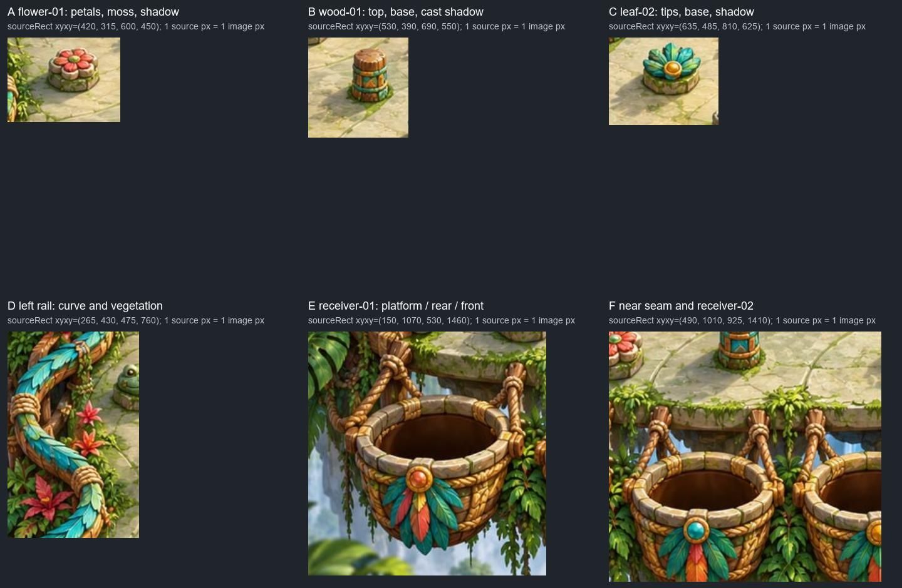

# P4: осмотр входа и запрос кадров для Builder

28 октября 2026. Visual QA `visual-qa-r4d-p4-extracted-01`.

**Осмотр входа завершён. Кандидат P4 ещё не получен; визуального PASS нет.**
Это подготовка независимой проверки, а не пересмотр принятого P1.
Обязательства: [ORDER](../../../../orders/perspective/ORDER.md) и
[P4](../../../../orders/perspective/P4-extracted-objects.md) на
`64061757802dc60770ab156ef5672af741d65d03`.

## Что действительно осмотрено

- Неизменённый `01-jungle.jpg`, 1536×1536, SHA-256
  `c8f9e4245c1de8c2086e615bc75dc10aea59b76b614d6e106593e07262e24f72`.
- Из exact P1 `4b47db04c7140ebf88f69b91faa0b790d46f22ec`, внутри
  `experiments/p1-collider-mapping/clean-repeat-01/`:
  `research/evidence/board01-source-candidate.jpg` и
  `research/evidence/board01-inverse-whole-source.jpg` — оба изображения
  просмотрены; также прочитаны config, manifest, проекция и
  `viewer/src/view-math.mjs`.
- Рецепт P0
  `ee4d8e5c7dbb3b6618d58d6dacb0caf9b73dfb1b:experiments/p0-perspective/research/CROSS_SERIES_CONCLUSION_AND_RECIPE.md`.
  Его композиционные числа не подставляются вместо входа P1.

Проверенные SHA-LF:

| Вход P1 | SHA-256 |
| --- | --- |
| config | `dd5c519cd6d4b7295118e0a3a1063efed424a0ce739450bd5153c6a9941982db` |
| manifest | `7784dc0a215d0e472cf06a4eee03793592727cf0fa9a1fa0e0c78e5f1d17da18` |
| projection | `9ca9e520f1927426a3a5ba73a5eacaf90fedffc9385e7d08d5b1e6ee644b020c` |

В config видны 25 pins, 16 segments, 4 buckets, 1 drop; r16, tick 5 ms,
g980, maxspeed2000, deviations 2°/0.02, lcg32, quantize7. Исходный seed=0;
движение здесь не запускалось. Эти значения прочитаны, а не проверены в
будущем consumer. Старые строки status внутри P1 не отменяют его последующее
принятие и не подтверждают качество P4.

## Рискованные места

Фрагменты ниже сохраняют исходные пиксели без увеличения. Координаты
прямоугольников — `x0,y0,x1,y1`, правая/нижняя границы исключаются.

| Место | Видно в исходнике / P1 | Что отличит рабочее извлечение |
| --- | --- | --- |
| **A flower-01**, ROI `(420,315,600,450)` | Лепестки выступают за каменное основание; мох и мягкая тень переходят в пол. | Нет срезанных лепестков, зелёной/светлой каймы и прямоугольника пола вокруг crop. Подложка отдельно чистая; контакт и отбрасываемая тень остаются один раз. |
| **B wood-01**, ROI `(530,390,690,550)` | Высокая стойка, верёвки, суженное основание и заметная тень вниз-влево. | Шарик может частично скрываться за телом, но правильно выходить перед основанием; порядок не определяется верхушкой или центром crop. Убрать прежнюю стойку и всю её тень с подложки. |
| **C leaf-02** и остальные leaf/frog | У листьев тонкие вершины и просветы, у лягушек выступающие глаза и неровный мшистый цоколь. | Сохранить детали, не оставлять непрозрачные мостики между ними. В движении нет прямоугольной маски и резкого исчезновения целого шарика вместо частичного перекрытия. |
| **D левый борт**, особенно изгибы около source y550/700/985; справа аналогично | Перила приподняты над полом, линия P1 проходит по ломаной; рядом листва и верёвки. | Смотреть реальный боковой контакт и кадры вокруг него. Разницу между линией P1 и нарисованным перилом записывать отдельно от ошибочного перекрытия P4. Не менять сегменты под силуэт. |
| **E receiver-01**, ROI `(150,1070,530,1460)` | Между передним краем платформы и отверстием есть разрыв; видны задний и передний обод, верёвки и подвесная корзина. | Пол не закрывает переход к отверстию; ободы перекрывают шарик в нужном порядке. Не исчезает весь шарик при первом касании прямоугольника корзины; нет двойного обода или старой копии под ним. |
| **F ближний край и receiver-02/03/04** | Мох/верёвки пересекают край, отверстия и украшения соседних корзин расположены рядом. | Не вырезать сразу полосу со случайными частями соседей; не закрывать путь невидимой маской. Статически осмотреть все четыре корзины, динамически фиксировать фактически достигнутые. |

Свет и материал оцениваются в собранной сцене: у проверенных стоек/оснований
тень направлена вниз-влево; контакт темнее и компактнее её мягкого продолжения.
Это наблюдение по исходнику, не заданный числовой угол света. Новая тень шара
должна поддерживать ту же сцену по направлению, мягкости и заметности.
Не вся тёмная область пола принадлежит препятствию: сохранить общие тени
архитектуры и фактуру, удаляя именно прежний объект и его след.

### Опорные точки: не смешивать данные

Из P1, без новых измерений:

| objectId | `sourceCenterPx` основания P1 | Видимая передняя точка опоры P1 |
| --- | --- | --- |
| flower-01 | `(525.4691,380.8817)` | `(524,400)` |
| wood-01 | `(628.6379,478.2464)` | `(628,493)` |

Эти точки имеют разный смысл. Если Artist выбирает одну из них как anchor,
нужно явно сохранить смысл в manifest; нельзя незаметно принять нижний край
crop за центр коллайдера. Native содержит translation `(33256,34072)`;
research, native и source coordinates не взаимозаменяемы.

## Короткий запрос evidence для Builder

Для первого стыка достаточно `flower-01`, `wood-01`, `receiver-01`, если
Artist/Builder не согласуют другой равноценный выбор. В основной сцене
сохраняется полный общий config. Эта проба будет консультацией, не полным QA.

1. **Версия.** Дать exact consumer commit, exact artwork commit/manifest SHA и
   hashes фактически загруженных PNG/подложки. Сохранить подтверждённый контракт
   частей/anchors/provenance. Для итогового QA — одно именованное frozen
   состояние, одинаковое для Visual QA и TQA, с локальным способом открыть его.
2. **Обычный кадр.** Один целый кадр в исходной перспективе, с Art on и Geometry
   off, в обычном размере окна: например 1280×900. Записать фактические viewport,
   canvas CSS size, DPR и scale/zoom; вся доска и корзины видны. Это предложение
   воспроизводимого размера, не новая продуктовая раскладка интерфейса.
3. **Чистая подложка.** В том же consumer, ракурсе и масштабе дать отдельный
   диагностический кадр: plate оставлена, извлечённые body/shadow/foreground
   отключены. Он должен показать восстановленный пол под двумя объектами и
   отсутствие старых копий/лишних теней. Постоянная кнопка для этого не нужна.
4. **Края.** Дать PNG/RGBA и фрагменты фактической сборки для двух объектов и
   корзины в 1:1 по source pixels. Нейтральный/checker просмотр alpha допустим
   как дополнение для каймы. Крупный фрагмент не заменяет обычный общий кадр.
5. **Настоящее движение.** Нужны доступные play/pause, +1/+N физических тиков и
   replay сохранённого seed. Сохранить обычные seed, исходный старт/config,
   версии ядра/геометрии/проекции и точные ticks. Короткий просмотр движения и
   соседние точные кадры нужны для контакта с высоким телом, низким основанием,
   смены перекрытия, бокового отскока и входа в корзину. Пауза соответствует
   указанному физическому тику, без остаточного сдвига интерполяции.
6. **Сопоставимые кадры.** У существенного события снять `t−1,t,t+1`; расширить
   окно до видимых состояний «до/частично/после», если соседних тиков мало.
   Для одного и того же seed/tick/вида дать Art-only, Art+Geometry и Art-off с
   Geometry. Art-off открывает весь путь и геометрию без невидимых масок.
   Переключатели/zoom/вид сохраняют run/tick и состояние симуляции.
7. **Корзины и покрытие.** На первом стыке отдельно увидеть rear/front части
   receiver-01; на полном комплекте статически все четыре. В движении сохранить
   входы в фактически достигнутые корзины и последний кадр до захвата/первый
   после. Недостигнутые состояния назвать непроверенными. Не отбрасывать
   неудобные обычные seed и не выдавать вручную поставленный шар за запуск ядра.
8. **Подпись кадра.** Рядом с файлом достаточно JSON: candidate/manifest hash,
   seed, tick, objectId/event, viewport/DPR/canvas/scale, art/geometry flags и
   framing. Общую ошибку P1 и дефект композиции P4 записывать раздельно. Пара
   одинаковых seed/tick, снятая при повторе, позволит проверить воспроизводимость.

Выпрямленный вид P1 используется как диагностика плоскости и anchors; он
деформирует возвышающиеся нарисованные объекты и не служит художественным
эталоном их формы. Изменять ракурс исходного арта для удобного QA не требуется.
Захват корзины сохраняет штатную семантику ядра; высота/падение внутрь корзины
и новая физика не добавляются ради устранения видимого несовпадения.

## Что подготовлено и что дальше

- `prepare-input-review.py` читает только названные exact P0/P1 objects и
  исходный JPG; проверяет три SHA-LF и SHA/dimensions JPG, извлекает наложения,
  делает фрагменты без увеличения. Все создаваемые рабочие файлы — только
  `E:/R4D/perspective/p4-runtime/visual-qa/input-review-01/`.
- `evidence/input-review-01/input-review-index.json` фиксирует точные источники,
  hashes и ROI; рядом сохранён небольшой итоговый лист фрагментов. Полный JPG
  и два уже существующих P1-наложения в ветку QA не дублируются.
- Перед этой лёгкой подготовкой: RAM свободно 17.79 из 31.91 GiB, CPU 3%/24
  logical CPUs; C/D/E свободно 14.94/16.32/16.93 GiB. Работа ограничена чтением
  и тремя небольшими изображениями; собственного тяжёлого процесса нет.
  Чужие будущие пики не измерены; перед browser/render потребуется новая сверка.

Не запускались consumer, ядро, браузер, сервер, build, imagegen или deploy.
Private source ядра не читался; чужие реализации/checkout не тронуты.
Director передал подтверждение `gpt-6.1-sol/xhigh`; собственного наблюдения
настройки сессии у Visual QA нет.

**Следующий вход:** первый реальный стык и его exact bytes для ранней
консультации, затем общий с TQA named frozen candidate. До этого вывод
ограничен осмотром исходных материалов; Art PASS не выставляется.
