# Dark full original · независимый Visual QA

**PARTIAL / scoped visual PASS.** В проверенной полной normal-сборке и перечисленных реальных cases новых подтверждённых блокирующих Art FAIL не найдено. **Полный Dark Art PASS не выдан:** approach/capture/front-rim receiver02/03/04 остаются **UNOBSERVED**. Это завершённый review данного freeze с указанными границами, а не перенос Water/Jungle PASS.

У receiver01 независимо подтверждены два capture и отдельный partial front-rim в LOST. Static warning о полном скрытии capture чёрной cavity в actual consumer **не воспроизведён**; исправлять source на основании той статической заметки оснований нет.

## Точная цель и integrity

| Поле | Проверенное значение |
|---|---|
| Candidate | `dark-full-original-p4-candidate-01` |
| artifact.json actual SHA256 | `6dd25ecd75b5ade5fb67f8bb4d06dbddd2efc15676168b713ab951729a82eecf` |
| payloadRoot SHA256 | `281cd26408c36d6fb84e77093b808f0df2eb6115e1636ecac5ecb9bf6a49b00e` — 218 files |
| artworkRoot SHA256 | `25708990254f20ec6681dec9c3c2c23ef74c0853937ff78d02a5ecb13fdbfcff` |
| app.js actual SHA256 | `96ddc0443f311dd46f7f07b287171118608a583f0fd26416dbaa18ad8c8e84d0` |
| native-runtime.js actual SHA256 | `8843446996582eaccbd9ff63d3147d74b7eca9a614d8e0df16851d1d89d46f50` |
| Art manifest actual SHA256 | `d71bf97b07fb2571aa3ea0298900270775ae939b270753d3bfbe22097104a716` |
| Artist | `05ba43101a95fc1efcda5395d1394c27cb887f09` |
| Builder | `ed62bae3f81d227494478c82b2279b5badcf715d`, LOCAL_HELD |
| Preview | `http://127.0.0.1:4399/` |

Frozen root: `E:/R4D/perspective/p4-runtime/builder/transfer-water-dark/dark/candidates/dark-full-original-p4-candidate-01`. Независимо проверены actual artifact SHA, все218 disk/HTTP file SHA и оба root digest по sorted file-record JSON rule. После browser повторно сверены artifact/app/native/art-manifest: те же bytes. [Identity](evidence/full-original-01/identity.json), [final binding](evidence/full-original-01/IDENTITY_AFTER.json).

Только accepted **Dark02/trial-01**, P1 `4b47db04c7140ebf88f69b91faa0b790d46f22ec`: config `14be2a023833d266d1e333bf582af5fd5885deb445698c10ebd846ef0cc080b2`, P1 manifest `3fab422bd1f74d477d1648620c97ad6d7b8b0a55a70a1102d6e6885def564d81`, JPG `7ceff71bd0a871fecd725527dff5522450c8e75a74eb99c107b5d8624bf8fa3a`. Core `5a6fa03f1cdb3de88a2d9c7dbe795eb8e2a7f023`, package tree `008d16a80a26bb77d562a45218b01da09b0d9ff0`; r16/tick5ms/quantize7/drop/H/noise/PRNG не менялись. Water geometry/checkpoints не подставлялись, native source не строился.

Coverage:28 objects=24 floor+4receiver;60 object parts+6scene=66;69 runtime textures. Все69 browser-reported dimensions совпали с decoded PNG. [Raw loaded-assets DOM](evidence/full-original-01/LOADED_ASSETS.raw.json), [dimension check](evidence/full-original-01/LOADED_DIMENSIONS_CHECK.json). Worker-response hash **UNVERIFIED**; disk/HTTP SHA и dimensions его не заменяют. Unsupported Target.setAutoAttach не вызывался, alternate actor/transport не использовался.

## Whole normal и материал

Собственная скрытая IAB tab, **1280×720 DPR1**, canvas **840×590**, board **574×574**, fit `0.3736979166666667`. Normal: source/zoom1/noFollow/ArtON/GeometryOFF/PartsON. Detail — штатный zoom2/follow, fit `0.7473958333333334`; viewport не менялся.

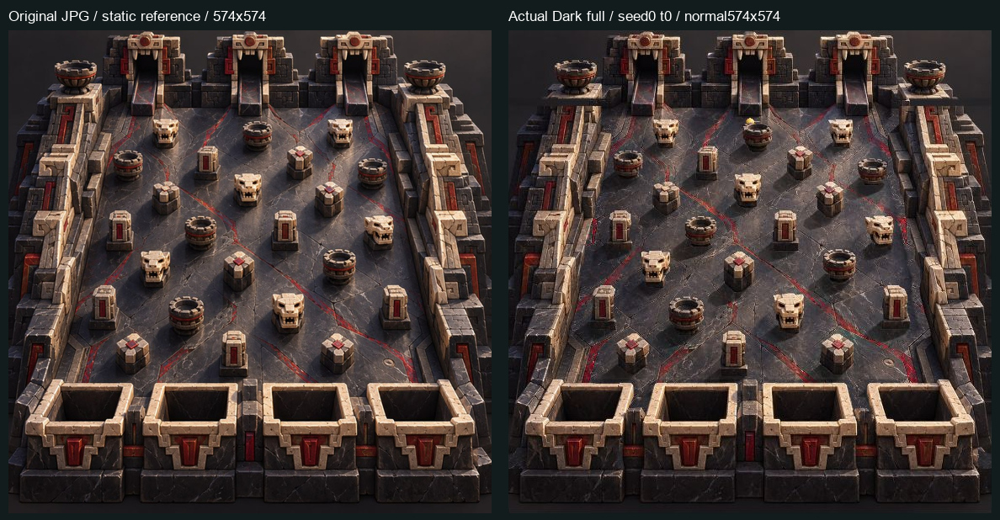

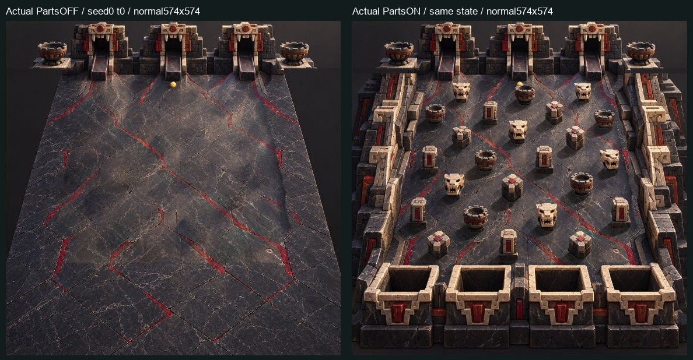

Все24 floor bodies, receiver walls, guards/dividers/near-platform и их отдельные тени снимаются PartsOFF; far architecture остаётся environment. В PartsON сцена сохраняет Dark source-style: тёплые светлые кромки, red veins, мрамор, тёмные базы; явных дублированных тел, светлых caps или внешней cyan/white каймы в просмотренных кадрах нет. Для38 видимых body/rear/front/scene PNG максимальная RGB-разница с соответствующим исходным JPG crop при alpha>0 равна `[0,0,0]`. [RGB checks](evidence/full-original-01/SOURCE_RGB_CHECKS.json). Эта проверка не заменяет оценку силуэта.

**D-VQA-OBS-01, background:** сначала в normal PartsOFF отмечены широкие тёмные тональные пятна под рядом бывших объектов. После whole/detail/source review определённые оставшиеся body silhouettes или резкие прямоугольные patch seams не выделены; как блокирующий FAIL это замечание **не подтверждено**. Пятнистость мрамора сохранена в evidence, качество не объявлено идеальным по одному числу. [Ограниченный RO диагностический тест](evidence/full-original-01/FLOOR_SHADOW_DIAGNOSTIC.json) не обнаружил точного unchanged original RGB на floor pixels с отдельной shadow-alpha≥32 вне body; отрицательный результат **не доказывает** безупречную декомпозицию старых теней.

Bowl/skull чёрные interiors остаются opaque body material. Во всех12 центральных dark-interior выборках bowl-base01..06 и skull-base01..06 minimum alpha255. Зубцы bowls, глаза/рот/мелкие зубы skulls и светлые края читаются в normal и details. [Interior samples](evidence/full-original-01/OPAQUE_INTERIOR_SAMPLES.json). Эти bowls/skulls не переименованы в четыре goals.

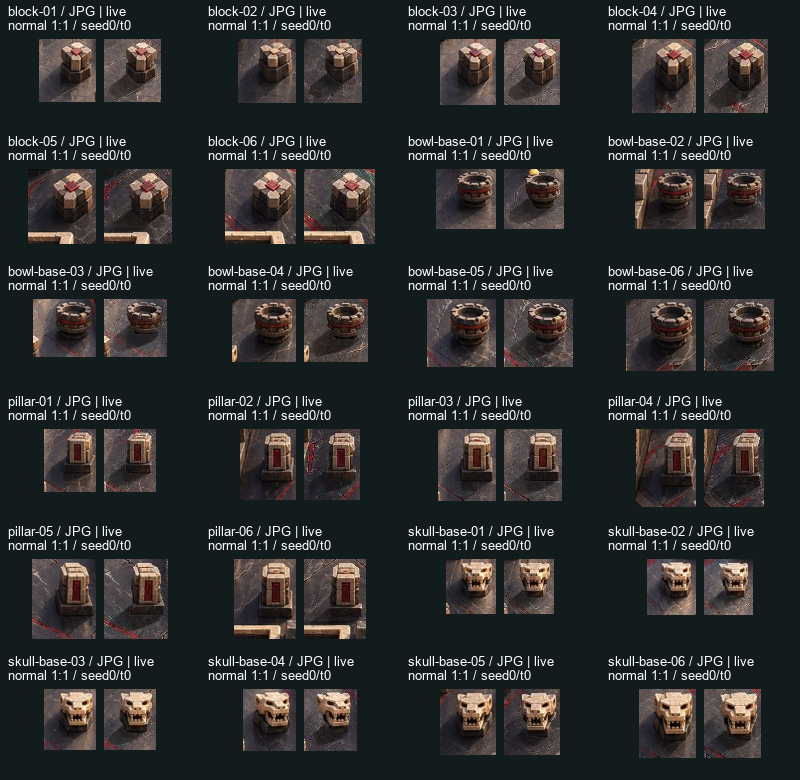

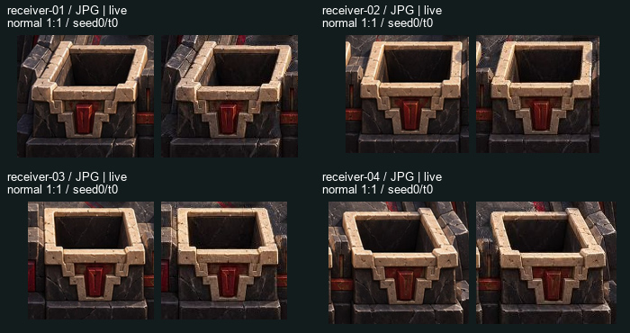

Gold ball — собственный прежний body `bf510895011a6a0a69896003517d242cd5a104e9c1ea37431895ca5bdf196b89`. Новый Dark black-alpha shadow **`f9a91c40b75c08e94f91d0948872050bb3d9bc56a3753cfc99ba21a0d9295887`** проверен как новый материал, не прежний olive. Его bounds/pivot описывают собственную texture: content bounds `[25,113,231,146]`, pivot `[128,129.5]`; placement сохраняет offsetR[-.95,.86], halfsizeR[1.55,.58], opacity.65, native r16/no uplift.

В настоящих normal кадрах gold body контрастен тёмному полу, мягкая малая тень ниже-слева различима, особенно при PartsOFF без теней объектов. В просмотренных кадрах не увидел brightening пола или жёсткого чёрного диска; контакт не заменён статическим shadow metric. В чёрной cavity тень не использована как отдельное доказательство читаемости на полу.

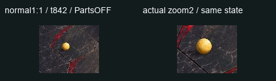

## Реальные corner/front/side и foreground

| Case | Собственные реальные кадры | Вывод в ограниченном охвате |
|---|---|---|
| Pillar02 corner | Seed2 states366–369, event367→state368, normal/detail | Шар действительно частично закрыт краем body; не по прямоугольнику crop. **PASS case.** |
| Pillar02 front | Seed2 states971–974, event972→state973 | Полный шар рисуется перед body в исходном порядке. Potential alpha overlap не выдан за actual hidden/partial proof. **PASS front rendering case.** |
| Pillar04 side | Seed0 states839–842, event840→state841 | Частичное закрытие до смены порядка; в normal явного скачка силуэта841→842 не увидел. **PASS normal-scale case**, см. OBS02. |
| Block02 corner | Ordinary1632614828 states890–892, event891→state892 | Шар полностью закрыт body. Это ожидаемая видимость данного case, **не partial proof**. |
| Outer-left foreground | Seed0 states459–462, event460→state461; paired PartsON/OFF461 | Видна узкая часть шара у guard; при PartsOFF весь шар появляется на том же state/events. **PASS overlap.** |
| Outer-right foreground | Ordinary1632614828 states1512/1514, event1513 | Шар частично закрыт guard. **PASS просмотренного overlap.** |
| Near-platform front | Existing seed2 states1770/1780/1790; paired normal PartsON/OFF1790 | Foreground действительно закрывает sphere; при снятии частей sphere виден на той же native pose. **PASS данного overlap**, не новый gameplay clip. |
| Divider02 | Ordinary1632614828 states1713/1715, event1714 | Малое alpha intersection присутствует около верхнего края; кадры сохранены. Не обобщено на другие контакты/dividers. |
| Divider01/03 | Static whole/source | Qualifying dynamic overlap **UNOBSERVED**. |

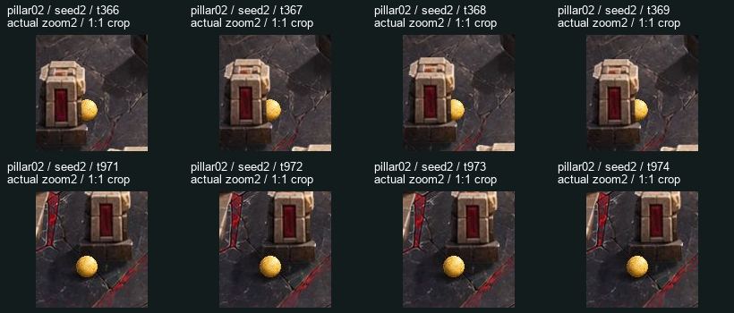

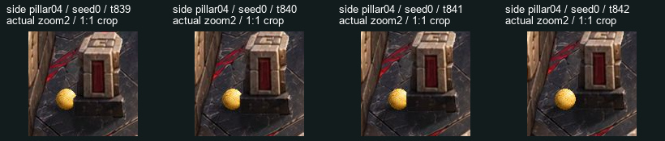

**D-VQA-OBS-02:** на enlarged841→842 видна малая передача видимости у края. Вывод выше относится к читаемости normal кадра; это не утверждение о совершенной per-pixel/per-face глубине во всех позах. Вариант height/per-face sorting не создавался, исходный результат сохранён. Builder percentages не приняты за GPU readback.

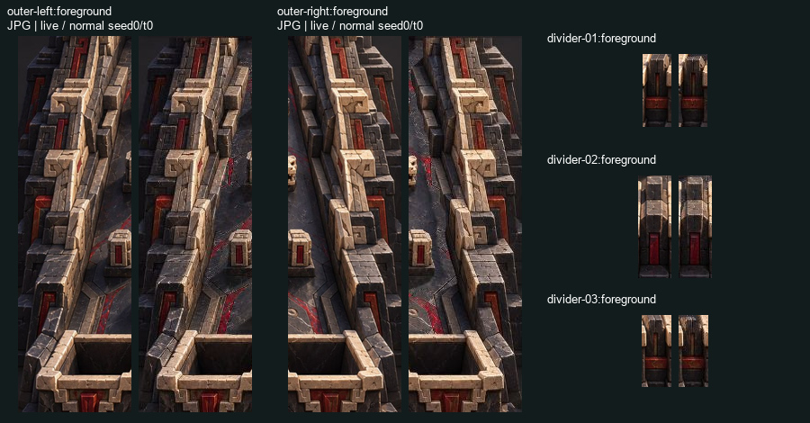

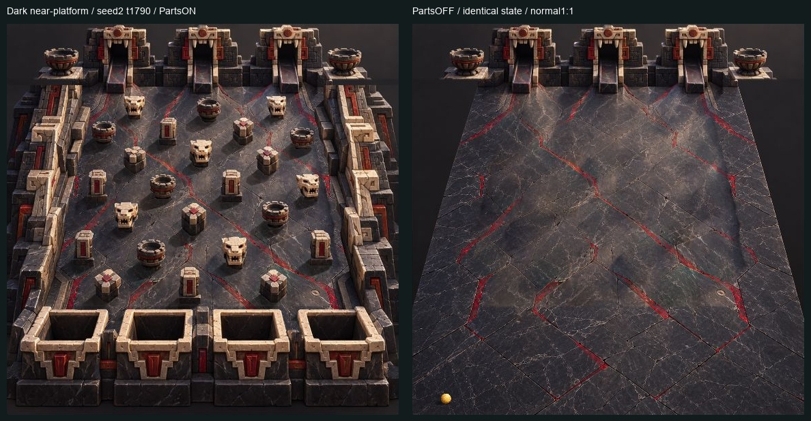

## Receiver01..04: честная граница

| Receiver | Approach / capture | Front-rim |
|---|---|---|
| 01 | **OBSERVED:** seed0 885–888→IN_BUCKET888; seed1 882–884→IN_BUCKET884 | В этих capture windows front alpha не пересекает sphere: **capture-rim UNVERIFIED**. Отдельно **OBSERVED/PASS:** seed2/LOST1744–1750, partial1746/47/48, с paired PartsON/OFF1747. |
| 02 | **UNOBSERVED** в просмотренных сохранённых cases | **UNOBSERVED** |
| 03 | **UNOBSERVED** в просмотренных сохранённых cases | **UNOBSERVED** |
| 04 | **UNOBSERVED** в просмотренных сохранённых cases | **UNOBSERVED** |

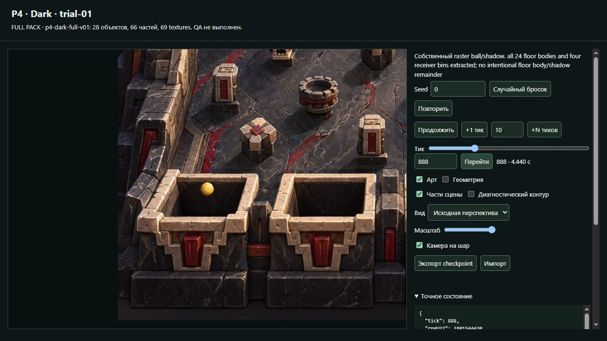

**D-VQA-OBS-03:** rear/cavity остаётся opaque, но штатный receiver-back располагается позади ball. В actual Pixi на888/884 виден полный шар; предположение статического helper о полном скрытии не воспроизвелось. Полностью видимый sphere внутри cavity не засчитан как front partial. По этому замечанию source/native не исправлялись.

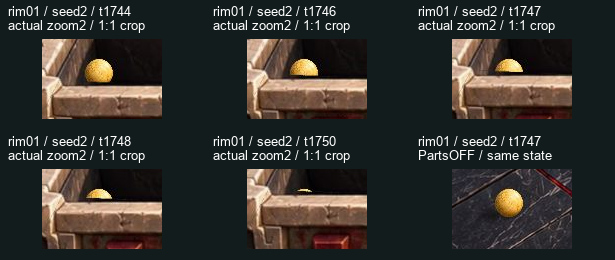

Seed2 остаётся **LOST1812**, без capture данного run. До1744 и в1746–1748 видны последовательные изменения покрытия передним rim; к1750 шар скрыт. Fully hidden frame сам по себе не partial proof. Проценты чужого selfcheck не переписаны как собственная оценка. [Собственный RO source-alpha support](evidence/full-original-01/ALPHA_SUPPORT.json) только дополнение: реальные screenshots и исходный order оцениваются отдельно. Новые winning seeds, удобные позы, sinking после native end и новая geometry не создавались. UNOBSERVED02/03/04 не означает невозможность/unavailable.

## Native observations и UI

State/events/depth/versions прочитаны как **raw DOM JSON TEXT**; `JSON.parse` только в собственной CUA REPL. Full native numeric objects через page-object transport не передавались; исходные UTF-8 bytes/precision/events order сохранены. Округлённый AX Value больших seed не использован как вход. [84 paused captures и strict comparisons](evidence/full-original-01/QA_CHECKS_INDEX.json).

**9 групп** PartsON/OFF, normal/detail, source/native, ArtOFF, повторного seek и +1→974 совпали побайтно по state и ordered events. Краткая draft-проверка: `9→97→973` при live1020/1026/1033, blur1113 сохранил973; Go дал точные собственные state/events973. Manual974/native совпал с Source974. [Raw draft trace](evidence/full-original-01/DRAFT_INPUT_TRACE.json). Это ограниченная VQA-проверка; formal technical closure не заменена.

| Предоставленный ordinary/native seed | Собственный реальный конец | Ordered events |
|---|---|---:|
| 0 | **IN_BUCKET receiver01/888** |12|
| 1 | **IN_BUCKET receiver01/884** |12|
| 2 | **LOST1812**, finalX `32824.3930072` |15|
| 1632614828 | **LOST2323**, finalX `33941.6877261` |26|
| 3207937946 | **LOST2011**, finalX `33716.9911295` |22|

3207937946 — предоставленный уже сохранённый ordinary Builder seed, не новый VQA random. Собственный Play/pause дал133, затем реальные два разрешённых +N1000 довели его до2011/done/LOST. Исторический Builder файл с названием01-new-ordinary-end и ACTIVE73 не использован как outcome; отклонённый +N4000 не повторялся. Все LOST сохранены, matrix/нового native oracle нет. Console errors/warnings0.

## Evidence и сохранность

Own runtime `E:/R4D/perspective/p4-runtime/visual-qa/transfer-water-dark/dark/qa-full-original-01`;84 original paused screenshots. В git32 selected raw screenshots,11 QA contact/reference sheets, raw JSON/metadata всех observations. [SHA-index](evidence/full-original-01/EVIDENCE_FILES.json), [machine-readable result/observations](evidence/full-original-01/RESULT.json). QA sheets — только crop/layout/source references, не изменённый product/art.

Before browser: RAM9.17/31.91GiB, CPU12%, C13.73/D14.61/E9.09GiB free. After: RAM9.07GiB, CPU5%, C13.69/D14.61/E9.04GiB. [Before](evidence/full-original-01/RESOURCE_BEFORE.json), [after](evidence/full-original-01/RESOURCE_AFTER_BROWSER.json). Один own IAB slot, light Pillow, process-local TEMP/TMP на ownE, estimated working set≤0.8GiB. Per-tab peak RSS отдельно не предоставляется; peak собственного shell92.9MiB не выдан за browser peak. E4/2GiB guard не достигнут.

Собственная вкладка закрыта, shared4399/owner38840 не менялся. Dark freeze/native/P1, Water/C1/C2/Jungle bytes сохранены; нет новых approval denials, публикации source/private TS/maps, изменений protected Review/server/nginx/security/global settings. Held ancestry7d2344c/b646d3fe/b6226979/ed62bae3 исключена из собственной QA-ветки. Доставка — только собственный report/evidence. Для общего Art PASS остаются непроверенные receiver02/03/04 cases и явно указанные границы наблюдений.
