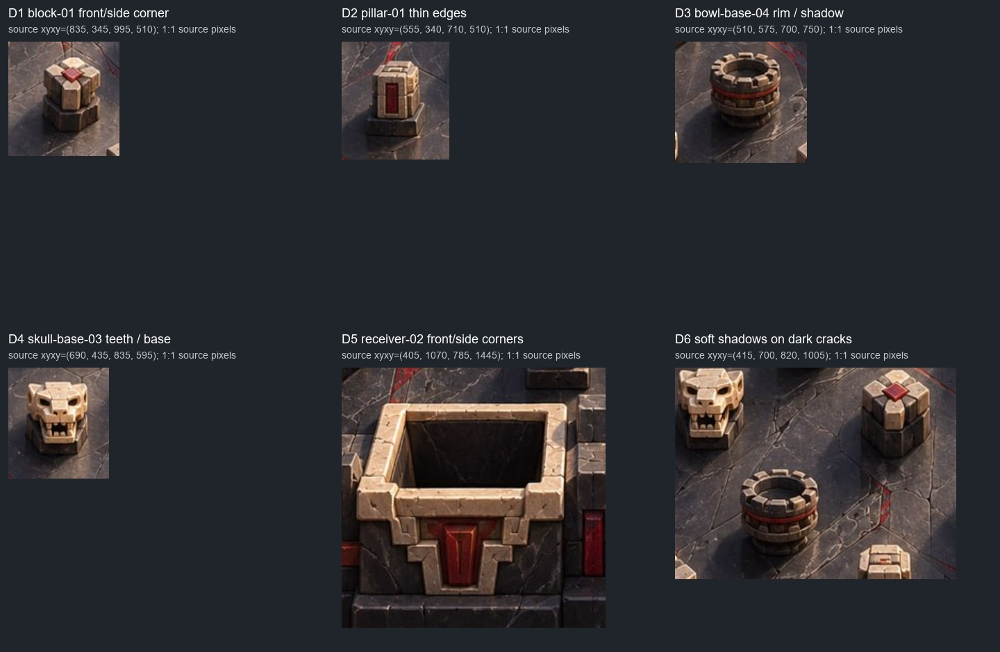
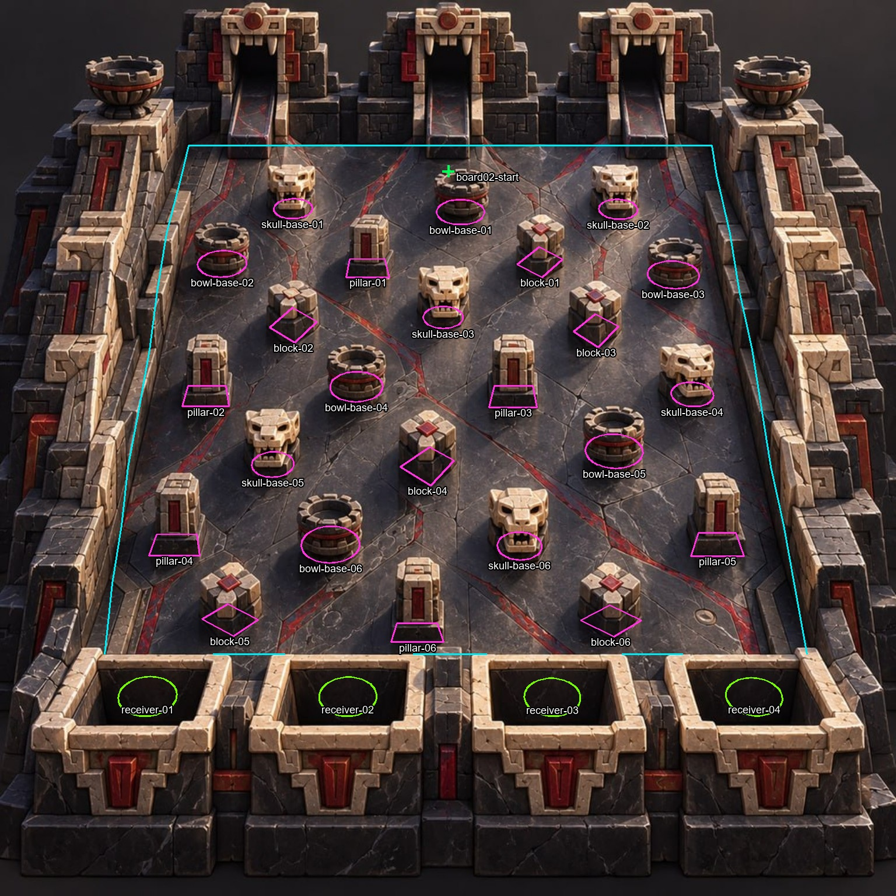

# P4 transfer Dark — source/P1 prep01

30 октября 2026, Europe/Kyiv. Visual QA `visual-qa-r4d-p4-extracted-01`.
**Bindings и source осмотрены. Это prep, не consumer proof и не PASS.**

Действует exact canon `b1382dd4c230815a019e52e2ec4617ef705661d5`:
ORDER, P2-P6-transfer, P4-extracted-objects, P4-transfer-water-dark,
roles/COMMON, roles/visual-qa — прочитаны через read-only source reader.
Transfer-card blob совпал: `0db67e8c3c841ede323a809789f5146ca4f77f11`.
Исходные Jungle RESULT `dac27ef9e25b8576094252e5e5a156120e9750dd`,
freeze/public bytes и PARTIAL/UNVERIFIED сохраняются; их QA не повторялся.

## Независимо проверенный вход

P1 exact **`4b47db04c7140ebf88f69b91faa0b790d46f22ec`**,
**boards/02/trial-01**. JPG прочитан read-only; config/manifest/view-math
извлечены как точные Git bytes, без text re-encode.

| Файл | Bytes | SHA-256 |
| --- | ---: | --- |
| 02-dark-temple.jpg,1536² | 536988 | `7ceff71bd0a871fecd725527dff5522450c8e75a74eb99c107b5d8624bf8fa3a` |
| boards/02/trial-01/config.json | 19508 | `14be2a023833d266d1e333bf582af5fd5885deb445698c10ebd846ef0cc080b2` |
| boards/02/trial-01/manifest.json | 13939 | `3fab422bd1f74d477d1648620c97ad6d7b8b0a55a70a1102d6e6885def564d81` |
| common viewer/src/view-math.mjs | 3050 | `96f01cc2093c353ff958cb906fe0c8ae93412425d0f7a5ec7cca0f2bf9f1aa5e` |

В config: **12 pins,70 segments,4 buckets,1 drop**, 24 objectId:
6 bowl-base,6 skull-base,6 pillar,6 block. r16/tick5ms/quantize7/g980/
maxspeed2000/noise2deg/0.02/lcg32; исходный seed0. Это свойства прочитанного
входа, не запуск. Translation `[33307,33912]`, не Water/Jungle offset.
`board02-start` проецируется в source **(768,293)**.

[INPUT_BINDING.json](evidence/source-prep-01/INPUT_BINDING.json), SHA
`68ebd846a553ea3dbe9ded29c5dcc852e3bd64611405743997624fb8f8ca88c4`.
Runtime inputs:
`E:/R4D/perspective/p4-runtime/visual-qa/transfer-water-dark/dark/inputs/`.

## Конкретные риски и ID

| Case | ID / source ориентир | Что увидеть в реальной сборке/движении |
| --- | --- | --- |
| D1: угловой блок | `block-01`, ground bbox886..965×424..475; ROI(835,345,995,510). Дополнительный ближний `block-04`, bbox687..778×766..832 | Передняя и боковая грань/угол при частичном пересечении силуэта. Не засчитать единственный фронтальный hit за проверку обеих граней; обратить внимание на скачок draw order около угла. |
| D2: высокая тонкая фигура | `pillar-01`, ground bbox593..668×443..475; ROI(555,340,710,510) | Светлые тонкие кромки, красная вставка, основание и боковина; нет светлого ореола/чёрной бахромы после alpha и нет исчезновения шара по crop rect. |
| D3: полая чаша-препятствие | `bowl-base-04`, ROI(510,575,700,750); остальные bowl-base01..06 аналогично | Зубцы обода и тёмная внутренняя поверхность сохранены, частичное скрытие у реального силуэта. Эти чаши — native pins, **не goal receivers**. |
| D4: мелкие светлые детали | `skull-base-03`, ROI(690,435,835,595) | Не потерять зубцы/края/полости и не считать всякую чёрную область прозрачностью. Сопоставить голову и реальное основание, а не коллайдер по всей верхушке. |
| D5: прямоугольный приёмник | `receiver-02`, center≈(596.4,1193.9); ROI(405,1070,785,1445) | Подход/capture и actual overlap с передним ободом/боковым углом. Сфере целиком внутри отверстия нельзя присвоить partial-rim PASS. |
| D6: тени и cleanup тёмного пола | Зона `block-04`, `skull-base-05`, `bowl-base-06`; ROI(415,700,820,1005) | Мягкая тень шара различима на тёмном камне без светящейся каймы/чёрного диска. Удаление прежних тел/теней сохраняет красные трещины, фактуру и цельность пола. |

Source координаты — ориентиры для наблюдения, не новые placement anchors.
У `block-NN`/`pillar-NN` реальные native IDs `...:edge-01..04`.
Все24 семейства и нижние4 goal triggers видны на статическом наложении:

Magenta — реальные pins/предметные segments, cyan — стены/разделители,
green — drop/buckets. Проекция взята из собственного Dark manifest;
контуры не подогнаны к арту. Подписи — только метки, не anchors.

## План наблюдения для последующего Dark handoff

1. Один exact local candidate с art manifest/bytes; затем один named freeze
   с тем же artifact SHA, который получит TQA. P4 из исходных RGB, alpha,
   локального скрытого пола и частей сохраняется исходным вариантом метода.
2. Контрольный обычный source whole-view: viewport1280×720,DPR1,
   ArtON/GeometryOFF, без follow/crop. При прежнем framing это574²;
   записать фактический canvas/fit/zoom. Крупные кропы — дополнение к нему.
3. PartsOFF с сохранённой plate: тела и их прежние тени удалены, тёмные
   копии/пятна не скрыты тем, что их трудно отличить от пола; красные жилы
   не обрываются прямоугольной заплатой. Далее обычный собранный кадр с
   читаемой отдельной shadow шара и согласованными тенями препятствий.
4. Для ordinary run, действительно коснувшегося `block-01` или `block-04`,
   получить до/во/после actual silhouette intersection у передней/боковой
   грани и угла. `pillar-01` и один bowl/skull дадут иной силуэт. Назвать
   seed/tick/event/objectId/actual part IDs; недостигнутую грань отметить
   not-observed, а не переставлять старт/коллайдеры.
5. У receiver-01..04 отдельно фиксировать approach/capture/front-rim.
   Обычный LOST/near-miss может показать rim overlap: сохранить его как
   промах и различать с capture. Проверить передний и боковой обод только
   там, где шар реально пересёк их силуэты; никакого sinking после native end.
6. В том же paused state снять Art+Geometry и ArtOFF/GeometryON: геометрия
   и путь открыты без масок, view/zoom/camera не меняют state/PRNG/events.
   Source/native используют профиль Dark, не числа Water/Jungle/P0.

Чёрный пол и сильная нарисованная тень здесь — отдельная трудность переноса.
Сам факт подключения shadow PNG или прежний Jungle PASS её не закрывает.
Решение по softness/свету/резкости принимается по реальной сцене. Изменение
метода sorting/подготовки, если понадобится, должно остаться отдельным named
вариантом после сохранения исходного переноса; здесь его не проектировал.

**Сейчас:** native/browser/consumer не запускались, настоящих seed/tick
примеров Dark не назначено. Нельзя утверждать доступность конкретного угла
или корзины по этой статике. Следующий вход — handoff реального кандидата;
до него активно не ожидаю и не начинаю новую seed/native matrix.

Перед лёгкой подготовкой: RAM11.03/31.91GiB free,CPU19%/24logical;
C/D/E15.70/14.65/9.78GiB free, с учётом второго активного слота.
Собственный дополнительный пик bitmap/overlays оценочно <0.15GiB; файлы
пишутся только в свой board runtime и завершённую собственную QA область.
Исходник/канон/старый Jungle/held payload и чужие checkout не изменялись;
private native source и чужие методы/выводы не читались.
