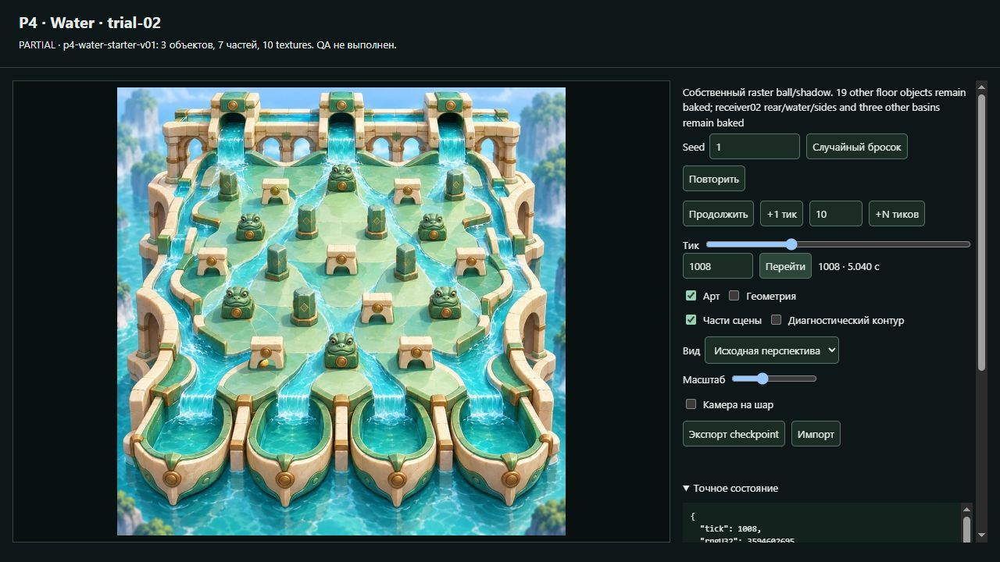
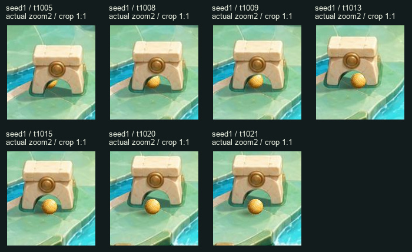
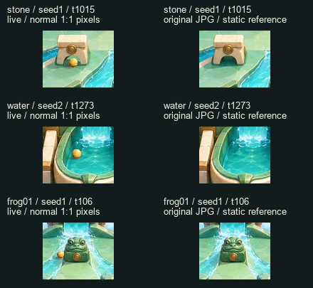
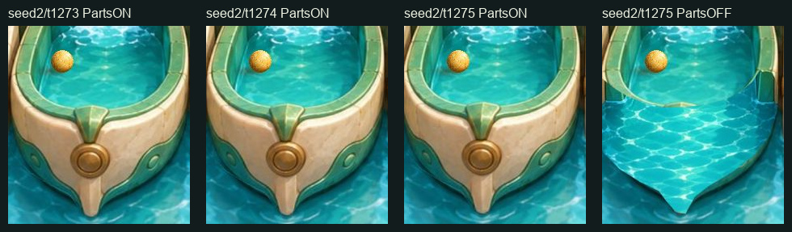

# Water starter original · независимый ранний Visual QA

**PARTIAL.** Видимая сборка выбранных трёх объектов, вырезки, тени и существующий проход `arch-07` — **PASS в описанном охвате**. Перекрытие шара передним ободом `receiver-02` — **UNVERIFIED**: на предоставленных обычных состояниях силуэты фактически не пересекаются. Новых блокирующих художественных FAIL в проверенном составе не найдено. Полный Water/Dark Art PASS не выдаётся.

Это первый actual consumer review данного Water-пакета; source prep `cc1fa56cc94982b47c6e0314b3039a5328b8b458` не использован как доказательство PASS. Самопроверки Builder и предварительные alpha-проценты не заменяют наблюдения ниже.

## Замороженная цель и границы

| Поле | Проверенное значение |
|---|---|
| Candidate | `water-starter-original-p4-candidate-01` |
| artifact.json actual SHA256 | `ee363d7e8dcaf555fcc06ebe1d42e695834ff003b9d50005b03ef1ada557aaee` |
| payloadRoot SHA256 | `dee951ddd007ff3313176de1ab9d8dcad7268780beb9987fd4d009b9ff6bc1e9` |
| artworkRoot SHA256 | `7ea0e79e36a0779d1a800af8127295f6d721cb65d8a4314f155a6783bb367bed` |
| app.js actual SHA256 | `9f0780a4f5039dc91c4c5a9c69eb040dc4df099ccdcc439e5910fd954af409b6` |
| native-runtime.js actual SHA256 | `8843446996582eaccbd9ff63d3147d74b7eca9a614d8e0df16851d1d89d46f50` |
| Art manifest actual SHA256 | `9b67bdec90fe37f24e5bc182064331d96e847316a19b832e581a740dcd4095f6` |
| Artist commit | `0d7ac6e6934d30a8f149124b1129036287d8baa4` |
| Builder commit | `b646d3fe948d2c7e80f0a4a90fed4d318f56f654`, LOCAL_HELD |
| Preview | `http://127.0.0.1:4395/` |

Frozen root: `E:/R4D/perspective/p4-runtime/builder/transfer-water-dark/water/candidates/water-starter-original-p4-candidate-01`. Artist manifest: `experiments/p4-extracted-objects/transfer-water-dark/water/artwork/starter-v01/manifest.json`.

Независимо пересчитаны все 79 file SHA на диске и через HTTP, actual SHA artifact и оба root digest: JSON массивов file records с сортировкой по `file`, без дополнительных пробелов. Все совпали. Проверены принятые Water04/trial-02 config `9048b28af2923c93d8be772367beeb828f1e4513a6298af1c803379f77d3e50c`, P1 manifest `48c4fef26fd8c94f06c278851222ef285edda54ac14e53da8908f4ee663dc420` и JPG `8da65c76c110b6ba7cefe113564fe12feed4428e84e84835f033e7da31d3b80d`. [Полная identity](evidence/early-starter-original-01/identity.json).

Состав: background + 7 частей + собственные переиспользованные raster ball/shadow = 10 runtime textures; `sceneParts=0`. `arch-07` имеет две опоры, lintel и ground-shadow; `frog-01` — body и ground-shadow; `receiver-02` — только front. Его rear/water/sides остаются baked; второй rear не добавлен. Остальные 19 floor objects, три других receiver и scene ещё baked. PartsOFF здесь показывает три локально очищенных региона, а не полный clean floor. `restoration-regions.png` не считается игровой mask.

## Наблюдение в настоящем consumer

Своя скрытая IAB-вкладка, viewport **1280×720, DPR1**, canvas **840×590**. Обычный режим: source, zoom1, no-follow, ArtON/GeometryOFF/PartsON. Полная картинка **574×574**, fit `0.3736979166666667`; detail — штатный zoom2/follow, fit `0.7473958333333334`. Размер viewport не менялся.

| Проверка | Наблюдение | Статус |
|---|---|---|
| `arch-07:left-support`, `right-support`, `lintel` | Исходный cream/gold материал, чёткие края; проём прозрачен. Нет прямоугольного обрезания шара по crop. На t1005/1008/1009 видно настоящее частичное закрытие входящего шара; на t1013 — край правой опоры. | PASS, seed1 |
| Прежний sorting арки | Все три body части сохраняют `sortNativeY=34755.12349268705`. На t1013 ballY=`34748.608067`, на t1015=`34756.6559934`: исходный переход за/перед аркой не даёт заметного скачка силуэта. Шар проходит открытый проём и выходит на t1021. | PASS, этот original-method case |
| `frog-01:body` | Глаза, зубцы верхнего контура и нижний край сохранены; тёмной/светлой внешней каймы и второго baked body не видно. Seed1 t104 → +1 → +1 → t106, затем t110 показывают естественный боковой контакт. | PASS |
| Ground shadows арки и frog | В PartsON тела стоят на поверхности, тени направлены согласованно с исходной сценой. PartsOFF убирает выбранное тело и его старую тень; явного дубля не остаётся. Включённая сборка не показывает заметного шва очищенного пола. | PASS, три локальных региона |
| Ball/body/shadow | Amber/gold читается на jade stone и cyan water; направление блика совместимо с исходным освещением. Мягкая тень ниже-слева различима; на фактурной воде она слабее, чем на камне. Увеличение не заменяет оценку обычного 574² кадра. | PASS, проверенные кадры |
| `receiver-02:front`, статическая сборка | Cream/green контур, медальон и остриё сохранены. В PartsON нет явной cyan-каймы или дублированного rear. Удалённый front в PartsOFF не принят за полный восстановленный бассейн. | PASS, только видимая сборка |
| `receiver-02:front`, перекрытие шара | На seed2/t1273–1275 шар целиком виден над водой. Front alpha равна 0 даже во всём прямоугольнике ball texture, включая её прозрачный padding. Фактического пересечения силуэтов нет. | **UNVERIFIED** |

Для арки просмотрены обычные целые кадры t1005,1008,1009,1013,1015,1020,1021 и detail тех же точек. Native foot events остаются `1006 → state1007`, `1012 → state1013`, `1018 → state1019`; это опоры `left-foot:edge-01`, `right-foot:edge-04`, `left-foot:edge-02` соответственно. Проход не выдан за доказательство новых lintel/collapse colliders. Изменять высоту или sorting по этому случаю оснований не найдено; метод не менялся.

Этот лист сохраняет 1:1 pixels обычных screenshots. Правая колонка — только статический исходный JPG, не другой native run. Отдельно побайтно по RGB декодированных пикселей проверено, что все пять body/front частей при любом alpha>0 совпадают с соответствующим crop исходного JPG: максимум разницы **[0,0,0]**. Это дополнительная проверка сохранности материала, не замена оценки краёв. [RGB checks](evidence/early-starter-original-01/source-rgb-checks.json).

### Receiver-02: граница доказательства

Через реальные +1 tick получен **IN_BUCKET receiver-02/t1275**; события `bucket_entered → ball_finished → run_finished` сохранены в исходном порядке. Это подтверждает native capture, но не художественное перекрытие ободом. Дополнительная RO alpha-проверка дала max0 для front во всём ball texture bounds: t1273 `[504,1157,553,1206]`, t1274 `[508,1160,556,1208]`, t1275 `[511,1162,560,1211]`. Crop overlap из DOM depth поэтому не использован как PASS. [Alpha support](evidence/early-starter-original-01/alpha-support.json).

**W-VQA-START-01 — UNVERIFIED:** part `receiver-02:front`, seed2, ticks1273–1275, screenshots выше. Причина — отсутствие фактического alpha intersection до native finish, а не выявленный плохой контур. Для закрытия понадобится настоящий случай пересечения в новом согласованном freeze/полном pack. Движение после native end, fake sinking и поиск удачного нового seed не выполнялись.

## Native observations и обычные результаты

Native state/events/depth/versions прочитаны как **сырые DOM JSON strings**; `JSON.parse` выполнен только в собственной CUA REPL. Full native numeric objects через page-object transport не возвращались. Сохранены исходные UTF-8 text bytes и их SHA. Например, event1006 содержит x=`33006.02589354972`, y=`34723.796488422486`; event1012 — timeSec=`5.0600000000000005`. Значения и порядок событий не сокращались ради сравнения. Числовое AX Value для большого seed может округляться; raw DOM input/state сохранили именно **2771772266**.

Пять групп сравнения имеют побайтно одинаковые raw state и ordered events: PartsON/OFF при t1008; +1/seek/detail/source/native/ArtOFF при seed1/t1009; pause после Play и новый seek при t1098; receiver PartsON/OFF/normal при seed2/t1275; frog PartsON/OFF при seed1/t106. [Индекс captures и точных сравнений](evidence/early-starter-original-01/QA_CHECKS_INDEX.json).

Настоящий Play от t1005 продвинул UI до t1048, отдельное live DOM наблюдение — t1061, пауза — t1098. Live screenshot `16-live-play-seed1-after-t1005` **не привязан к точному тику**: во время screenshot run продолжался. Он не используется как paused-frame evidence. Состояние паузы t1098 совпало с новым seek по всем raw state/events bytes.

| Существующий обычный seed | Независимо полученный конец | Ordered events |
|---|---|---:|
| 1 | **LOST / t1196**, finalX `33728.1429454` | 13 |
| 2 | **IN_BUCKET receiver-02 / t1275** | 20 |
| 2771772266 | **LOST / t1100**, finalX `32096.5552585` | 14 |

Новая native prep/матрица seed не запускалась. Броски не подбирались под красивый capture. Console warnings/errors: **0** в собственной вкладке. Это визуальный review и ограниченные проверки связности observations, не подмена независимого TQA.

## Evidence и сохранность

39 raw screenshots и 38 paused captures находятся в собственной runtime-директории `E:/R4D/perspective/p4-runtime/visual-qa/transfer-water-dark/water/qa-early-starter-original-01`. В git сохранены 16 выбранных исходных screenshots, QA contact sheets и raw JSON/metadata всех наблюдений. [SHA-index сохранённых evidence](evidence/early-starter-original-01/EVIDENCE_FILES.json). Contact sheets — только crop/компоновка screenshots и помеченных source references; product/art PNG не изменены.

Перед браузером: RAM free10.89/31.91GiB, CPU15%, C14.83/D14.64/E9.57GiB free. После: RAM10.31GiB, CPU2%, C14.16/D14.64/E9.54GiB. [Resource guard](evidence/early-starter-original-01/RESOURCE_GUARD.json). Использованы собственные process-local TEMP/TMP, один IAB tab и лёгкий Pillow QA. Собственная вкладка закрыта; сервер PID8572 не останавливался и не менялся.

Frozen payload/art/source, Jungle и Dark не менялись; native не строился; protected Review/webroot/nginx не затронуты. Новых approval denials не было. Оба held Builder commits `7d2344c1a8959f73ff26af5d3aba7dd02eb0e971` и `b646d3fe948d2c7e80f0a4a90fed4d318f56f654` проверены как не входящие в ancestry собственной QA-ветки. Доставка содержит только собственный отчёт/evidence. Полный Water pack, другие арки/receiver и Dark требуют отдельного frozen target.
