# Water full original · независимый Visual QA

**FAIL. Полный художественный PASS кандидату не выдан:** открыты **VQA-WF-01/02/03** — тон/фактура восстановленной воды, жёсткие грязные тени чаш и отверстия alpha во внутренних стенках receiver. Работа native и успешные отдельные перекрытия эти дефекты не закрывают.

Проверен полный пакет впервые в настоящем consumer. Прежний partial PASS C1 и source prep не перенесены на этот результат. Новый исправленный пакет должен иметь отдельный freeze и пройти повторную QA.

## Точная цель

| Поле | Проверенное значение |
|---|---|
| Candidate | `water-full-original-p4-candidate-01` |
| artifact.json actual SHA256 | `12c5f6a96a1c2c7571b13c303ffca0da4e84676916edd21fd1ddd87c39758a6c` |
| payloadRoot SHA256 | `be302ce69e86ca2f0ca73b2ee7143440013ee0c6dd077bef0d78e5e18d72d59c` — 206 files |
| artworkRoot SHA256 | `51b0ee67d078ad7d6da71077f624b8e9de758af78400c6718fdf271789d63332` |
| app.js actual SHA256 | `96ddc0443f311dd46f7f07b287171118608a583f0fd26416dbaa18ad8c8e84d0` |
| native-runtime.js actual SHA256 | `8843446996582eaccbd9ff63d3147d74b7eca9a614d8e0df16851d1d89d46f50` |
| Art manifest actual SHA256 | `f1cdda7a9cf4865e5ece6893eaa5f6c7214e2d29c4a0bafa52f276b6d4a34a23` |
| Artist | `f973db5b20a99eb241a88c677b1b83ed307e1eaf` |
| Builder | `b6226979df39662e745e8636553019fae14fa19e`, clean/LOCAL_HELD |
| Preview | `http://127.0.0.1:4398/` |

Frozen root: `E:/R4D/perspective/p4-runtime/builder/transfer-water-dark/water/candidates/water-full-original-p4-candidate-01`. Independently verified actual artifact SHA, all206 disk/HTTP file SHA and both root digests, using the declared sorted file-record JSON rule. [Identity](evidence/full-original-01/identity.json).

Accepted Water04/trial-02 only: P1 `4b47db04c7140ebf88f69b91faa0b790d46f22ec`; config `9048b28af2923c93d8be772367beeb828f1e4513a6298af1c803379f77d3e50c`; P1 manifest `48c4fef26fd8c94f06c278851222ef285edda54ac14e53da8908f4ee663dc420`; JPG `8da65c76c110b6ba7cefe113564fe12feed4428e84e84835f033e7da31d3b80d`. Native reuse remains Core `5a6fa03f1cdb3de88a2d9c7dbe795eb8e2a7f023`, package tree `008d16a80a26bb77d562a45218b01da09b0d9ff0`. No new native build/prep, geometry, radius, drop, PRNG, H, height or sorting.

Full coverage:25 objects =21 floor+4 receivers;70 object parts+5 fixed scene parts=75;78 runtime textures. All78 browser-reported dimensions independently match decoded PNG dimensions. [Loaded assets raw DOM](evidence/full-original-01/LOADED_ASSETS.raw.json), [dimension checks](evidence/full-original-01/LOADED_DIMENSIONS_CHECK.json). Worker-response hash remains **UNVERIFIED**, separately from disk/HTTP hashes and observed dimensions. Unsupported Target.setAutoAttach was not attempted or replaced by another actor/transport.

## Whole-view и открытые дефекты

Своя IAB tab; **1280×720, DPR1**, canvas **840×590**, full board **574×574**, source zoom1/noFollow/ArtON/GeometryOFF/PartsON; actual fit `0.3736979166666667`. Detail uses штатный zoom2/follow, fit `0.7473958333333334`. Viewport не увеличивался.

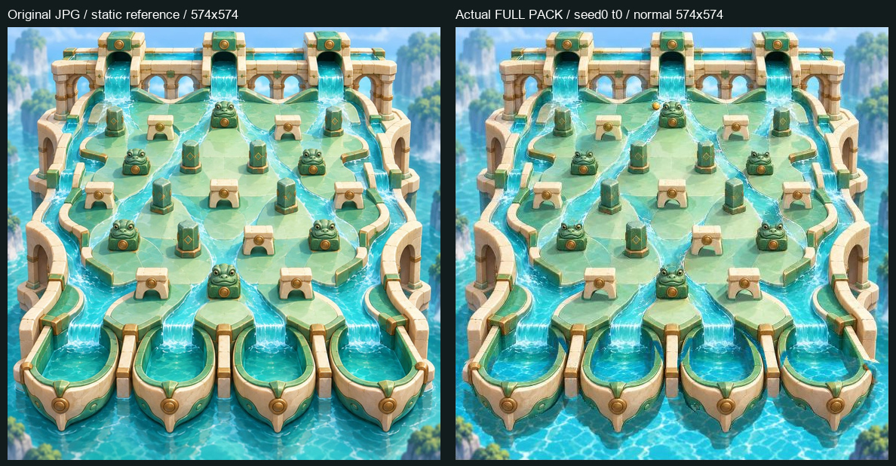

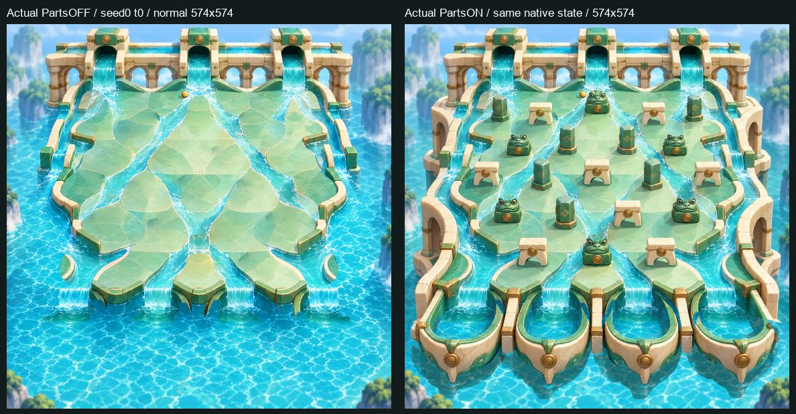

| ID / статус | Part / source ROI / настоящий repro | Наблюдение и полезная поправка |
|---|---|---|
| **VQA-WF-01 — FAIL** | `background.png`; ROI `[0,1188,1536,1536]`; seed0/t0, normal01/02; также visible в detail seed2/t1275 | Нижняя восстановленная вода намного ярче, с более резкой и контрастной caustics-фактурой, чем исходная сцена. В обычном целом кадре она выглядит другим материалом; вместе с отдельными тенями делает нижнюю полосу пятнистой. Согласовать низкочастотный тон, насыщенность, фактуру и переходы water repairs с исходной водой, сохранив извлечение объектов. |
| **VQA-WF-02 — FAIL** | `receiver-01..04:ground-shadow`; показательные нижние ROI:02 `[505,1480,665,1503]`,03 `[880,1480,1030,1503]`; normal seed0/t0, detail seed2/t1275 и seed1/t1125 | Под чашами видны серо-грязные тёмные пятна с жёсткими угловатыми краями и плоским нижним срезом. На новой яркой воде они особенно оторваны от окружения. Переработать силуэт, мягкость, falloff и цвет отдельной ground-shadow относительно исправленного фона. |
| **VQA-WF-03 — FAIL** | Минимальный repro `receiver-02:rear`, также видимый дефект03; source ROI02 `[690,1080,740,1210]`; seed2/t1275, normal20/detail21 | Cyan вода проступает клиньями через структурные внутренние боковые стенки. В source point `(720,1115)` исходный RGB `(144,165,109)`, но alpha и rear, и front равна0; других body/foreground owners там нет. Восстановить alpha ownership стенки, сохранив source RGB и exclusive rear/front; вода чаши должна оставаться прозрачной там, где действительно вода. При правке силуэта также проверить мелкие края зелёного рельефа. |

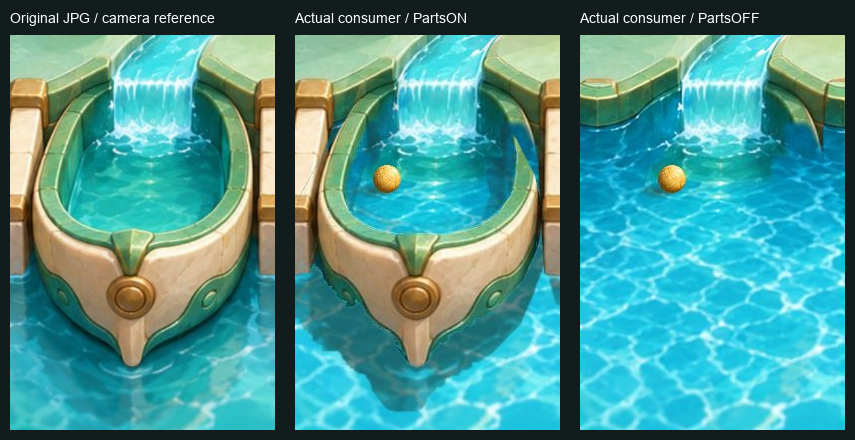

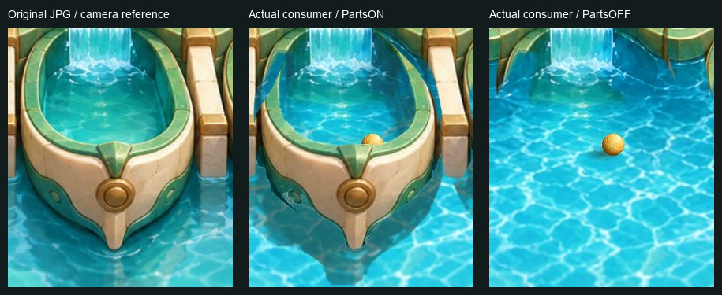

[Machine-readable findings](evidence/full-original-01/FINDINGS.json), [точка ownership WF03](evidence/full-original-01/WF03_OWNERSHIP_POINT.json). Камерные reference — преобразованный исходный JPG для сравнения, а не второй native run или Artist preview. Основное доказательство дефектов — реальные normal/detail screenshots.

Первоначально отмеченную прямую линию пола около arch04 сверил с исходником: она присутствует в JPG и **не получила отдельный FAIL**. [Сравнение](evidence/full-original-01/floor-arch04-actual-source-detail.jpg). В PartsOFF видны восстановленные тональные участки, но прямые исходные границы плит не приняты за новые прямоугольные швы. Явных оставшихся тел/старых теней21 floor objects в этом режиме не обнаружено. Низкие environmental banks, interior water, channels и дальняя архитектура остаются по контракту; floating bank fragments при PartsOFF не засчитаны за baked receiver walls. Declared remainder0 не использован как доказательство clean-quality PASS.

## Семейства и реальное движение

Все21 floor objects и5 fixed parts просмотрены в целом normal-кадре, сравнены по source references и нужным details. У50 видимых body/front/rear/scene PNG максимальная RGB-разница с исходным JPG при любом alpha>0 равна `[0,0,0]`. Это подтверждает сохранность RGB, но **не правильность alpha**, как показывает WF03. [RGB checks](evidence/full-original-01/source-rgb-checks.json).

| Семейство | Наблюдение | Ограниченный результат |
|---|---|---|
| Arch01..08 | Whole normal/source atlas; реальные seed0 arch04 states696–700, event697→state698; seed1 arch07 t1005,1008,1009,1013,1015,1020,1021 | В просмотренных cases проём прозрачен; supports/lintel действительно частично закрывают шар, прямоугольный crop его не обрезает. Original nativeY order не даёт заметного скачка в этих окнах. **PASS cases04/07**, не все возможные проходы. |
| Frog01..06 | Source-style лица/глаза/верхний контур видны в normal; frog01 seed0 t104–110, event105→state106 | Боковой контакт/перекрытие читается, дубля baked body и светлой внешней каймы в просмотренных кадрах нет. **PASS данного case/видимой сборки.** |
| Pillar01..07 | Читаемые верх/бок/основание, отдельные тени; pillar05 seed1 t709/t711, event710→state711 | Реальная часть шара скрывается за телом у контакта, без заметного crop/pop. **PASS данного case/видимой сборки.** |
| Receiver01..04 | Все четыре normal, matched source/detail | Художественное качество **FAIL WF01/02/03**. Успешные rim-cases ниже не закрывают эти defects. |
| Outer-left/right foreground | Seed1/t518–520 и seed0/t1037–1039; paired normal PartsON/OFF при520/1039 | Шар действительно закрыт alpha архитектуры и появляется при PartsOFF при том же state/events. **PASS этих overlaps.** |
| Divider01/03 | Seed2/t1081–1083, seed0/t1121–1123 native contacts | В этих позах actual body alpha с divider не пересекается; crop/contact не засчитаны за visual overlap PASS. |
| Divider02 | Whole normal/source comparison | Видимая статическая сборка просмотрена; qualifying dynamic overlap **UNOBSERVED**. |

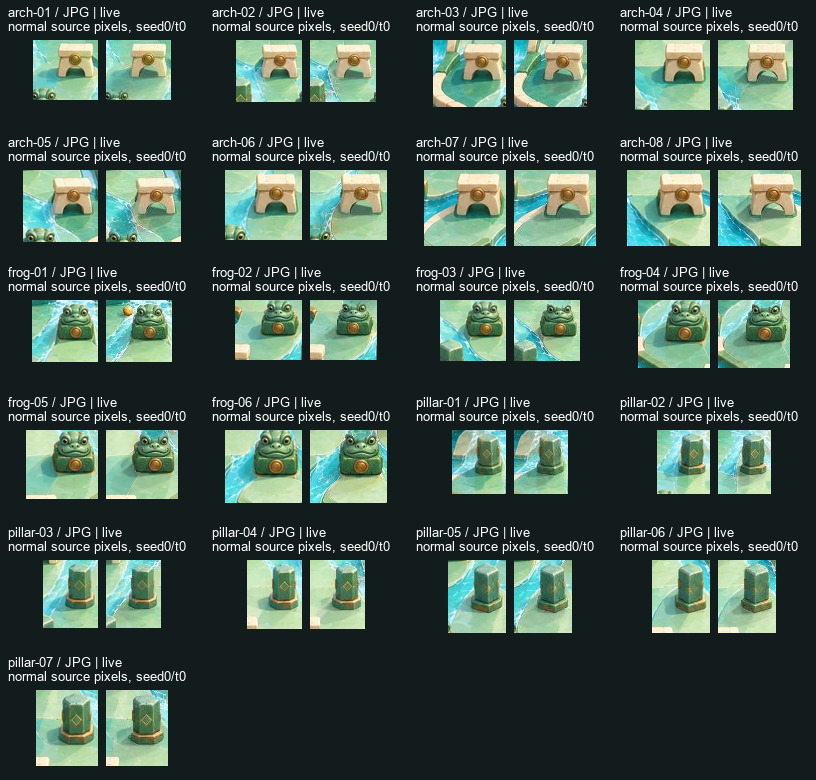

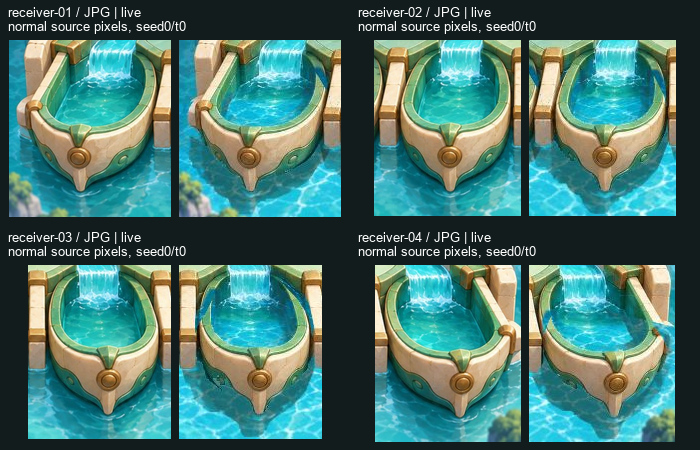

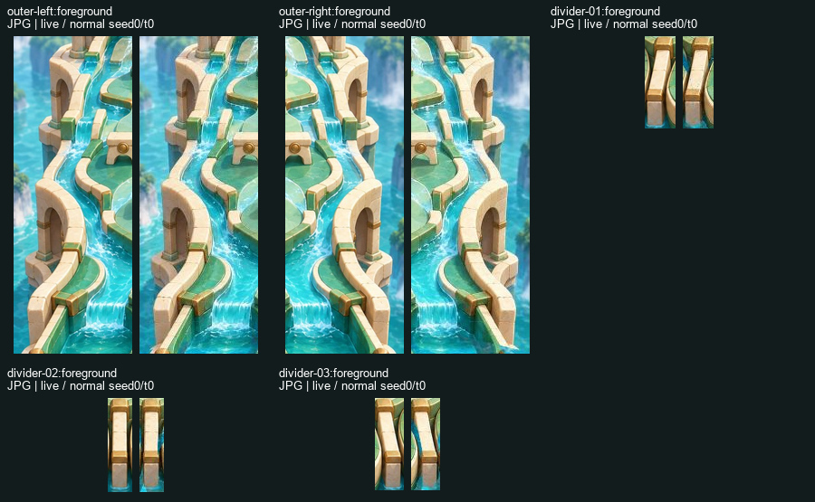

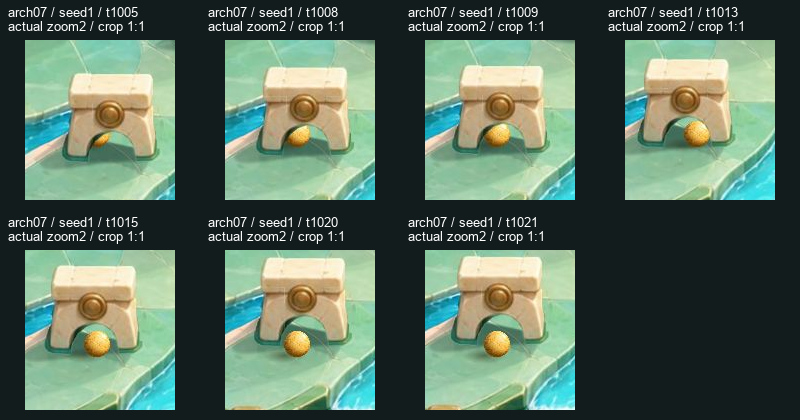

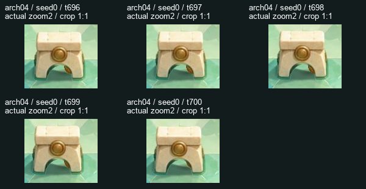

Сортировка частей arch07 остаётся общей `34755.12349268705`; изменение метода не потребовалось для просмотренного прохода. Положительное заключение об этих частных overlaps не расширено на все высоты/грани/арки. Gold ball/body читается на stone и water, направление блика совместимо с исходным светом; мягкая ball-shadow ниже-слева видна в normal кадрах. Открытый WF02 относится к большим отдельным теням receiver, а не к подмене ball radius или PRNG.

## Receiver: observed / unobserved

| Receiver | Approach / capture | Front-rim, реальная alpha | Граница вывода |
|---|---|---|---|
| 01 | **UNOBSERVED** в просмотренных сохранённых cases | **UNOBSERVED** | Не доказана невозможность; нового удобного seed/позы не создавалось. |
| 02 | **OBSERVED**, seed2/1273–1275, **IN_BUCKET1275** | В этом capture-окне alpha intersection0: **UNVERIFIED для capture-rim**. Отдельно **OBSERVED/PASS** на seed0/LOST:1246→1250/1252 partial→1262 hidden→1281/1282 exit | LOST-rim не выдан за capture. Общий seed0 всё равно LOST1326. |
| 03 | Видимое пересечение bowl/front на seed1/1120–1146; native capture **UNOBSERVED** | **OBSERVED/PASS**:1124/1125/1126 partial,1135 hidden,1145/1146 exit; paired PartsON/OFF при1125 | Seed1 остаётся **LOST1196**. Ни fake sinking, ни продолжение после native end не добавлялись. |
| 04 | **UNOBSERVED** в просмотренных сохранённых cases | **UNOBSERVED** | Не заявлена невозможность и не выдан PASS. |

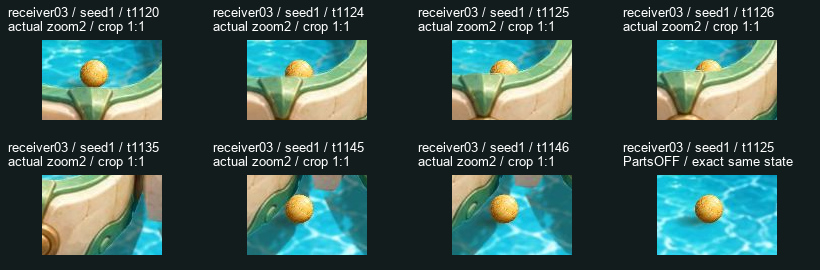

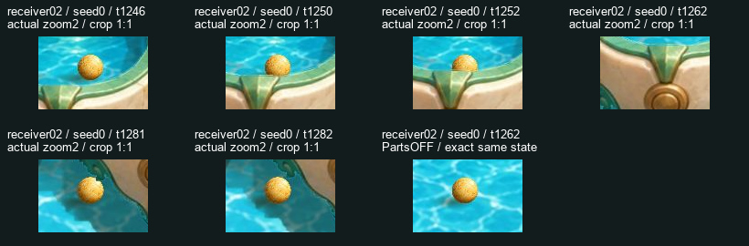

Окна этих existing runs — test inputs, включая присланное позднее окно seed0/receiver02. Вывод сделан по собственным actual кадрам. Builder/TQA percentages не приняты за GPU readback. [RO source-alpha support](evidence/full-original-01/ALPHA_SUPPORT.json) только дополняет видимые кадры: actual mask intersection для rim02/03 есть, для seed2 capture1273–1275 и приведённых divider contacts — нет. Полностью скрытый шар и полностью видимый шар в отверстии сами по себе partial proof не заменяют. Сохранённые0/1/2 не сканировались новым native oracle/матрицей; UNOBSERVED не означает unavailable/impossible.

## Native observations, UI и сохранённые исходы

Сырые DOM JSON **TEXT** state/events/depth/versions переданы строками и `JSON.parse` выполнен только в собственной CUA REPL. Полные native numeric objects через page-object transport не передавались. Raw UTF-8 bytes, полная precision и порядок events сохранены. Например, event1006 x=`33006.02589354972`, y=`34723.796488422486`; event1012 timeSec=`5.0600000000000005`. Округлённый AX Value больших seed не использован как исходный seed.

**8 групп** PartsON/OFF, normal/detail, source/native, ArtOFF и повторного seek совпали по raw state и ordered-events bytes. Три сравнения с прежними **собственными** native observations C1 (1009, +1→1010, seed2 capture1275) также совпали; это не перенос художественного C1 PASS. [89 captures и точные сравнения](evidence/full-original-01/QA_CHECKS_INDEX.json).

Краткая проверка C2 draft на этом full artifact: во время Play введены `1→10→100→1009` при actual ticks1050/1060/1066/1073; blur через Geometry оставил draft1009 при1160. Go остановил на1009; state/PRNG/events совпали с независимым1009. Source/native/Art/Geometry и manual +1→1010 проверены. [Raw draft trace](evidence/full-original-01/DRAFT_INPUT_TRACE.json). Это ограниченная проверка VQA, formal technical closure остаётся отдельной TQA.

| Предоставленный обычный seed | Собственный реальный конец | Ordered events |
|---|---|---:|
| 0 | **LOST1326**, finalX `32866.4825074` |14|
| 1 | **LOST1196**, finalX `33728.1429454` |13|
| 2 | **IN_BUCKET receiver02/1275** |20|
| 3009470305 | **LOST1429**, finalX `33592.6385901` |10|
| 2771772266 | **LOST1100**, finalX `32096.5552585` |14|

Seed3009470305 — уже сохранённый ordinary Builder run, а не новый VQA random seed. Дополнительно реальный Play/pause на нём дал paused129. Все LOST сохранены; нового success-hunting нет. Console warnings/errors0 в собственной вкладке.

## Evidence, ресурсы и доставка

Own runtime: `E:/R4D/perspective/p4-runtime/visual-qa/transfer-water-dark/water/qa-full-original-01`. Все89 screenshots — paused, state-bound. В git сохранены34 selected original screenshots,12 QA contact/reference sheets и raw JSON/metadata всех89 observations. [SHA-index](evidence/full-original-01/EVIDENCE_FILES.json). QA images — только crop/layout/помеченные source references, не изменённый product/art.

До browser: RAM10.08/31.91GiB free, CPU11%, C13.83/D14.62/E9.26GiB. После: RAM9.23GiB, CPU3%, C13.77/D14.62/E9.16GiB. [Before](evidence/full-original-01/RESOURCE_BEFORE.json), [after](evidence/full-original-01/RESOURCE_AFTER_BROWSER.json). Один собственный IAB slot, лёгкий Pillow, process-local TEMP/TMP на своёмE; estimated own working set ≤0.8GiB. Отдельный browser-tab peak RSS не предоставляется; измеренный peak собственного shell92.5MiB не выдан за browser peak. E guard4/2GiB не достигнут.

Своя вкладка закрыта; shared static4398/owner18384 не менялся. Freeze, P1/native, C1/C2, старый Jungle и Dark не изменены. Нет новых approval denials, Source/TS/maps не скопированы в QA delivery; protected Review/webroot/nginx/security/global settings не тронуты. Held Builder ancestry7d2344c/b646d3fe/b6226979 проверена как отсутствующая в собственной ветке. Доставка содержит только собственный отчёт/evidence. **WF01/02/03 остаются открытыми для нового named freeze.**
