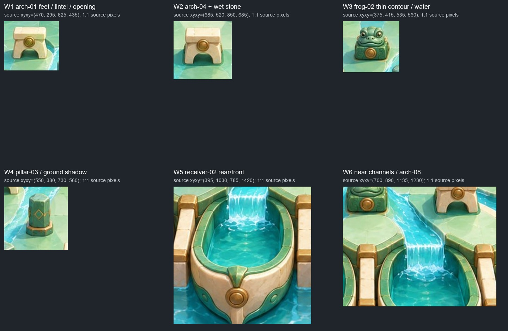
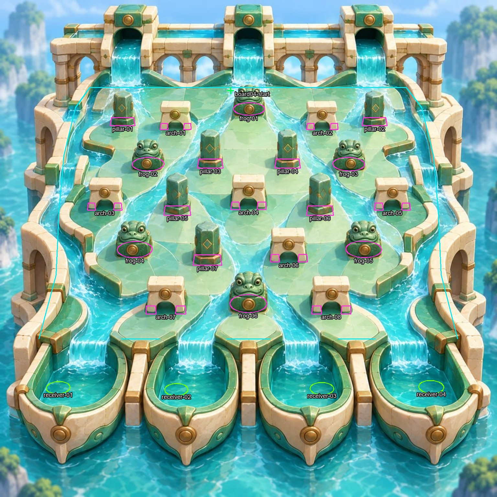

# P4 transfer Water — source/P1 prep01

30 октября 2026, Europe/Kyiv. Visual QA `visual-qa-r4d-p4-extracted-01`.
**Осмотр исходника и bindings завершён. Это prep, не consumer proof и не PASS.**

Прочитаны exact canon/common/своя роль на
`b1382dd4c230815a019e52e2ec4617ef705661d5` через read-only
`E:/R4D/perspective/p6-source.git`: ORDER, P2-P6-transfer,
P4-extracted-objects, P4-transfer-water-dark, roles/COMMON, roles/visual-qa.
Blob карточки P4-transfer совпал: `0db67e8c3c841ede323a809789f5146ca4f77f11`.
Jungle RESULT `dac27ef9e25b8576094252e5e5a156120e9750dd` и его
PARTIAL/UNVERIFIED не меняются. Метод P4 остаётся извлечением исходных RGB
с alpha, локальным восстановлением скрытого пола и раздельными частями.

## Независимо проверенный вход

P1 exact: **`4b47db04c7140ebf88f69b91faa0b790d46f22ec`**.
Активен **boards/04/trial-02**; trial-01 не извлекался и не запускался.
Его исторический startup FAIL не отменён. Git blobs извлечены binary-safe,
без PowerShell text re-encode. JPG только прочитан.

| Файл | Bytes | SHA-256 |
| --- | ---: | --- |
| 04-water-temple.jpg,1536² | 527016 | `8da65c76c110b6ba7cefe113564fe12feed4428e84e84835f033e7da31d3b80d` |
| boards/04/trial-02/config.json | 27231 | `9048b28af2923c93d8be772367beeb828f1e4513a6298af1c803379f77d3e50c` |
| boards/04/trial-02/manifest.json | 15870 | `48c4fef26fd8c94f06c278851222ef285edda54ac14e53da8908f4ee663dc420` |
| common viewer/src/view-math.mjs | 3050 | `96f01cc2093c353ff958cb906fe0c8ae93412425d0f7a5ec7cca0f2bf9f1aa5e` |

В config: **6 pins,106 segments,4 buckets,1 drop**; 21 objectId:
7 pillar,6 frog,8 arch. r16/tick5ms/quantize7/g980/maxspeed2000,
noise2deg/0.02,lcg32; исходный seed0. Это прочитанные настройки,
не проверенный запуск. Translation research→native `[33256,34124]`.
Принятый revised drop `board04-start` проецируется в source **(712,280)**.

[INPUT_BINDING.json](evidence/source-prep-01/INPUT_BINDING.json), SHA
`2c9c6bcea3ac081406d31bdb0bad64bd85bc55c41c4d32a26944e19d7bf81d1c`.
Runtime inputs:
`E:/R4D/perspective/p4-runtime/visual-qa/transfer-water-dark/water/inputs/`.

## Конкретные риски и ID

| Case | ID / ориентир source px | Что потребуется увидеть в consumer |
| --- | --- | --- |
| W1: воротца | `arch-01`, left-foot bbox496..519×381..401, right-foot568..591×381..401; вся фигура ROI(470,295,625,435) | Реальное наложение шара на каждую опору, перемычку и видимый проём. Не считать весь crop сплошной маской. |
| W2: второй доступный арочный случай | `arch-04`, две опоры714..741 и795..823 при y625..647; ROI(685,520,850,685) | До/во/после прохода или контакта на ordinary run. Один удачный кадр перед воротцами не доказывает проход внутри. |
| W3: низкое тело у канала | `frog-02`, ROI(375,415,535,560) | Сохранить контур глаз/головы и мокрый цоколь; частичное перекрытие не должно становиться исчезновением по прямоугольнику. |
| W4: высокая опора и shadow | `pillar-03`, ROI(550,380,730,560) | Боковая/передняя грань, опора и тень на зелёном камне/рядом с бликами. Нет старой тени на plate плюс второй поверх. |
| W5: приёмник | `receiver-02`, center≈(545,1204), ROI(395,1030,785,1420) | Подход со струёй/водной областью, capture и реальное пересечение силуэта переднего/бокового обода; полностью видимый шар в чаше не front-rim proof. |
| W6: ближние каналы/перепад рисунка | `arch-08`, `frog-06`, соседние lips/channels; ROI(700,890,1135,1230) | Шар/тень и передний план при переходе к приёмникам; не закрыть путь невидимой маской и не оставить baked части после извлечения. |

Координаты — только ориентиры из принятого преобразования/ROI исходника,
не новые anchors или collider proposals. Отдельные arch feet имеют native IDs
`arch-NN-left-foot:edge-01..04` и `...right-foot:edge-01..04`.
Все восемь арок и их footprints/ID видны на статическом QA-наложении:

Magenta — pins/предметные segments, cyan — стены/разделители, green —
drop/goal triggers. Контуры получены из точного config и nativeToSource,
не нарисованы по силуэту. Положение подписи не является placement anchor.

### Граница Water 2D

Manifest явно сводит зелёные островки, внутренние водные каналы и короткие
мостики/ступени к **одной проходимой 2D plane** внутри наружных стен.
Generated shoreline/height/lintel colliders **0**. У ворот физические
footprints есть только у двух опор; перемычка остаётся видимым артом.
Доступность конкретного прохода r16 пока не испытана. Не добавлять
коллайдер перемычки, глубину, береговой барьер или новое движение для
объяснения рисунка. Возможное несовпадение входа — точный repro Lead/CTO.

## Небольшой запрос к раннему Water handoff

1. Exact local candidate/manifest hashes и ordinary checkpoint, где реально
   достигнут `arch-01` или `arch-04` (другой доступный arch допустим с его ID).
   Полного комплекта нарезки для ранней консультации ждать не требуется.
2. Обычный целый source-view кадр при viewport1280×720,DPR1: whole-source,
   ArtON/GeometryOFF, без follow/crop. Если consumer сохраняет Jungle framing,
   доска574² — удобный общий контроль. Записать фактический canvas/fit/zoom,
   не менять продуктовый интерфейс ради заданного числа.
3. Тот же view с PartsOFF при сохранённой plate: пол/вода под удалёнными
   фигурами чистые, каустика и границы рисунка не превращены в заплаты.
4. Реальное движение и paused snapshots до/при/после пересечения силуэта
   каждой доступной опоры/перемычки/проёма. Сохранять seed/tick/event/objectId
   и actual part IDs; соседние ticks расширить, если ими наложение не видно.
5. Связанные тени шара/тел в том же обычном масштабе, в том числе на ярком
   камне и водных бликах. Наличие PNG/opacity или удачный увеличенный crop
   не заменяет видимое пятно опоры. Source/native/Art/Geometry не меняют run.
6. Для receiver-01..04 отдельно записать approach/capture/front-rim или
   not-observed/unavailable. Обычный LOST/near-miss годится для rim-case,
   если действительно пересекает силуэт; отметить, что это промах, а не capture.
   Новых seed matrices, постановки шара вручную и sinking после IN_BUCKET нет.

Для final VQA нужен **один named frozen artifact этой Water-доски**, общий
с TQA, с exact SHA. Пока browser/native/consumer не запускались; seed/tick
реальных случаев ещё не назначены. После готового prep активно не ожидаю.

Свежий resource snapshot: RAM11.03/31.91GiB free,CPU19%/24logical;
C/D/E15.70/14.65/9.78GiB free, включая второй активный слот. Собственная
нагрузка — два source bitmap и лёгкие overlays/crops, оценочно <0.15GiB
сверх уже работающих процессов; никаких build/browser/cache-heavy шагов.
Все рабочие bytes — в собственном board runtime. Jungle/held ancestry,
private native source и чужие продукты/checkout не тронуты.
