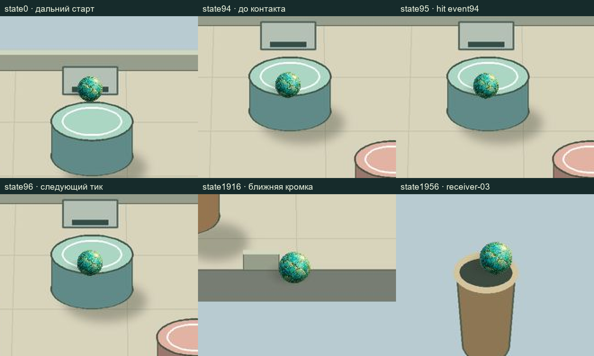

# Integration-02: actual sphere/shadow v01

URL: `http://127.0.0.1:41767/`. Отдельный output: `E:\R4D\perspective\p6-runtime\builder\candidates\integration-02\site`. Baseline41766 не пересобирался и не изменялся.

Источник Artist: `1adf57cfde5a20855c02a846baa045936e4d5a6d`. Adapter: [SPRITE_ADAPTER_V01.json](SPRITE_ADAPTER_V01.json). Raw PNG без alpha suppression/перерисовки: ball SHA256 `378cc5abe32dc2086bf87c580c31675d06b91b41bbef81065bc5fe786b88542c`, shadow SHA256 `3a4e58a4d3b9b707e6ec10ffe80e26c561605a4f99d5498c04ae5c684cf5606a`.

Важная идентичность JSON: выданный packet hash `d23452ebeaa45725175fbc5d915420df0f2c60f13205eeffd3599622069640cb` относится к 5521-byte authorized local CRLF файлу. Exact Git blob имеет 5302 bytes, LF и SHA256 `5ef0efec3633755935fa260a13f0e4e218da16e1479b54c4caee7d3b0d32bb6c`. Первый import остановился на mismatch; read-only сверка установила точное равенство после CRLF→LF. Использован разрешённый локальный packet с исходным выданным hash, обе идентичности сохранены в provenance. Содержимое JSON и PNG не исправлялось по догадке.

## Реальная стыковка

Sphere-only adapter не требует фиктивных 25 готовых body layers. Фон остаётся frozen геометрическим черновиком. В UI прямо указано отсутствие obstacle occlusion layers.

- Ball anchor `[626/1254,636.5/1254]`, uniform scale по `distance(P(x+r,y),P(x-r,y))/2/428`, r16. Explicit `visualLiftPx:0` имеет приоритет над прежним default lift1; проверяется presence, не truthiness. Actual sphere center точно P(native center).
- Ball opacity1; raw alpha<16 specks сохранены. Коррекция lift/alpha не выполнялась.
- Shadow actual canvas1774×887, anchor885.5/442. Каждый UV переводится через raw canvas в native ground patch radius22, offset[-6,10], затем через принятую гомографию ровно один раз. Actual mesh scale `[1,1]`, opacity0.42. Второй perspective flatten и square stretch отсутствуют.
- Шесть browser native snapshots совпали с самостоятельно рассчитанным native seed0. Полные state/event digests normal seeds0/1/2 по-прежнему совпадают с independent QA contract: [native-selfcheck.json](native-selfcheck.json).

## Actual frames

Это JPEG1536×1536, реально снятые встроенным браузером с PixiJS. Они не перерисованы кодом. `?frame=1&seed=0&tick=N` запускает тот же native controller/renderer, скрывая только UI и показывая canvas1:1. Геометрия отключена для просмотра actual sphere/shadow. Снимки параметров отрисовки и native state — соседние JSON. [render-check.json](render-check.json) содержит hashes и проверки actual render properties.

| State | Полный actual frame | Назначение |
|---|---|---|
| 0 | [far](frames/seed0-state0000-far.jpg) | Дальний старт |
| 94 | [before](frames/seed0-state0094-contact-before.jpg) | До первого контакта |
| 95 | [hit](frames/seed0-state0095-contact-after.jpg) | После шага с hit event94 |
| 96 | [next](frames/seed0-state0096-contact-next.jpg) | Следующий тик |
| 1916 | [near](frames/seed0-state1916-near.jpg) | Ближняя кромка |
| 1956 | [receiver](frames/seed0-state1956-receiver-03.jpg) | Native IN_BUCKET/receiver-03 |

Лист выше — только подписанные crops для инспекции; untouched full frames лежат отдельно. В contact frames sphere визуально лежит поверх нарисованного цилиндра: это ожидаемое незакрытое ограничение отсутствующих body occlusion layers, а не подтверждённое корректное перекрытие. В basket пока нет front/rear частей. Читаемость тени и высота/опора сферы переданы на Artist/VQA; художественного PASS нет.

Сборка этого варианта: `node experiments/p6-geometry-first-art/builder/scripts/build.mjs --sprites-v01`. После freeze больше не запускать её поверх этого output; следующий wood candidate использует отдельный output/URL.
