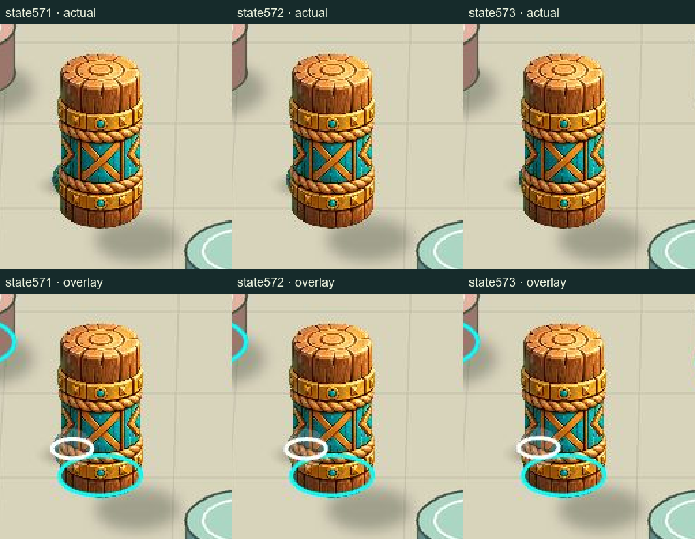

# Integration-03: один настоящий wood-01

URL: `http://127.0.0.1:41768/`. Output: `E:\R4D\perspective\p6-runtime\builder\candidates\integration-03\site`.

Взят ровно один `wood-01` из actual accepted config, seed0, первый native hit этого ID: event571, transition state571→572. Обычный запуск уже был сохранён; новые seed не искались. States571/572/573 показаны в ordinary и actual-config overlay. Остальные24 препятствия остаются черновыми; не размножены все8 wood.

## Источник и registration

Artist exact `f493bbf8d5ec92b429767e2bd9afd8de766c13e0`, `asset-artist/components-v01/WOOD_PACKET_V01.json` и `raw/wood-master-v01.png`. Raw master SHA256 `802f339d693d4dfc175a1e0f9013c78a6e9062bd6532a3db228bd98cd307e161`, 1254², не редактировался и не очищался по alpha.

Adapter: [WOOD_ADAPTER_V01.json](WOOD_ADAPTER_V01.json).

- Ground anchor source `[625,1032]` поставлен в `[628.6379171404694,478.2464227639511]` = P(actual pin center).
- Uniform scale `0.11764705882352741` = projected horizontal radius30 / packet rx255. Нижний пиксель1170 и весь alpha bbox не использованы как anchor/footprint.
- Scaled packet ellipse rx30 / ry16.235294. Реальный projected native circle имеет y bounds463.623891…492.999999. Максимальное попарное расхождение sampled ellipse/circle — `1.7325015273889661 px`. Это остаток приближённого fit, не исправленный коллайдер.
- Видимая высота above ground —111.647059px; у технического draft —70.205462px, примерно на59% выше. По высоте master не сплющен.
- Из детерминированного черновика исключено только тело wood-01; пол и остальные объекты пересобраны из прежнего machine geometry. Его прежняя единственная baked draft shadow сохранена. Raw master не содержит ground shadow; новая shadow не добавлена и прежняя не продублирована.
- Эта shadow остаётся иллюстративной: направление/длина старого draft не объявлены согласованными с новым master и sphere light. Это открытый художественный вопрос, не повод менять geometry.
- Sphere/shadow v01 сохранены с explicit visualLift0 и actual rectangular shadow canvas.

## Correction provenance: source Git и input copy

По проверенному уточнению Lead, source `1adf57cfde5a20855c02a846baa045936e4d5a6d:experiments/p6-geometry-first-art/asset-artist/SPRITE_PACKET_V01.json` — Git LF5302 bytes, SHA256 `5ef0efec3633755935fa260a13f0e4e218da16e1479b54c4caee7d3b0d32bb6c`. Фактически использованный разрешённый input copy — CRLF5521 bytes, SHA256 `d23452ebeaa45725175fbc5d915420df0f2c60f13205eeffd3599622069640cb`. Это разные byte hashes одного JSON: CRLF→LF даёт полное byte equality, parsed JSON также равен. Оба различены в adapter/meta. Frozen integration-02, его raw/prompts/logs не переписывались; повторной симуляции/генерации ради EOL не выполнялось. Новые adapter/meta/freeze JSON записываются UTF-8/LF без BOM и хешируются по названным байтам.

## Actual frames и проверка

Все кадры — реальные browser JPEG1536² из PixiJS, а не повторная отрисовка арт-композиции Python. Python создал только отдельный лист crops для удобства просмотра. Native snapshots и реальные свойства Sprite/mesh сохранены рядом с кадрами в JSON.

| State | Обычный | Config overlay |
|---|---|---|
| 571, до | [actual](frames/seed0-state571-ordinary.jpg) | [overlay](frames/seed0-state571-overlay.jpg) |
| 572, после шага с event571 | [actual](frames/seed0-state572-ordinary.jpg) | [overlay](frames/seed0-state572-overlay.jpg) |
| 573, следующий | [actual](frames/seed0-state573-ordinary.jpg) | [overlay](frames/seed0-state573-overlay.jpg) |

В ordinary кадрах видна часть сферы слева за столбом; contour в overlay проходит поверх арта и позволяет увидеть реальный collider и state шарика. Для этих трёх состояний wood находится в above-ball группе. Это подтверждает работу первой локальной стыковки; достаточность одной base-y сортировки для всей доски не заявляется.

[render-check.json](render-check.json) проверяет actual body registration, один instance, точные native snapshots, visualLift0 и hashes кадров. [native-selfcheck.json](native-selfcheck.json) сохраняет независимый расчёт всех state/event digests normal seeds0/1/2; physics/config/projection не менялись. Проверка всех остальных сторон объекта, flat-арта, других7 wood и художественная приёмка ещё не выполнены.

Этот компонентный вариант не подменяет обязательные whole-image trials/v04 Artist. До просмотра одного экземпляра Artist/VQA остальные7 не ставятся. При коррекции меняется master/его явно согласованная нормализация; принятая geometry не подгоняется.

Сборка исходной версии: `node experiments/p6-geometry-first-art/builder/scripts/build.mjs --wood-v01`. После freeze output не пересобирать поверх него; guard останавливает build, если в parent candidate есть `freeze-inventory.json`.
