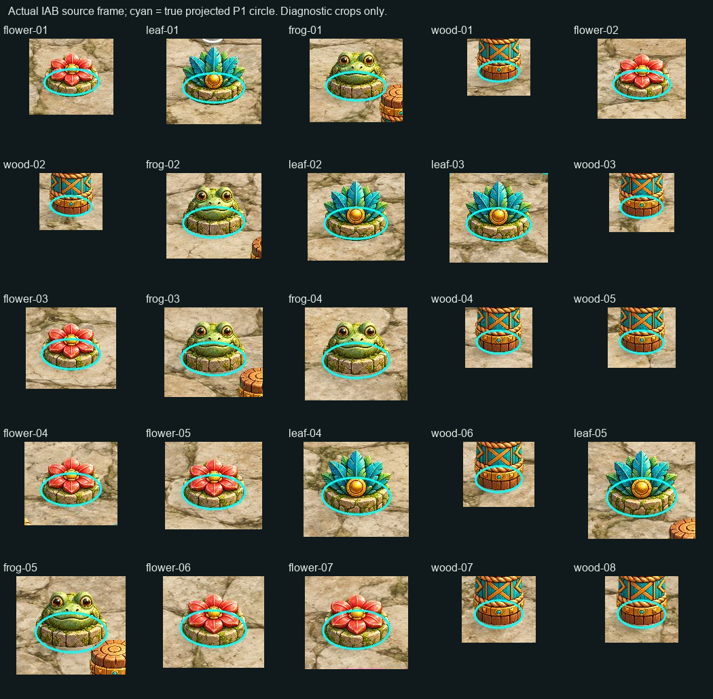
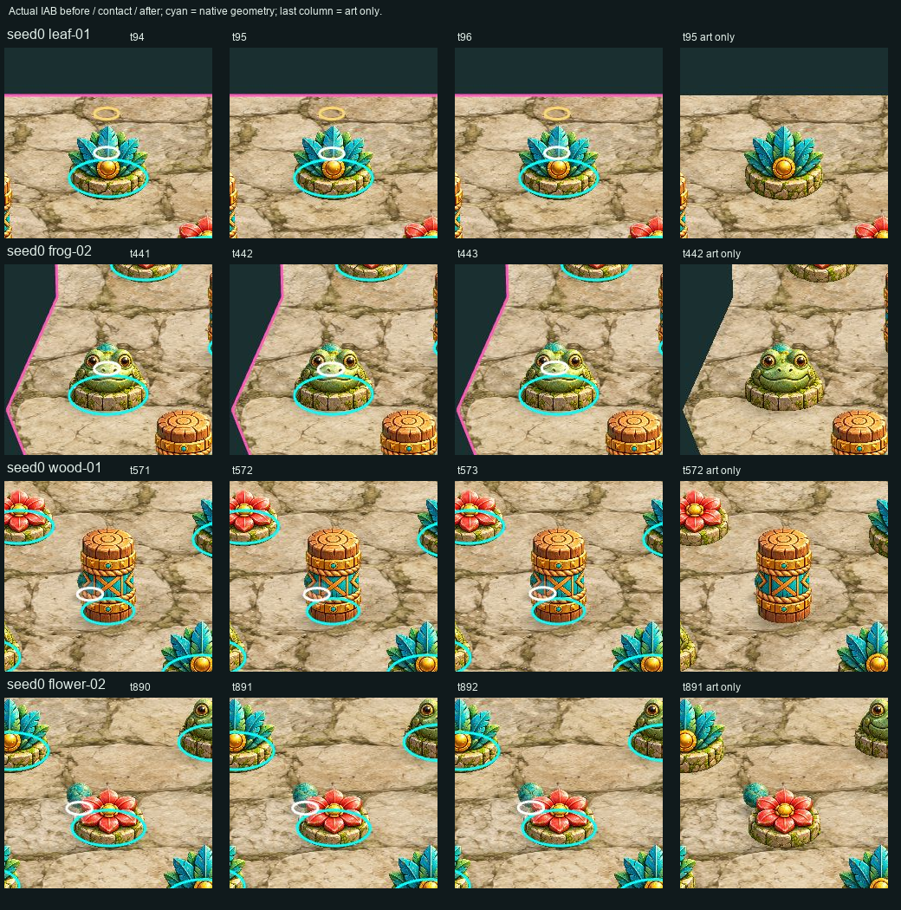
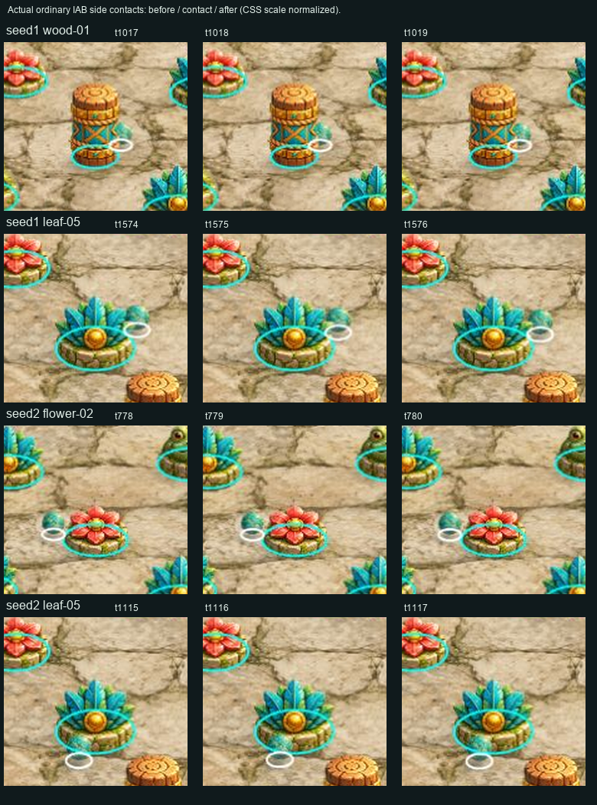
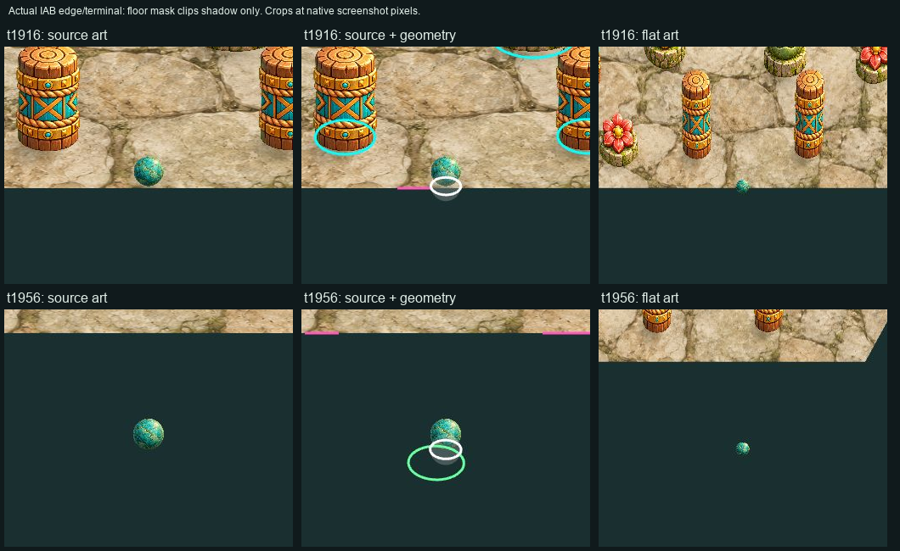

# Independent Technical QA — preliminary25

Проверены frozen bytes `7a4450a8c2edc20880b3d300abc1d51187005479`, `http://127.0.0.1:41770/`. В проверенном объёме нового интеграционного блокера не воспроизведено. Это ограниченный результат preliminary25; финальный scene/art/motion PASS не выдан.

## Байтовая граница

| Поле | Проверенное значение |
|---|---|
| Public snapshot | `E:\R4D\perspective\p6-runtime\builder\candidates\integration-04-preliminary25\site` |
| Files / bytes | **74 / 23 530 619** |
| freeze-inventory SHA256 | `efa9ad5d74025c5893178a62a5da7ad4601bbbbc44fbef5d5b27914b402ad833` |
| files-list SHA256 | `15c5a2308a78a29d7df7e3aac781aadb45642320c14d93aaedf3772e238813df` |
| Consumer SHA256 | `efaff71843b69a415b3dc755586c459ba6d7e146675fde441aa82b4123cff741` |
| Native bundle SHA256 | `8843446996582eaccbd9ff63d3147d74b7eca9a614d8e0df16851d1d89d46f50` |
| Controller source SHA256 | `355591297e3a7ba7a1e775101785338956547261b5430de1d29b43f9357d108b` |

До проверки сцены каждый файл независимо сравнен по length/SHA с inventory, disk и HTTP. Inventory повторно прочитан без изменений; повторный disk pass совпал. После IAB-проверки все74 disk/HTTP файла снова совпали с первоначальной QA-копией; inventory остался прежним. Builder `qa/*` вошли только в инвентаризацию байтов: их измерения, кадры и oracle не использовались как независимое доказательство.

Сохранены [первичная квитанция](byte-validation.json), [заключительная квитанция](closing-byte-validation.json) и [точные исходные байты inventory](frozen-inventory.source.bin). Старые frozen сайты и прежние QA-отчёты не изменялись.

## Native state и управление

Config/manifest побайтно равны принятым P1-входам. Native bundle и controller равны ранее проверенным версиям. Использован сохранённый собственный oracle seeds0/1/2, независимо подготовленный из pinned native source. Новый полный независимый oracle run не создавался; реальные UI seek/replay выполняют настоящий core.

Сравнены **82 actual-IAB snapshot / 34 уникальных seed+tick**, в том числе **81 доступный event stream** и его `eventStateTicks`. Все state, PRNG, события и конечные результаты совпали. Первый initial snapshot содержал state/metrics без exportReplay, поэтому не включён в81 event stream.

| Seed | Обычные сохранённые состояния |
|---|---|
| 0 | 0; leaf94/95/96; frog441/442/443; wood571/572/573; flower890/891/892; край1916; IN_BUCKET1956 |
| 1 | 0; wood1017/1018/1019; leaf1574/1575/1576; LOST1735 |
| 2 | 0; flower778/779/780; leaf1115/1116/1117; LOST1290 |

Source/flat, Art-off/on, geometry/registration, повторные mask rebuild и resize сохранили state и PRNG. Console warnings/errors и UI error не наблюдались. При live edit поле95 удержалось на движущихся тиках63→90; «Перейти» дало paused95. `+10` дал105; «Следующий контакт» от0 —95. Реальный file import независимого API-export восстановил seed0/t95 после переключения на seed2. Эти export/import проверки не засчитываются как проверка кнопки скачивания.

State contract сохранён: SHA256 `b9b303c8ef05245b88d2d1e09f4cdfc165048bde112a4f06319c4bdb383a1fb7`.

## 25 actual sprites

Все25 P1 IDs присутствуют ровно один раз: flower7, leaf5, frog5, wood8. У каждого фактического body совпали native centre/radius, texture, anchor, uniform scale и source rect. Максимальная арифметическая ошибка переноса asset anchor в `P(native centre)` — **1.1368683772161603e-13 px**; это не заявление о точности растеризации GPU. Во всех source snapshots фактические Pixi position/dimensions равны проверенным rect; depth parent соответствует текущему правилу native Y. Геометрия берётся из исходных кругов P1.

Все8 wood используют V02 с anchor633/1050 и ellipse262/123. WoodV01, старый floor и geometry-draft присутствуют среди файлов, но не входят в текущие actual draw layers.

| Авторитетный вход | Commit | SHA256 packet |
|---|---|---|
| MastersV01 | `a6d0493383f55ffcfc2de966d15c79bcd3c088bd` | `ce9843e959004ecd668a82d27d7862398cfbfc4315d4d0a4564b6f121f4f76d1` |
| WoodV02 | `0c3a6b7ae6916262b061234d8e6f5a7a9aa0f3b9` | `73523d0669c3f4121161a2dced82587bdcf6f467d9de9986cb7610b7bd8ea49a` |
| SpriteV03 | `2467aced9c8c7a90fb567d368eee865ac931d922` | `93d84435979c1df900abfb1ec5aca69967823b7f8255fc69cde644d68709bda1` |
| FloorV02 | `e805089167c4d2ec98ff0409b818b5016550e59e` | `4b00ca7fd9aed2254db66897b3b8a9c8f90c8f415f4d8db53ba233da0b5a24be` |

Raw hashes/canvases проверены независимо. Approximate asset ellipse не является true projected collider: измеренный max-nearest residual по128 точкам круга и1024 точкам ellipse составляет0.50–7.36 source px в зависимости от ID. Это описание аппроксимации; новый художественный порог из этих чисел не вводился.



Кадры before/contact/after четырёх семейств и боковых контактов просмотрены. На них не обнаружена новая причина дефекта привязки/перекрытия. Tall bodies местами закрывают шар сзади. Выбранные still frames не доказывают качество всего непрерывного движения; текущее разделение перекрытий по native Y остаётся предварительным.





## Floor и тени

- FloorV02 alpha побайтно совпала с mask и alpha старого floor на всех **2 359 296 пикселях**. В независимой растеризации14-вершинного P1 floor polygon нет внутренних дыр и внешнего alpha spill за пределами3px зоны сглаживания границы. Все25 pin centres имеют alpha255. Эта зона учитывает растровое сглаживание, а не задаёт новую геометрическую допустимость.
- Рисуются ровно два ground layers: новый floor и один composite static-shadow PNG. Его covered IDs уникальны и полностью совпадают с25 P1 IDs. Независимый анализ alpha нашёл25 отдельных пятен, по одному у каждого ID, при диагностическом threshold16/area20. Это дополнительное пиксельное подтверждение состава слоя, а не художественный opacity gate.
- Raw masters и floor packet не содержат baked ground shadows; отдельные старые master/draft shadows в draw layers отсутствуют. Static opacity: per-instance baked0.42, composite alpha1. Ball shadow: **0.60**, без override. Это разные источники opacity.
- Ball имеет uniform radius и liftRadiusFactor1. В source его нижняя точка совпадает с `P(native position)`; в flat radius16/lift0. Первые вершины shadow mesh совпали с независимой одноразовой проекцией, включая Float32 representation.
- Dynamic mask назначен только shadow mesh. Sphere/body, scene и geometry не masked. При Art-off mask снимается, geometry/body diagnostic остаются видимыми. Повторные source/flat/Art cycles не выявили stale/destroyed mask.

На1916 край пола обрезает тень, но не sphere. На1956 шар и диагностический контур видимы ниже пола; вне пола ground shadow не виден. Source и flat проверены фактическими кадрами.



Оригиналы: [source overview](frame-source-all25-geometry.jpg), [source edge1916](frame-source-edge1916-art-only.jpg), [flat edge1916](frame-flat-edge1916-art-only.jpg), [Art-off geometry вне пола](source-terminal1956-geometry-only.jpg), [paused95 после live edit](live-seek-paused95.jpg).

## Границы результата

Подтверждённых новых дефектов с отдельной причиной на этих bytes не получено. Предварительно заявленные отсутствующие boundary/receiver art и незавершённое окружение не превращаются в final-scene PASS. Не выдан art/motion/occlusion PASS всей сцены.

**Кнопка «Сохранить повтор» остаётся непроверенной.** Ранее остановленный `Page.setDownloadBehavior`, call_id `call_dfb293d358174d6b8a83b1b0686463ad`, не повторялся, не переносился на другой transport/actor и не обходился. API-export/import проверен отдельно. Исторические findings и ограничение скачивания не переписаны.

Первые собственные frame captures оказались1280×720 и не вошли в доказательства. Итоговые25 source/flat captures пересняты полностью **1536×1536, DPR1**, после готовности `main`. Реальный формат CUA screenshots — JPEG; оригиналы сохранены `.jpg` без изменения байтов. PNG-листы — явно обозначенные диагностические crops/labels, с uniform resize только там, где это указано. Числовая регистрация не вычислялась из этих увеличений.

Обычные ошибки QA fixture отличались от denial: `Capability is not available: viewport` получен при обращении к tab capability; viewport доступен на browser capability и применён там. Новый tab первоначально получил default1280×720, поэтому итоговый размер проверен через actual viewport и full-page capture. После navigation преждевременное чтение QA API дало `Cannot read properties of undefined (reading 'state')`: `window.p6` ещё не был выставлен после загрузки art. Исправлено ожиданием `main:not([inert])` перед чтением в том же IAB. Первые image-script assertions выявили размер и JPEG-формат собственных captures; пути/диагностический crop исправлены, итоговая генерация прошла. Это ошибки готовности/обработки доказательств, не подтверждённые дефекты продукта и не отказ approval review. Они не меняют отдельный STOP скачивания.

Чужой приватный runtime/oracle не читался. Native source/build, временные файлы и cache оставлены только в own E runtime; продуктовые candidates не менялись. Точные результаты: [check.json](check.json), [pixel-check.json](pixel-check.json), [actual-ui.json](actual-ui.json), [frames.json](frames.json), [screenshots.json](screenshots.json).

## Воспроизведение

Из `E:\R4D\perspective\p6-worktrees\technical-qa`, с UTF8 Python и TEMP/TMP own E runtime:

```powershell
python experiments/p6-geometry-first-art/qa/check-preliminary25.py --runtime E:/R4D/perspective/p6-runtime/technical-qa --verify-live
python experiments/p6-geometry-first-art/qa/render-preliminary25-evidence.py --runtime E:/R4D/perspective/p6-runtime/technical-qa
```

Первый script сравнивает собственный oracle и actual IAB receipts, frozen disk/HTTP bytes,25 placements и alpha. Второй строит диагностические листы из собственных сохранённых IAB captures; исходные кадры и source inputs для воспроизведения находятся в own E runtime.
