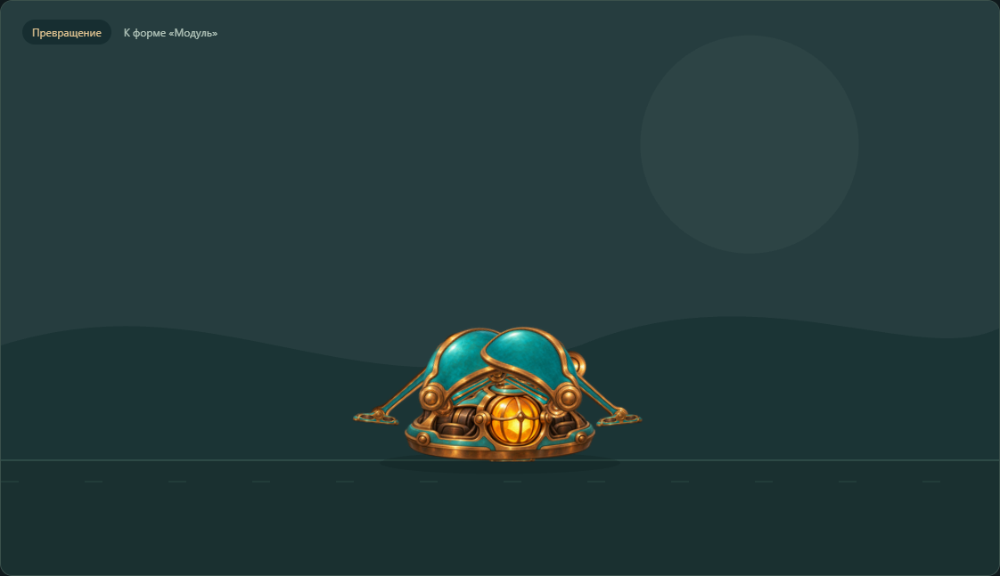

# Technical QA — q3b-c1

6 ноября 2026. `technical-qa-r4d-q3-gpt61-01`, thread `01a1690d-7f5b-74e1-ac75-66a5b0320ae2`. Независимая проверка по выдаче Lead; отчёт, свидетельства и выводы Visual QA и ART_REVIEW не читались и не использовались для формирования этого вывода. Реализацию QA не изменял.

**Итог: основные проверенные функциональные сценарии пройдены; технического блокера управления в этом объёме не найдено. Есть небольшой воспроизводимый дефект контакта при упаковке — TQ-01 ниже.** Три формы, оба превращения и reverse, смена третьей цели, действия из промежуточной формы, ход в обе стороны, low, прыжки с хода и выбор формы в воздухе, auto-show/ручное вмешательство работают в проверенных случаях. Этот вывод не заменяет художественную оценку и решение CTO о готовности красивого игрового героя.

## Exact version и условия

- Frozen commit: **`916c872f43bc7205ab64c101fc0edfee8670541a`**, HEAD совпал в начале проверки.
- Pin: `output/builder/c1-files.json`, SHA256 **`74d752ec88d8141528b4ce051bd267cf17195c73034fede1d3008021fabfd964`**. Все **21/21 runtime/art SHA** совпали [до](hashes-c1-before.json) и [после](hashes-c1-after.json); SHA самого pin также не изменился.
- Арт `q3b-full-art-v2`, сборка `q3b-pack-v1`: 12 настоящих PNG / 23 attachments. Проверял текущий C1 после takeoff-fix, не выдаю pre-fix общий прогон Builder за собственное подтверждение.
- Живой URL `http://127.0.0.1:4186/`; существующий сервер CTO PID28588 не дублировался и не останавливался. Отдельная сессия Chromium Playwright CLI `q3b-tqa-c1`, viewport **1280×1060**, собственный профиль, TEMP/TMP и evidence внутри `qa/technical/` на D:. Личный Chrome, чужие вкладки/мышь, Review/VPS не использовались.
- Все 12 PNG и manifest загрузились HTTP200. Консоль Q3B: **0 ошибок / 0 предупреждений**, включая заключительную проверку ([сеть](output/playwright/c1/network.txt), [консоль](output/playwright/c1/console-final.txt)). Mock/stub, видео вместо персонажа и подмена арта не применялись.

Прочитаны [точный заказ](../../../../orders/animation/Q3B-transforming-crab.md), CANDIDATE, договор редакции 2, README, текущие main/motion/rig и self-review Builder. Сборку и node-тесты повторно не запускал: самостоятельный объём ниже проверен на текущих байтах через настоящий UI и runtime; сообщённые Builder 9/9/build остаются его самопроверкой.

## Реальное управление и наблюдение

В реальном времени браузера нажимал кнопки форм и действий; сохранял последовательности текущих состояний и настоящих кадров canvas. Осмотрены крайние формы и промежуточные изображения обеих прямых и обратных трансформаций, ход, low, подготовка, полёт и посадка, кости и дневной фон. Это управление живой демкой с последовательными снимками; непрерывное видео глазами не оценивалось. Субъективные выводы о темпе/массе ограничены этими наблюдениями и не объявлены полноценной художественной приёмкой.

Дополнительно на существующей паузе команды подавались теми же кнопками, а время продвигалось штатным `__Q3B.step`. Точные ряды world-позиций всех 23 attachments дополняют наблюдение. Для контакта независимо прочитаны реальные PNG, построены границы непрозрачных пикселей alpha≥128 и преобразованы текущими world-трансформами. Это измерение геометрии пиксельной границы, не обещание точности сглаженного изображения до долей пикселя.

| Сценарий | Фактический результат |
|---|---|
| Три формы, оба маршрута и reverse | Реальными кнопками выполнены module→crab→work→crab→module. Крайние u приблизились к 0/1/2, все 23 части сохранились; масштаб в этом viewport постоянный **1,12439**. Силуэты различимы: закрытый модуль, разложенные опоры и раскрытые створки/клешни мастерской. На паузе дополнительно проверены прямые module↔work. |
| Reverse и третья цель | Reverse запрошен при u≈0,262; 0,702; 1,601; 1,839. В момент каждой команды world-позиции/углы, u, uv и скорость не изменились. После двух reverse через 0,3 с назначена третья цель: получены work и module. Продолжение шло из промежуточной позы, сброса в завершённую стойку не наблюдал. |
| Движение / разворот / стоп | В живом разгоне вперёд измерены скорости около +26→+56 px/s. После «Назад» +15→−12→−53, после «Стоп» −25→−1,17: знак и скорость не подменяются мгновенно. На паузе проверены move из незавершённой трансформации, обратная команда и торможение до 0,02 px/s. Удержание/отпускание ArrowRight запустило ход и остановку. |
| Опоры и длины | В отдельном шестисекундном ходе минимум две опоры в пределах 0,75 экранного px от своих плоскостей. На 1622 соседних парах заведомо контактирующих стоп максимальное изменение мирового положения около **4,3e−13** исходного px. Длины 90/105 сохранялись с численной погрешностью; максимальный запрос досягаемости 193 при длине 195. Это проверка кинематики контактов, не физической устойчивости. |
| Idle нескольких частей | На живом времени и на интервале 0,75 с меняются корпус, колени/опоры и оптика, у work также клешни. Например, в crab корпус изменил высоту на 2,83 px, колено переместилось на 2,67 px, угол оптики изменился на 0,073 rad. В module движение заметно меньше, но оно не сведено к одной антенне. Low также продолжает жить. Числа подтверждают наличие движения, не его художественную достаточность. |
| Low | Из crab корпус в измеренных кадрах опустился на **43,22 исходного px**, изменились суставы; масштаб прежний. Команда «Ниже» из промежуточной трансформации довела до crab с low≈1. Покой в low не замер: корпус и сочленения продолжали меняться. |
| Прыжки из форм | Три независимых сценария module→jump→work, crab→jump→module, work→jump→crab прошли prepare→flight→land→ground, счётчики 1/1 и нужный конечный u. Новая форма в воздухе не меняла текущие world-координаты/углы в момент команды и выполнялась после посадки. |
| **Прыжок именно с хода в обе стороны** | Отдельный живой сценарий явно дождался скорости **+45,45 / −45,44 px/s** и только затем нажал «Прыгнуть». Цели module/work выбраны в воздухе; финалы нужные, по одному прыжку/посадке. Отдельно на паузе стартовая скорость ±59,28, посадки work/module, а также сохранение move в обоих направлениях без смены формы. |
| Граница отрыва после последней правки | На шаге 1/240 с при prepare→flight горизонтальный сдвиг настоящих стоп в world от 0 до **1,14e−13 px**; вертикальный — в пределах 1,3e−13. Старый скачок порядка 9 px не воспроизвёл. Все части продолжили движение; на этом соседнем шаге максимум движения оси другой детали 0,308 px. |
| Отложенные и уже начавшиеся действия | «Стоп» отменил ещё отложенный jump; смена формы тоже отменила его, оба случая дали 0 прыжков. Если подготовка уже началась, «Стоп» не оборвал её: цикл закончился 1/1. Повтор jump в активной подготовке не добавил второй прыжок. Прыжок из low проверен в auto-show и отдельным UI-сценарием. |
| Клавиши / промежуточные состояния | 2/3 выбрали crab/work, S — low, Space — прыжок. Кнопка «Один кадр» на паузе прибавила ровно 1/60 с и оставила паузу. Возможность рассмотреть промежуточную конструкцию доступна через обычный интерфейс. |
| Auto-show и ручной ввод | После запуска show ручная кнопка work сразу дала auto=null и сохранила ручную цель позднее. Затем выполнен весь автоматический показ в реальном времени: завершился примерно за **40,55 с** в crab/idle, jump/land 1/1. Журнал содержит те же form/move/stop/low/jump с source=auto. Прочитанный код использует общий dispatcher и те же функции формы, а не отдельный клип. |
| Кадрирование | В проверенных пиках прыжка верхний запас около **68 px**; персонаж целиком помещался. Амплитуду тест не уменьшал. Остальные формы и действия осмотрены при одном постоянном масштабе. Другие viewport этим не подтверждены. |

В broad live-actions второй запрос прыжка пришёл из ещё раскрывавшейся формы, скорость до него была практически нулевая. Этот конкретный случай **не засчитан как прыжок из обратного хода**. Поэтому отдельный `c1-live-moving-jumps.js` проверяет явное условие скорости в обе стороны; исходный broad-лог сохранён и не переписан.

В сплошных рядах превращений максимальное соседнее перемещение одной оси составило около **10,67 world px за 1/120 с**, угла — 0,159 rad. Это конечная быстрая фаза, а не мгновенный скачок при команде; выбранных кадров недостаточно, чтобы автоматически признать любую такую фазу художественно убедительной. Ускорение/торможение формы, компрессия перед прыжком, поджим в воздухе и посадочное оседание читаются как связанные фазы механического героя; количественные ограничения сами по себе не доказывают ощущение массы или игровой уровень качества.

## Единый пакет замечаний

### TQ-01 — небольшой заход дальней голени под общую поверхность при упаковке

Низкая значимость в этом viewport; не блокирует команды или завершение форм. В ряду **work→module** часть `lowerRear` в промежуточной позе выходит за общую линию поверхности. Независимый расчёт нижних граней alpha≥128 настоящей PNG дал **1,7897 экранного px ниже переднего пола** при u=`0.3032049950`, t=`35.6833333333` с и масштабе 1,12439. Это отдельное наблюдение о реальном крае детали, а не отрицательный gap относительно условной дальней плоскости.

Точный сценарий: пауза → «Сначала» → последовательно crab, work, crab, module, work, каждый по 780 шагов 1/120 с → module ещё 382 шага. Данные: `c1-contact.json`, `routes[5]` / `worst`, включают все world-координаты. Воспроизводитель `c1-contact.js` также сохраняет точный кадр. Этот путь не выдаётся за единственный возможный: проверена именно указанная последовательность. Другие увиденные подступы к переднему полу были субпиксельными (до 0,37 px), их не расширяю до отдельных дефектов.

Ожидаемая граница — видимые детали складываются над сценической поверхностью; «уложенная стопа не обязана касаться дальней плоскости» не доказывает допустимость захода под общий пол. Само растровое сглаживание может менять видимую толщину края, поэтому не приписываю скриншоту точность до 0,0001 px. Причина на уровне выбранной траектории/покрытия дальней цепи требует решения авторов; QA её не исправлял. Lead/CTO следует решить локальную доработку или явно принять этот малый остаток, а не обещать полное отсутствие пересечений с поверхностью.

Иных воспроизводимых функциональных дефектов в описанных сценариях не выявил. При исходном численном сканировании отрицательные gaps порядка 10–20 px относительно **дальней** plane не объявлялись проникновением в общий пол: дальней опорной плоскости соответствует y=−16, а уложенные детали не обязаны на ней стоять. Именно поэтому выполнено отдельное независимое измерение всех настоящих PNG относительно общего пола.

## Свидетельства и воспроизведение

Все файлы в `qa/technical/`; scripts запускаются через Playwright CLI `run-code --filename`, session/config `q3b-tqa-c1` / `cli-c1.config.json`. Основной URL остаётся сервером команды, новый сервер не нужен. Для скриптов contact/command-edges используется наблюдатель, установленный `c1-mechanics.js`; это данные/функции только в браузерной сессии, не модификация исходников.

- `c1-live-forms.js` / [данные](c1-live-forms.json): прямые/обратные превращения и живой retarget.
- `c1-live-actions.js` / [данные](c1-live-actions.json): разгон, разворот, low, действия и клавиатура; оговорка о предшествующей форме выше.
- `c1-live-moving-jumps.js` / [данные](c1-live-moving-jumps.json): живые прыжки с доказанным ходом в обе стороны.
- `c1-auto.js` / [данные](c1-auto.json): ручная отмена и полный show.
- `c1-mechanics.js` / [данные](c1-mechanics.json): точные ряды переходов, прерывания, idle/low, прыжки, опоры, длины и кадрирование.
- `c1-contact.js` / [данные](c1-contact.json): независимые PNG-границы, TQ-01, граница отрыва, мировые контакты.
- `c1-command-edges.js` / [данные](c1-command-edges.json): low в превращении, отмена отложенного и завершение активного jump, повтор запроса, клавиши и один кадр.

Выбранные кадры: `output/playwright/c1/00-module-page.png`, `form-0-crab-*.png`, `form-1-work-*.png`, `form-2-crab-*.png`, `form-3-module-*.png`; `walk-pre-jump-*.png`, `walk-jump-*.png`, `moving-jump-*-apex.png`, `mech-low.png`, `show-*.png`, `joints.png`, `daylight.png`. Сырые CLI-выводы сохранены отдельно там же; производные JSON содержат фактический результат, не текст команд.

## Непроверенное и завершение

Не проверялись Review/production dist, другие браузеры/viewport, touch/mobile, длительная работа, все возможные моменты и сочетания команд, реальная физика устойчивости. Полный художественный PASS, привлекательность конечного героя и равная убедительность каждой промежуточной фазы не следуют из численных проверок. Полезные кадры и самостоятельный технический вывод передаются Lead отдельно от других QA.

Старый Q3 не менялся и его runtime-регресс не запускался. Source/art C1 остались заморожены; чужие dirty/untracked сохранены. Браузер QA закрыт, общий сервер CTO не тронут; evidence сохранены на D:. Каталоги `qa/technical/profile-c1/` и `qa/technical/temp/` остались на D: — очистка отклонена автоматической проверкой с `blocked by policy`; не включать их в Git. Git add/commit/push не выполнялись, доставку централизует Lead. Последующий просмотр после коррекции определяется изменением и реальным риском; исторического лимита «один проход / одна коррекция» к Q3B нет.
