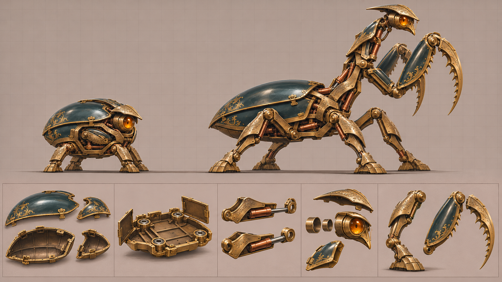

# Q3C · производственный арт и риг Stage C

7 ноября 2026, Europe/Kiev. Владелец `concept-artist-r4d-q3c-01`. Checkpoint `C2_FULL_RIG_TRANSFORM`. База `21fbafcfb435838bc84aed931fe68e57cae9fdbc`. Исходный task turn `01a1b358-28f5-7bd1-b54d-d21f61ea9404`, продолжение `01a1b4a0-34bc-7733-ab1b-5707df7d35d7`.

Пакет развивает утверждённый образ до посадок и движения одной машины. Обязательства остаются в карточке Q3C, редакция 2. [Заказ](../../../../orders/animation/Q3C-victorian-mantis.md), [передача CTO](../../../../work/requests/Q3C_CTO_HANDOFF.md).

## Листы

- Вверху две формы. Нижние пять групп слева направо показывают две стороны оболочки, нижнюю раму и двери, грудные звенья и привод, один глаз с кареткой и передним люком, ходячую и хватательную цепи. Ориентир по рельефу, эмали, латуни, меди и отделке скрытых поверхностей. [01](01-c2-art-inventory.png).
- Транспортный разрез P0, ходячая капсула и высокая стойка в одном масштабе. Помечены корень груди B, общее плечо S, локоть серпа A, тазовая вилка H и единственный глаз E. Внизу крупные детали локтя, разрез глубины, каретка и условия швов. [02](02-c2-rig-overlap-pivots.png).
- Шесть вычисленных поз от одной геометрии и тех же кривых. Физическое раскрытие крыши и боковых люков видно в K1, закрытые руки вынесены к K2, в K3 они уже подняты, серпы раскрываются в K4, K5 держит цельное брюшко. [03](03-c2-k0-k5-motion.png).
- Художественная трактовка шести фаз с цельными металлическими поверхностями и разным характером поз. В K2 корпус держит пустое глазное гнездо, а линза остаётся на поднятой груди. Масштаб брюшка и перекрытие дальней руки на иллюстрациях могут отличаться от монтажных. Числа и посадки брать из 02, 03 и JSON. [03b](03b-c2-k0-k5-art.png).
- Графики всех 28 дорожек, восемь выведенных углов ходячих звеньев и раздельный живой покой обеих форм. Масштаб амплитуды в каждой строке свой. Абсолютные значения и профили в JSON. [04](04-c2-curves-and-idles.png).
- Девять секунд монтажной анимации из тех же данных. Покой капсулы, раскрытие 4,22 с, покой богомола. [05](05-c2-motion-study.webp).

## Производственные посадки

U = 180, x вправо, y вверх, z к камере. Отзеркаливание экранного y включает pivots, углы и контуры. Корень остаётся в `cradle`. Разметка включает 77 постоянных узлов и массу в 100 условных единицах. 54 остаются в оболочке, раме и её креплениях, 12,5 у груди, 6,5 у головы и каретки, 16 у опор, 11 у двух хватательных цепей. Центры масс учитывают повороты крышек. [Инвентарь, pivots, оси, глубина и слои](C2_ART_RIG_SPEC.json).

| Узел | Конструкция |
|---|---|
| Рама, оболочка, люки | Один контур 180 × 90, глубина 110. Два узла крыши и два боковых люка сохраняют свои шарниры. Свободное окно рук x [−67, 68], y [35, 95]. Петли боковых люков вдоль x при y=35, z=±51. Кант шириной 4,5 лежит снаружи свободного сечения |
| Опоры | Четыре постоянных hip на x=±75, y=20. Бедро 68 и голень 76. Одно и то же широкое сечение можно сохранить в обеих формах. Проверены контуры шириной до 22 и 18. В упаковке подошва x ±6 даёт наружную границу ±89. В K0–K5 остаются закреплённые пятка или носок, а углы двух звеньев выводятся из своего контакта |
| Грудь | Корень (40,32) на раме, два широких звена по 98. Их общий шарнир несёт обе ловчие цепи. Внутренние плиты 28 и 25 проходят проверку укладки в разных полосах глубины. После раскрытия грудь имеет непрерывное силовое сечение и видимый средний шарнир |
| Хватательные пары | Две цепи 86 + 88 на одном узле плеч с разными z. Бедро и серп лежат в разных полосах толщины. Радиус крышки 5 входит в проверенный контур. Под кромкой сохранять 2,7 видимого металла, эмаль отступает от шва на 1,8. Дорисовывать сопряжение под крышкой внутри проверенного XY, расширение огибающей требует нового промера |
| Голова | Одна цепь `thorax.upper → head.carriage → head.chassis → eye.gimbal → eye.barrel → eye.lens`. Две секции по 18, ход каждой ≤12 и нахлёст ≥6. Поворот каретки около конца upper начинается после выхода головы, доходит до 70,5° и садится на 68°. Передний люк остаётся на раме, козырёк и лепестки на голове |
| Приводы | Каждый цилиндр сидит на двух численных креплениях. Гильза и секции имеют постоянные размеры. Диапазоны хода вычислены по трансформации и образцам idle. Видимая длина меняется за счёт выдвижения и физического перекрытия |

Глубина конструкции и порядок отрисовки заданы отдельно. У проёма последовательность идёт от задника через физически находящуюся в нём деталь к наружному канту. Для переупорядочивания в 2D точка переключения целиком закрыта непрозрачным краем. Ложементы и обратные стороны створок имеют законченный металл. Золотая гравировка и светлые кромки заканчиваются на своём rigid звене.

## Движение по секундам

| Ключ | Время | Работа звеньев |
|---|---:|---|
| K0 | 0,00 | Вход из текущего idle капсулы. Оптика начинает короткий перевод, рама переносит массу на опоры |
| K1 | 0,83 | Ближний и дальний замки, двери и крыша работают в разные моменты. У каждой стопы свой перекат |
| K2 | 1,69 | Нижнее звено прошло 170° → 131,8497°, плечо на 105. Обе закрытые руки держат абсолютные 0° / 170° при переносе. Голова ушла из оптического гнезда |
| K3 | 2,48 | Плечо выше 120. Ближнее бедро поднято до 60°, дальнее до 54°. Серпы ещё вложены. Верх груди следует с задержкой |
| K4 | 3,09 | Ближний серп пошёл с 2,52 с, дальний с 2,68 с. Крыша и двери садятся после освобождения проёма |
| K5 | 4,22 | Рама прошла 42 → 40, грудь и каретка затухли каждая по своей дорожке. Серпы разведены по углу и глубине. Вход в живой покой |

Кривая каждого участка вычисляется из собственной кубической Bézier. Инвертируется ось времени x(u), затем по y(u) вычисляется значение канала. Между участками значение удерживается. Ускорение плеча начинается после хода люков, верх груди запаздывает на 110 мс. Каретка вторая запаздывает на 230 мс. Отдельные overshoot и settle у рамы, груди, створок и серпов ограничены свободным ходом. Разные параметры падения, контакта, выхода ног и глаза находятся в `introProfiles` как указание по интеграции этой же геометрии.

У капсулы девять каналов покоя, у богомола пятнадцать. Независимые периоды рамы, грудных звеньев, серпов и штоков сочетаются с отдельными seeded событиями взгляда и диафрагмы. Голова приходит за оптикой со своей кривой и задержкой 83 или 96 мс. При входе в раскрытие затухает текущая капсульная добавка, затем покой богомола включается непрерывно за 0,42 с. Цели взгляда пользователя имеют приоритет. [Численные дорожки и покой](C2_MOTION_CURVES.json).

## Сверка и ближайшая работа Asset

Монтажная модель проверена в 622 положениях с шагом 120 Гц и добавленными границами сегментов. Контуры P0 помещаются в оболочке. Минимальный зазор 1 у упакованных опор, у козырька 1,62. В закрытом выходе рук x от −61,51 до 65,62 при минимальном y 38,02. После выхода запас над крышей не меньше 4, при открытии серпов 19,23. Стопы не проходят ниже пола, расчётная проекция центра массы остаётся внутри опоры с минимумом 19. Проверены также 6 секунд каждого idle, диапазоны штоков и сохранение нахлёста. Это промеры монтажных контуров. Полные объёмные пересечения, итоговые маски и характер движения проверяются на C2 runtime. [Числа и ключи](C2_MEASUREMENTS.json).

Сверен текущий `assets/rig/FULL_RIG_V1.json`. Он использует точные SHA-256 двух JSON этого пакета, сохраняет один `eye.lens`, поворот каретки и 28 дорожек. Asset вынес петлю нижнего люка на y=28 для реального верхнего края проёма. Это конкретное место повторного промера четырёх створок на сборке.

На сохранённом `assets/production-v1/output/playwright/asset-c2-poses.png` читаются металл и цельная эмалевая масса. По K5 остаются три связанных художественных дефекта.

- В монтажной проекции кончики серпов разнесены на 42,03. В текущей проекции Asset с `xPerZ = -0.19` и `yPerZ = +0.12` в экранной системе расчёт по его `K5.drawTransforms` даёт 13,37. Серпы сближаются и читаются почти одним пакетом. Сравнить K4/K5 с `xPerZ = +0.24` при прежнем y. Для текущих точек это даст около 26,1 единицы между кончиками. После пробы проверить просвет между самими клинками и силуэт на размере телефона.
- Голени на Asset-превью читаются как тонкие тяги, а круглые крышки визуально замещают подошвы. Заполнить проверенный контур голени до 18 и бедра до 22 цельной металлической плоскостью с тёмной обратной стороной. В ширине стопы 12 сохранить непрерывный плоский контакт пятки и носка и видимую подошву поверх локального затенения. Сверить расширенный профиль и настоящий люк на двух средних углах.
- В нейтральном K5 глаз выглядит тёмным отверстием. Оставить видимый янтарный центр при `eye.iris.open = 0.82`, примерно 5,6 единицы видимого радиуса, с тёмным зрачком и мягким бликом внутри того же стекла. Проверить взгляд и границы лепестков вместе с выходом всей головной рамы.

Эти пункты относятся к стыковке Asset и Builder перед предъявлением живого C2. Приоритет первого образца у вложенного серпа, его металлического нахлёста, настоящего люка и посадки глаза. Дальше весь ход смотрится в обычном темпе с паузами в K1–K4 и без подмены деталей. [Текущий риг Asset](../../assets/rig/FULL_RIG_V1.json).

Листы воспроизводятся командой `python experiments/q3c-victorian-mantis/design/concept-stage-c/render_c2.py` из R4D с установленным Pillow. Художественные PNG и промпты сохранены отдельно. [Скрипт](render_c2.py), [промпты](PROMPTS.md).
