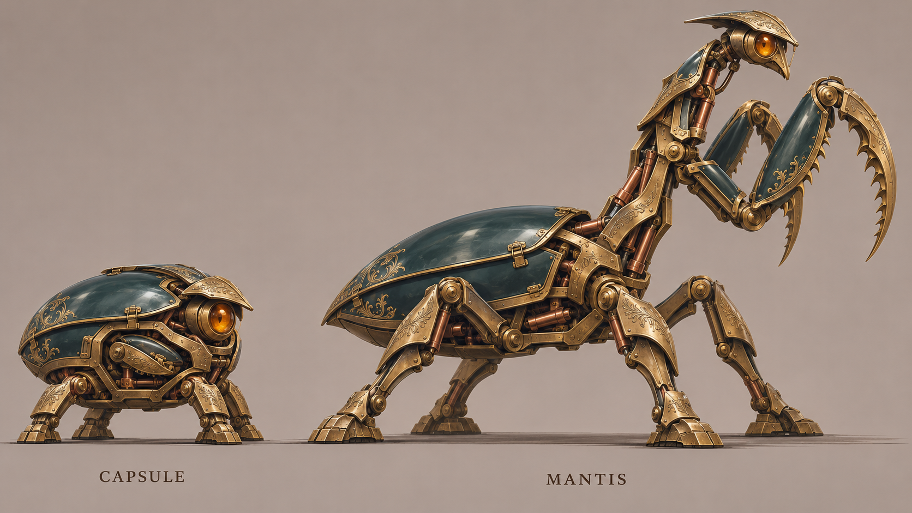
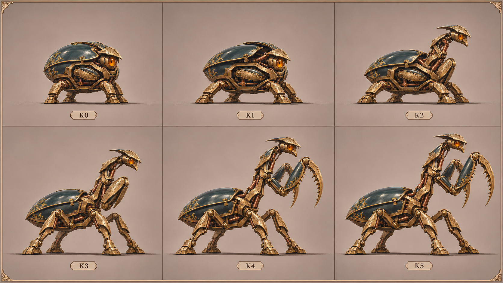
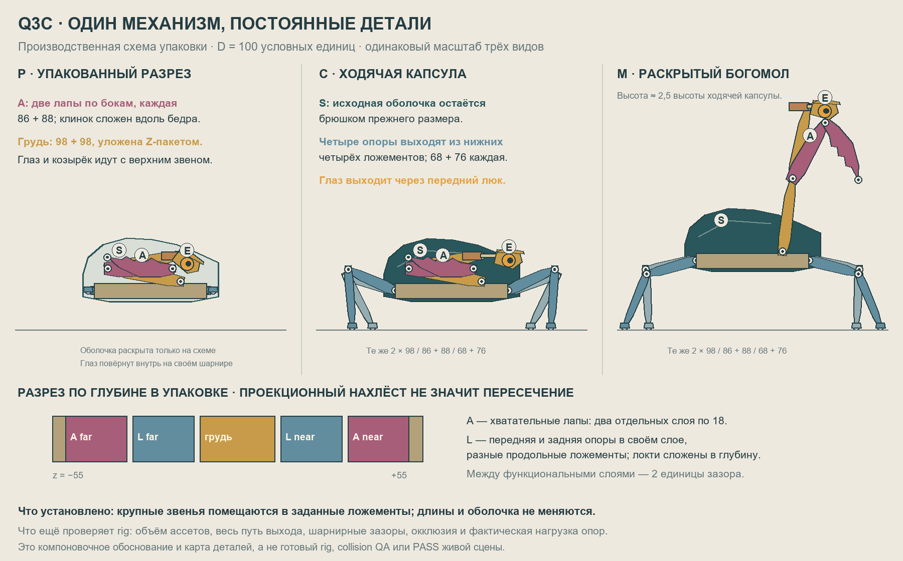

# Q3C — производственный художественный якорь v1

7 ноября 2026 · `concept-artist-r4d-q3c-01` · получен прямой Stage 2 CTO.

Канон обязательств: [заказ, редакция 2](../../../../orders/animation/Q3C-victorian-mantis.md) и [передача CTO](../../../../work/requests/Q3C_CTO_HANDOFF.md). После `git fetch origin` проверен `origin/main = cf74ad2ca64fe738de327ae50641b42085b4d460`; расхождений этих источников с HEAD нет. Этот файл описывает внутренние художественные решения и стартовые ориентиры для производства; он не меняет заказ и не создаёт согласование концепта с Максом.

## Смотреть сначала

[Полный парный лист](01-capsule-mantis-anchor-v1.png) — цель по качеству материалов, цельности масс и характеру. Крупное брюшко сохраняет исходный объём капсулы; высокая грудь и две большие хватательные лапы создают новый силуэт. CTO после просмотра подтвердил силу направления и отдельно потребовал показать физическое хранение деталей.

[Лист K0–K5](02-transformation-keyposes-v1.png) — две конечные и **четыре промежуточные** постановочные позы. Они задают рисунок и порядок действия, а не шесть сменяемых картинок или дополнительные формы персонажа.

[PNG схемы](03-packing-and-mapping-v1.png), [редактируемый SVG](03-packing-and-mapping-v1.svg), [источник схемы](packing_diagram.py) — компоновка при неизменных размерах, постоянные цепи и распределение по глубине. Цвета здесь обозначают функции. Розовые лапы и упрощённые прямоугольные пластины не являются палитрой или финальным артом.

**Граница достоверности:** Imagegen дал художественные иллюстрации, а не согласованную геометрию rig. На парном листе оболочка богомола нарисована немного крупнее оболочки капсулы; при изготовлении брать один исходный shell-ассет без scale-анимации. На листе поз мелкие детали и видимость дальней лапы местами дрейфуют. Не переносить эти ошибки в продукт и не использовать картинки как покадровую подмену. Схема подтверждает компоновку крупных звеньев в покое при указанной толщине; полный непрерывный путь, объём будущих ассетов, все створки и столкновения ещё проверяют аниматор/Builder и независимый QA на сборке. Сейчас художественный PASS живой сцены не заявлен.

## Что увидел в Q3 и Q3B

Просмотрены сохранённые фактические кадры, без изменения старых опытов:

- `experiments/q3-other-anatomy/output/playwright/artist/route1-final-idle.png` и `experiments/q3-other-anatomy/qa/visual/route2-contact.png`: цельный купол, крупные спокойные эмалевые поверхности, читаемый центр корпуса; на контактном листе масса сохраняется в движении. Это полезные свойства для преемственности, а не разрешение взять старого героя.
- `experiments/q3b-transforming-crab/output/playwright/cto-full-review/10-crab.png`: длинные узкие тяги и крупные диски шарниров дробят опоры; верх корпуса кажется отдельным колпаком над меньшей базой.
- `experiments/q3b-transforming-crab/output/playwright/cto-full-review/20-work.png`: раскрытие оставляет пустой центральный просвет, отдельные створки и небольшие верхние инструменты; общего убедительного силуэта крупного существа не возникает.

Вывод по увиденным изображениям: сохранить сплошные объёмы, уменьшить роль круглых шарнирных дисков, дать звеньям сечение и наплыв брони. Живое движение старых релизов в этой сессии не просматривалось; контактный лист не выдаётся за просмотр в реальном темпе.

## Образ, который сохраняем при изготовлении

Один дорогой викторианский автомат: небольшой любопытный прибор с глазом раскрывает высокую гордую осанку хищника. Обаяние капсулы идёт от наклона взгляда, пауз и поведения крышки, а не от нарисованной улыбки. Грозность богомола создают высота груди, точное внимание оптики и крупные замкнутые хватательные пары.

Главная иерархия: глаз/голова и обе хватательные лапы → цельная грудь → большое брюшко → опоры → орнамент. Гравировка поддерживает кромки и посадочные места, не забивает каждую поверхность. Насыщенная тёмная эмаль даёт крупные спокойные пятна; тёплая латунь формирует силовые рамы, медь — приводы; патина остаётся в углублениях. Стеклянная линза имеет объём и отражение, свечение не должно заменять её рисунок.

Фиксированный близкий к боковому ракурс с небольшим разворотом в три четверти даёт глубину и видимость обеих лап. Дальние детали темнее и спокойнее, ближние имеют ясные передние кромки. Нужны небольшие отрицательные просветы между головой, грудью, предплечьями и брюшком. Оба состояния целиком в кадре, включая вершины раскрытых клинков и пятки. Пустое место под маленькую капсулу работает как ожидание будущей высоты, но не делает её неразличимой на телефоне.

## Постоянный инвентарь и хранение

Размеры ниже — **компоновочный ориентир**, не предписание реализации. Единица D = 100; общий наружный объём упаковки примерно 180 × 90 × 110. В основной схеме нет увеличения жёстких деталей. Рост получается из раскладывания груди и реального подъёма опорами; высота раскрытого силуэта около 2,5 высоты ходячей капсулы.

| ID / узел | В упаковке и капсуле | В богомоле / постоянная связь |
|---|---|---|
| S-N / S-F — две большие оболочки | Крупные перекрывающиеся боковые/верхние створки на задней раме; под передними кромками есть выходной проём | Те же оболочки перекрываются над брюшком. Не разлетаются в декоративные крылья; сохраняют размеры и задние шарниры |
| B — нижняя рама | Жёсткая база с четырьмя нижними ложементами, корнем груди и замками | Та же рама несёт брюшко, грудь и четыре тазобедренных корня. Поднимается на опорах без масштабирования |
| C1 → C2 — грудь, 98 + 98 | Два широких звена сложены Z-пакетом: корень (40,32), средний шарнир примерно (−56,49), верхний (40,66). В центральной камере звенья разведены по толщине | C1 поднимается из корня B; C2 догоняет и распрямляет длинную грудь. Между ними остаётся настоящий локоть, перекрываемый скользящими броневыми кромками |
| E — один глаз с головой и козырьком | В упаковке голова повёрнута внутрь примерно на 25°. У верхнего конца C2 находится короткая оптическая каретка: сначала открывается отдельный передний люк оболочки, затем голова доворачивается и каретка выдвигает её на 24 | Та же линза и та же каретка становятся головой; после подъёма груди остаётся небольшой ход около 10. Две вложенные секции по 18 дают ход до 12 каждая, сохраняя нахлёст; новые детали не возникают. Козырёк головы остаётся её защитой, передний люк остаётся на оболочке |
| A-N / A-F — две хватательные пары | В отдельных ближнем/дальнем боковых ложементах. Каждое бедро 86, клинок 88: клинок возвращён вдоль бедра, зубья укрыты в ответной канавке. Пакет длиной меньше 100 расположен вдоль камеры длиной 180 | Корни закреплены на среднем узле C1/C2 через поперечные оси. Сначала весь закрытый пакет выходит через открытый верхне-боковой проём, затем поворачивается бедро, последним открывается клинок |
| L-N-front / L-N-rear / L-F-front / L-F-rear | Четыре отдельные опоры 68 + 76, сложенные навстречу своим голеням. Передние и задние пакеты занимают разные продольные нижние ложементы, ближняя и дальняя пары разнесены по глубине | Те же четыре опоры распрямляются и расширяют базу. Это четыре ходячие лапы; хватательные лапы не используются как добавочные опоры |
| P — медные приводы | Цилиндры связаны с конкретными двумя узлами; шток убран в свой цилиндр | Меняется выход штока, а не размер цилиндра. Привод не висит одним концом в воздухе |

Разрез по глубине в схеме: стенки `z = ±51…55`; хватательные пакеты `−51…−33` и `33…51`; опоры `−31…−13` и `13…31`; центральная грудь `−11…11`. Между функциональными камерами остаётся 2 единицы. **Внутри** камеры две складывающиеся ветви тоже требуют своих толщин и втулок: центральные пластины, например, по 8 с зазором 2; это не два взаимопроникающих звена в одной плоскости. Поперечная плечевая ось проходит над нижними пакетами опор. Точные толщины согласовать с аниматором до финальной нарезки ассетов.

В схеме проверены вершины контуров сложенных хватательных пар, четырёх опор, головы/козырька, оптического цилиндра, груди и рамы внутри выпуклого наружного контура упаковки, а не только прямоугольника `x ∈ (−90,90), y ∈ (0,90)`. Длины всех изображённых цепей сохраняются. Скрытые боковой проекцией части разведены на разрезе. Это даёт правдоподобное место для крупных масс и исключает необходимость дорисовывать их в момент трансформации; не заменяет проверку траекторий, внутренних креплений и рабочих зазоров. Передний люк оболочки и её верхне-боковые створки должны быть отдельными деталями ассетов; схема не моделирует их полный ход.

## Четыре промежуточные позы K1–K4

| Поза | Рисунок и опора | Порядок механики / что нельзя потерять |
|---|---|---|
| K0 — исходная ходячая капсула | Низкий цельный объём, короткий внимательный взгляд | Опоры уже вышли из нижних люков; хватательные пары и Z-грудь ещё упакованы |
| K1 — упор и отпирание | Капсула чуть приседает, стопы получают устойчивую базу, взгляд намеренно поднимается | Замки отходят, створки приоткрываются. В иллюстрации различие K0/K1 слишком тонкое: в движении дать читаемый наклон корпуса и щель механизма, без появления новых масс |
| K2 — первая диагональ | Голова и закрытый пакет груди появляются над передней кромкой, брюшко остаётся тяжёлым | C1 начинает выход, C2 ещё сложен. Глаз ведёт. Хватательные пары ещё сомкнуты и выходят вместе с узлом плеч; ничего не проходит через броню |
| K3 — высокая сжатая пружина | Грудь вытянута, но локоть ещё заметен; большие закрытые хватательные пары лежат у неё | Опоры приподнимают B. Створки возвращаются вокруг брюшка. Корни A уже снаружи; дальняя пара отстаёт по углу, а не материализуется позже |
| K4 — открытие силуэта | Крупные бедра выходят вперёд, клинки расходятся, голова смотрит поверх них | Сначала плечо, затем бедро, затем клинок; разведение клинков запаздывает. Обе пары читаются, но не становятся симметричным логотипом |
| K5 — полный богомол | Гордая голова, высокая непрерывная грудь, тяжёлое брюшко, широкая база и большие ловчие пары | Последовательно садятся упоры/защёлки; после затухания сразу продолжается живое внимание |

Отдельный вход до K0: маячок → падение закрытой капсулы → контакт → выход четырёх опор → выход глаза. Лист трансформации не отменяет эти события и не предлагает начинать сцену готовой ходячей капсулой.

## Направление движения

Времена — стартовый материал для аниматора; выбирать и доводить по реальному темпу. Нельзя применять одну ease-кривую ко всем звеньям. Вместо масштабирования целого спрайта работают шарниры, реальные стойки, выход штоков и положение массы.

| Действие | Основной профиль | Запаздывание, вес и завершение |
|---|---|---|
| Падение | Разгон по высоте, заметно быстрый финал; не равномерный спуск | В контакте рама проходит короткую амортизацию за 60–90 мс, оболочка догоняет на 30–50 мс. Один малый обратный ход и затухание 180–280 мс. Герой не проминается масштабированием |
| Выход опор | Замок быстро отходит, створка разгоняется и тормозит; бедро начинает только после появления физического зазора | Передняя/задняя и ближняя/дальняя пары идут с задержками порядка 60–120 мс. Голень раскрывается позже бедра; стопа ставится и принимает вес до освобождения следующей опоры |
| Выход глаза | Крышка открывается, короткая пауза, оптика ускоряется из гнезда и мягко тормозит | Глаз делает быстрый поиск 80–140 мс, затем любопытный наклон головы с задержкой около 60 мс. Короткий overshoot только в допустимом шарнире; взгляд приходит в цель без дрожания |
| Большое раскрытие | Ориентир 3–4 с: упор/замки → сжатый выход → быстрый подъём → замедление на самой высокой позе → раскрытие хватательных пар | Верхнее звено груди запаздывает примерно на 120–180 мс от нижнего; закрытые A сначала перевозятся плечом. Бедра и клинки имеют отдельные фазы, дальняя лапа отстаёт на 80–140 мс. Оболочка садится раньше финального кивка головы; последнее затухание 250–450 мс |
| Ходьба | Перенос массы начинается до отрыва; примерно 65% цикла — опорная фаза, 35% — перенос | Стопа на опоре закреплена в мире; голень догоняет бедро. Пятка/носок и корпус не стартуют одновременно. На остановке следующая опора принимает массу, затем оседают грудь и голова |
| Подготовка и бросок | Взгляд/голова находят реальную цель; 220–380 мс собирается напряжение; бросок резко ускоряется за 80–140 мс | Движение проходит от базы через грудь и плечо к бедру; клинок замыкается отдельно за 45–70 мс у фактического места захвата. Ближняя и дальняя пары не зеркальны |
| Удар и возврат | Короткий ясный контакт, частицы из фактической точки; затем быстрый начальный отвод и долгий мягкий финал | Допустима очень короткая акцентная задержка в контакте, если не ломает ввод. Поршни и козырёк догоняют; возврат около 0,5–0,8 с, затем живой idle. Добыча вне досягаемости требует реального подведения, а не растяжения рук |

### Живой покой в двух формах

Капсула: быстрые осмысленные переводы оптики с выдержками 0,7–2,1 с; микродоворот головы догоняет глаз; независимый медленный ход небольшого привода и редкое перераспределение веса. Поднятая бровь/крышка даёт характер, но не щёлкает непрерывно. После остановки и приземления персонаж продолжает наблюдать.

Богомол: сначала наводится глаз, через 80–150 мс подстраиваются голова и верх груди; ловчие пары иногда слегка меняют напряжение на 1–3°, мелкие приводы продолжают цикл, опоры компенсируют перенос массы. Корпус не качается общей синусоидой, все четыре стопы не скользят и не переступают вместе. Разные действия имеют разные периоды и нерегулярные выдержки; в обычном просмотре всегда виден хотя бы один спокойный признак жизни без постоянного трясущегося силуэта.

### Мотылёк и читаемость контакта

Маленький викторианский механизм того же семейства материалов, с более светлыми металлическими/эмалевыми крыльями и реальными сочленениями. Не соперничает с головой по размеру и яркости. Случайно **место** после раскрытия; для QA используется воспроизводимый seed. Перед захватом оптика и поза объясняют намерение, в контакте силуэт пары остаётся различимым. Короткое облачко латунной пыли/стружки и несколько искр рождаются в точке соударения, а не в центре сцены. Здесь не создаётся отдельный вид добычи или новая игровая система.

## Передача Lead и ранняя независимая проверка

Lead `01a1b2db-b4d2-7730-bdd6-62b1fef5fe77`: прошу назначить **ранний независимый Visual QA** на три листа по ссылкам выше до тиражирования деталей. Это внутренняя проверка производства, не новый gate Макса. Проверяющему нужны собственное мнение по силе образа и конкретные места потери цельности/преемственности; согласие CTO с первым листом не является готовым QA-ответом.

Проверить вместе: крупность и красоту силуэта; величину и постоянный объём брюшка; две крупные ловчие пары и их хранение; один и тот же глаз; четыре настоящие опоры; читаемые K1–K4; пригодность ширины звеньев и просветов для будущего масштаба телефона. Затем аниматор и Asset Artist сверяют реальные толщины, шарниры и глубину на характерном складном узле перед финальной нарезкой. После сборки художник и независимый QA обязательно смотрят живые переходы и easing в обычном темпе; эти листы такую проверку не закрывают.

Весь мой новый результат находится только в `experiments/q3c-victorian-mantis/design/concept/`. Runtime/product source, старые опыты и чужой WIP не менялись. Commit/push не выполнялись: интеграция принадлежит Lead. Точные промпты и режим генерации — [PROMPTS.md](PROMPTS.md).
