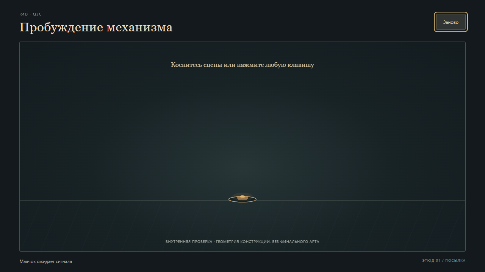

# Technical QA — q3c-slice-01

7 ноября 2026, Europe/Kiev. Независимый проверяющий: `technical-qa-r4d-q3c-01`.

**Кандидат:** `c79af101d944c121d9dc6b7e203d393a45baf8e5`. Основание: [карточка Q3C, редакция 2](../../../../../orders/animation/Q3C-victorian-mantis.md), [handoff](../../../../../work/requests/Q3C_CTO_HANDOFF.md), [граница среза](../../../tests/QA_HOOKS.md). Проверен только первый construction slice до живой капсулы с глазом.

**Вердикт: SCOPED_FAIL — один воспроизводимый дефект TQ-01.** Основной путь мышью и touch работает; безусловный PASS клавиатурному повтору дать нельзя. Это не художественная приёмка и не оценка готовности полной Q3C.

## Единый список дефектов

**TQ-01 — после «Заново» клавиатура не активирует маячок. Средняя серьёзность.**

1. Открыть обычную страницу с `?seed=42`, без `paused=1`.
2. Кликнуть по сцене и дождаться капсулы с глазом.
3. Кликнуть «Заново».
4. Нажать `A`, не переводя фокус со штатной кнопки.

Ожидается: подсказка «…нажмите любую клавишу» выполняется — начинается `beacon`. Фактически: `phase=waiting`, `events=[]`, фокус остаётся на `#restart`; ввода активации нет. Клик по сцене после этого работает. Дефект также воспроизводится с QA-паузой; свежая страница принимает ту же клавишу правильно. Причина локализована в `src/main.js:56`: обработчик отвергает все клавиши при фокусе на любой HTMLButtonElement. Кандидат не исправлялся.

Доказательство: [результат обычного прогона](keyboard-repro-results.json), [точный сценарий](keyboard-repro.js).

## Проверено

| Сценарий | Результат и граница вывода |
| --- | --- |
| `npm ci`, `npm test`, production build | Чистая установка в изолированной побайтной копии PASS; 7/7 штатных тестов PASS; Vite build PASS. Изменён только каталог выхода сборки. |
| Первый ввод | Реальные Playwright mouse click, mouse drag, keyboard `A` и Chromium touchscreen tap активируют маячок. Повторный ввод не перезапускает интро. TQ-01 касается повтора после кнопки. |
| Падение и контакт | Ускорение падения, контакт над маячком, затухание и эффект контакта просмотрены на неприостановленном пути. В момент `t=1.45` низ модели и маячок совпадают с погрешностью около `3.4e-13` мировых единиц. |
| Створки, четыре лапы, глаз | Просмотрены промежуточные положения и обычный темп: сначала открываются двери, затем выходят связанные звенья; отдельно открывается крышка и выходит глаз. Граф частей в source создаётся однократно; `optical-head` и четыре leg ID сохраняются во всех 2401 снимках. Подмены цельных спрайтов не обнаружено. |
| Длины и опоры | 2401 снимок от 0 до 20 с с шагом 1/120: максимальная ошибка длины `1.57e-13`; максимальный дрейф поставленной стопы `1.35e-13` мировых единиц. Центры коленей и стоп не уходят ниже `y=0`, кроме машинной погрешности. Это проверка суставов/центральных линий и видимого контакта, не доказательство полного объёмного swept collision. |
| Непрерывность и easing | Штатный тест границ стадий PASS; в живом desktop/touch пути наблюдаются последовательное раскрытие, задержки лап, поздний выход глаза, разгон падения и затухание. Пошаговый численный прогон использовался дополнительно, не вместо обычного темпа. |
| Idle и взгляд | На неприостановленном пути до 8.4 с и при последующем наведении видны микродвижения корпуса/глаза; опоры остаются на месте. Реальные mouse move и touch tap меняют направление взгляда. Художественная выразительность idle этим не принята. |
| Seed / replay | Seed 42 и одинаковый ввод в те же моменты дают идентичный snapshot при одном и 240 приращениях времени; другой seed меняет idle. Две обычные загрузки выдали разные seed. Проверяется только существующий idle, случайный мотылёк отсутствует. |
| Desktop / mobile | Chrome: 1280×720 и Pixel 7 **эмуляция touch** 412×839, `maxTouchPoints=1`, coarse pointer. На обоих нет горизонтального overflow и ошибки запуска; мобильная сцена целиком помещается в viewport. Физический телефон и другие браузерные движки не проверены. |
| Restart | Мышь/touch возвращают `waiting`, tick 0, пустые events. Следующий touch/click запускает сцену. Клавиатурный путь — TQ-01. |
| Console | В обеих независимых сессиях 0 console errors/warnings и 0 page errors на проверенных маршрутах. |

[Desktop: сценарий](desktop-check.js) / [результаты](desktop-results.json), [touch: сценарий](mobile-check.js) / [результаты](mobile-results.json). Последовательности `output/playwright/desktop-live-*.png` и `mobile-live-*.png` сняты по реальному времени без `seek`/паузы; `time` каждого снимка записан в JSON. Кадры просмотрены проверяющим агентом; человеческое тестирование не заявляется.

## Среда, установка и сохранность

`D:\dev\R4D`, host `local`, `WIN-36E9FF9EJM0`; Node `v24.15.0`, npm `11.12.1`, Playwright CLI `0.1.23`, Chrome `157.0.8103.15`. Встроенный браузер недоступен; личный Chrome Макса не использовался. Сборка обслуживалась отдельным localhost `127.0.0.1:4194`.

Первый `npm ci` в общей папке получил `EPERM` при unlink занятого `@esbuild/win32-x64/esbuild.exe`. Чужие процессы не останавливались. Установка в новой QA-копии с пустым cache затем получила сетевой `ECONNRESET`; тот же exact lock успешно установлен командой `npm ci --offline --cache E:\Caches\npm` из существующего cache. Логи: [общая папка](npm-ci.log), [сетевой сбой](npm-ci-isolated.log), [успешная чистая установка](npm-ci-isolated-offline.log), [тесты](npm-test.log), [сборка](npm-build.log). Удалённые неудачным `ci` общие generated-зависимости восстановлены из чистой установки только копированием отсутствующих файлов; занятый exe не перезаписан, его SHA256 совпал. Итоговый `npm ls --depth=0`: PixiJS 8.22.0, Vite 7.3.7.

22/22 файлов кандидата совпали с Git перед проверкой и сохранились без изменений в рабочей папке и проверяемой копии после неё: [до](source-before.json), [после](source-after.json). Product source, арт и чужой WIP не изменялись. Все записи QA находятся в `qa/technical/**`; clone/worktree/reset/stash/clean не использовались. Проверка выполнялась на production build побайтной QA-копии, чтобы чужая dev-сессия не влияла на кандидата.

Собственные browser sessions `q3c-tech-slice01` / `q3c-tech-mobile01` закрыты; QA HTTP server остановлен. Удаление собственных временных sandbox/build/profile каталогов отклонено автоматической проверкой разрешений с причиной `blocked by policy`, без дополнительных пояснений. Они сохранены локально в игнорируемом `qa/technical/.local/`; логи не удалялись, эти временные файлы не входят в commit.

## Not included

Ходьба; полное раскрытие в богомола; механический мотылёк и его безопасные случайные позиции; реальный захват добычи, удар и частицы поимки; финальный арт. Их отсутствие не является дефектом заявленного `q3c-slice-01`; PASS на них не выставлен.
