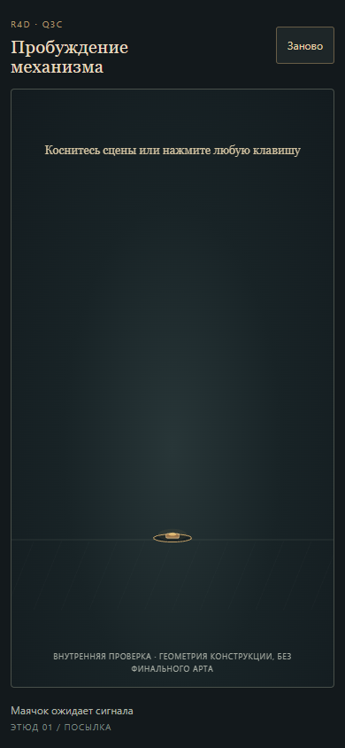

# Q3C — targeted Visual recheck VQ-01

7 ноября 2026, Europe/Kiev · `visual-qa-r4d-q3c-01` · независимая сессия `gpt-6.1-sol` / `xhigh`, host `local`, `WIN-36E9FF9EJM0`, `D:\dev\R4D`.

**Вердикт: PASS targeted recheck. VQ-01 закрыт на exact correction candidate `4a26f1cb789a4b41d09e7b7c9ac1905680d965b4`.** Из выявленных первым проходом визуальных блокеров текущего конструкционного WIP-среза открытых не осталось. Полный художественный PASS Q3C не выставлен.

Это узкое продолжение [первого отчёта HOLD для `c79af101…`](REPORT_SLICE_01.md). Предыдущий отчёт сохраняет факты своей версии. Канон — [заказ, редакция 2](../../../../orders/animation/Q3C-victorian-mantis.md) и [handoff CTO](../../../../work/requests/Q3C_CTO_HANDOFF.md).

## Что перепроверено

Для каждого размера открыта новая изолированная Chromium-сессия, без сохранённого браузерного состояния. URL `http://127.0.0.1:4187/?seed=42`, обычное течение времени 1×, настоящие эмулируемые touch/click/key-вводы. Debug pause/seek/step не использовались. Mobile — эмуляция viewport и touch, не физический телефон. Использованы прежние Playwright CLI `0.1.23` и Chromium `145.0.7632.6`.

| Условия | Наблюдение |
| --- | --- |
| Fresh `390×844`, ожидание без ввода | После загрузки и выдержки 0,9 с видны маячок и подсказка; капсулы и её обрезанных фрагментов нет. `waiting`, `time=0`. |
| Fresh `360×732`, ожидание без ввода | То же: пустая область над маячком, читаемая подсказка, фрагмента корпуса у верхней границы нет. `waiting`, `time=0`. |
| Restart из раскрытой капсулы на обоих mobile | После настоящего tap по «Заново» и выдержки 0,9 с возвращается чистое ожидание. Капсула не остаётся у верхней границы; повторный первый tap снова запускает посылку. |
| Первый вход и повторный вход сверху, оба mobile | После отклика маячка нижний край капсулы постепенно пересекает верхнюю границу, затем в сцену входит весь корпус и ускоряется к маячку. Вход непрерывный; внезапного появления целого корпуса внутри сцены, скачка положения или нового popping в просмотренных проходах не обнаружено. Контакт и затухание сохраняются. |
| Короткий desktop sanity `1440×1000` | Чистое ожидание; Enter → падение → выход опор и глаза → капсула; restart → чистое ожидание. Клавиша `a` после restart, при фокусе на кнопке, вызывает видимый отклик маячка и новый вход. Раскрытая капсула со стопами и глазом остаётся целиком в кадре. |

Источник остальных состояний: [360×732 fresh waiting](output/recheck-vq01/mobile360/fresh-waiting.png), [390×844 после restart](output/recheck-vq01/mobile390/restarted-waiting.png), [360×732 после restart](output/recheck-vq01/mobile360/restarted-waiting.png).

## Evidence и границы вывода

- Непрерывные записи обычного темпа 25 fps, включая начальное ожидание, первый tap, раскрытую капсулу, restart и повторный вход: [390×844](output/recheck-vq01/mobile390/normal-speed.mp4), [360×732](output/recheck-vq01/mobile360/normal-speed.mp4).
- Характерные live-фазы входа с одинаковой областью кадра в каждом листе: [390×844](output/recheck-vq01/entry-contact-390.png), [360×732](output/recheck-vq01/entry-contact-360.png). Подписи обозначают целевое время live-capture после ввода; фактические runtime-времена сохранены отдельно.
- Read-only наблюдения для привязки изображений к состояниям: [390×844](output/recheck-vq01/mobile390/observations.json), [360×732](output/recheck-vq01/mobile360/observations.json), [desktop](output/recheck-vq01/desktop/observations.json).
- Входы exact correction candidate: [21 файл до просмотра](output/recheck-vq01/inputs-before.json), [сверка после просмотра](output/recheck-vq01/inputs-after.json). Продукт, исходные ассеты и канонические документы QA не менял; собственные файлы находятся только в `qa/visual/**`.

Это targeted повтор затронутого ожидания/входа и короткий desktop sanity. Полный первый визуальный проход и его оставшиеся границы описаны в исходном отчёте. Чистовой runtime-арт, ходьба, полный богомол, его idle, мотылёк, захват и частицы по-прежнему **NOT INCLUDED**. Весь заказ Q3C этим PASS не закрывается.
