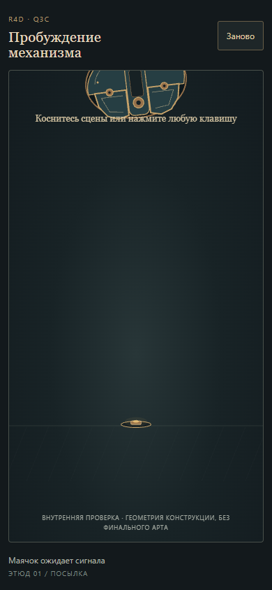
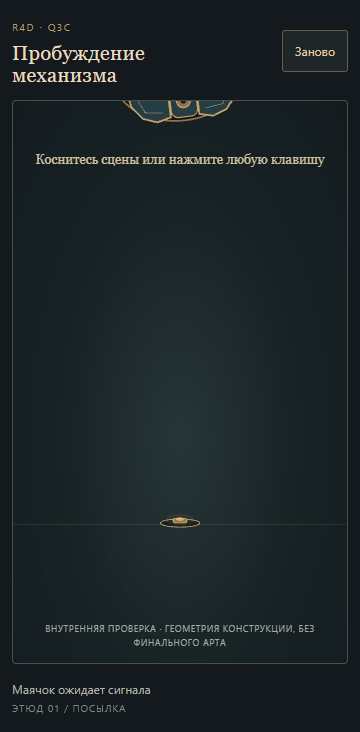

# Q3C slice 01 — независимый Visual QA

7 ноября 2026, Europe/Kiev. Проверяющий: `visual-qa-r4d-q3c-01`, отдельная независимая сессия. Runtime проверяющего: `gpt-6.1-sol` / `xhigh`, `D:\dev\R4D`, host `local`, `WIN-36E9FF9EJM0`.

**Вердикт: HOLD для выпуска текущего WIP-кандидата. Один воспроизводимый визуальный блокер VQ-01 на мобильном viewport.** Художественное направление трёх concept sheets проходит внутренний просмотр. Полная художественная приёмка Q3C остаётся открытой.

Проверенный exact aggregate candidate: **`c79af101d944c121d9dc6b7e203d393a45baf8e5`**. Runtime в нём — `4e74d371`, Concept — `53781d00`. Проверка начата после передачи этого SHA CTO и сверки `HEAD = origin/main`. Канон: [заказ, редакция 2](../../../../orders/animation/Q3C-victorian-mantis.md), [handoff CTO](../../../../work/requests/Q3C_CTO_HANDOFF.md). Этот отчёт описывает наблюдения и не меняет обязательства.

## VQ-01 — капсула видна и обрезана до первого действия

**Блокирует заявленную начальную сцену WIP.** На `390×844` и `360×732`, при `phase=waiting`, `time=0`, часть закрытой капсулы уже выступает из верхнего края сцены. В `390×844` виден большой фрагмент корпуса, который заходит на строку «Коснитесь сцены или нажмите любую клавишу». После «Заново» дефект возвращается. Это устойчивая картинка ожидания, а не пойманный кадр падения.

Воспроизведение: открыть `http://127.0.0.1:4187/?seed=42` в touch viewport `390×844`; не подавать ввод; подождать 0,9 с. Повторено при `360×732`. Дополнительно обнаружено после настоящего tap по «Заново» в обычном запуске без заданного seed. Диагностические данные: [waiting-clipping-observations.json](output/playwright/mobile/waiting-clipping-observations.json), [narrow-observation.json](output/playwright/mobile/narrow-observation.json). Эти наблюдения подтверждаются изображениями; статус и числа используются только для привязки к состоянию.

Ожидаемое по сценам 0–1 карточки: до ввода видна пустая сцена с маячком; капсула входит сверху после активации. Здесь преждевременно показанный обрезанный корпус портит появление посылки и читаемость подсказки. Исправление выбирает sole-writer Builder; QA candidate не менял. После коррекции нужен новый pin и узкий повтор waiting → первый ввод → падение → restart на обоих мобильных размерах, с проверкой отсутствия нового popping при входе.

## Что проверено и что наблюдалось

Среда просмотра — отдельные headless Chromium-сессии Playwright CLI `0.1.23`, Chromium `145.0.7632.6`, без личного Chrome и рабочего стола Макса. Desktop `1440×1000`; mobile touch emulation `390×844` и дополнительный узкий `360×732`. Это браузерная эмуляция, не испытание на физическом телефоне.

Основные проходы выполнялись в штатном реальном времени, без `paused`, `seek`, `step` или изменения скорости: настоящий click по сцене, отдельный запуск клавишей Enter, настоящие эмулируемые tap, движения указателя и «Заново». Сохранены непрерывные записи 25 fps и отдельная серия live-снимков с фактическими runtime-временами. Разбор промежуточных кадров дополняет эти проходы. Человеческое испытание не заявляется.

| Проверяемое свойство | Независимое наблюдение на текущей геометрии |
| --- | --- |
| Маячок и первое действие | Click, Enter и tap запускают сцену без поиска кнопки Start. Маячок отвечает световым кольцом. VQ-01 затрагивает предшествующую картинку ожидания на mobile. |
| Падение, масса и контакт | Видны ускоряющийся спуск, короткий наклон/отдача в контакте и затухание. Капсула приходит к маячку; после контакта сохраняется цельный корпус. |
| Люки и четыре опоры | Створки сначала отходят; сложенные звенья последовательно выходят через открывшуюся нижнюю область, разворачиваются и ставят четыре различимые стопы. Подъём корпуса следует после выхода опор. В просмотренных проходах существенных разрывов цепей, внезапного появления готовых ног и заметного провала стоп под пол не обнаружено. |
| Тот же глаз | Верхняя створка открывается раньше оптики. Одна оптическая головка постепенно выходит из гнезда на каретке; край корпуса последовательно перекрывает скрытую часть. Видимой замены всего персонажа или глаза нет. Продолжение этого глаза до полного богомола ещё не реализовано. |
| Easing, overlap, settle | Различаются быстрый конец падения, затухающая отдача, опережающие створки, запаздывающие звенья ног и отдельное торможение глаза. Существенные действия не выглядят одним равномерным вращением всех деталей. |
| Idle и взгляд | После раскрытия остаются тихое покачивание корпуса и отдельные микродвижения оптики; направление взгляда меняется вслед за курсором/tap. Стопы визуально сохраняют опору. На mobile покой очень сдержанный; насыщенность характера после чистового арта ещё предстоит оценить. |
| Силуэт и кадрирование раскрытой капсулы | Корпус, четыре стопы и поднятый глаз читаются целиком во всех трёх проверенных размерах. В `360×732` горизонтального переполнения нет. Важное исключение — обрезанный корпус до активации, VQ-01. |
| Перезапуск | Состояние возвращается к ожиданию. На desktop ожидание чистое; на mobile возвращается VQ-01. |

Других значимых визуальных блокеров в указанном участке на этих viewport не обнаружено. Это оценка видимой конструкционной графики; отсутствие ошибок в консоли и состояние модели не используются как художественный PASS.

## Три concept sheets

Просмотрены exact PNG из кандидата:

- [01 — capsule/mantis anchor](../../design/concept/01-capsule-mantis-anchor-v1.png): цельная эмалевая масса, узнаваемый глаз, высокое раскрытие и крупные хватательные пары заметно сильнее разрозненного силуэта Q3B. Направление PASS.
- [02 — K0–K5](../../design/concept/02-transformation-keyposes-v1.png): подъём груди и последующее раскрытие хватательных пар имеют читаемые промежуточные силуэты. Иллюстративный дрейф мелких деталей/видимости дальних частей, отмеченный автором, сохраняется; лист не доказывает постоянный инвентарь и непрерывный физический путь.
- [03 — packing/mapping](../../design/concept/03-packing-and-mapping-v1.png): общая размерная схема и разделение по глубине полезно отвечают на риск упаковки крупных цепей. На самом листе корректно указано, что он не подтверждает готовый rig, весь путь выхода и столкновения. Самостоятельная проверка объёмных столкновений будущих чистовых частей этим Visual QA не проводилась.

Риски полного art/rig pass остаются открытыми: неизменный объём оболочки, перевозка того же глаза грудной цепью, выход обеих крупных хватательных пар из реальных посадок, различимость ближних/дальних звеньев и вес высокой формы. Текущий runnable slice этих будущих участков не показывает.

## NOT INCLUDED — отсутствующее продолжение

Чистовой runtime-арт, ходьба, полная capsule→mantis трансформация, idle большого богомола, механический мотылёк, случайная позиция/seed-replay добычи, захват и контактные частицы **не входят в проверенный WIP**. Их выполнение и художественное качество не подтверждены. Три концепт-листа не заменяют эти будущие живые сцены. Полный artistic PASS Q3C не выставлен.

## Evidence и сохранность

- Непрерывные записи обычного темпа: [desktop 1440×1000](output/playwright/desktop/normal-speed.mp4), [mobile 390×844](output/playwright/mobile/normal-speed.mp4).
- Характерные промежуточные состояния: [выход ног](output/playwright/leg-opening-contact.png), [глаз и idle](output/playwright/eye-and-idle-contact.png), [плотный разбор ног из исходной 25 fps записи](output/playwright/video-legs-contact.png). В пределах каждого листа использована одна область кадра без относительного увеличения отдельных поз; видео-время и время сцены подписаны отдельно.
- Исходные live-наблюдения: [desktop](output/playwright/desktop/live-observations.json), [mobile](output/playwright/mobile/live-observations.json); исходные PNG лежат рядом с JSON.
- До/после: [20 входных файлов до просмотра](output/candidate-inputs-before.json), [повторная сверка](output/candidate-inputs-after.json). Runtime, concept и asset inputs не исправлялись. Изменения QA находятся только в `qa/visual/**`; чужой WIP сохранён.

Следующий шаг — вернуть VQ-01 владельцу runtime через Lead/CTO, получить исправленный exact candidate и повторить затронутый участок. Этот отчёт относится только к `c79af101…`.
