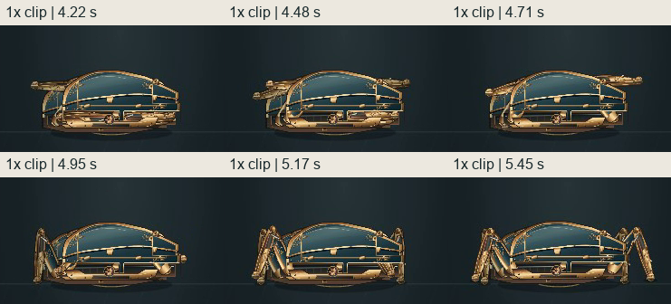
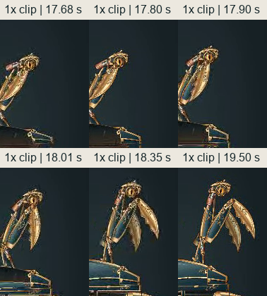

# C2_FULL_RIG_TRANSFORM — независимый Visual QA

**`READY_TO_COMMIT` · `FAIL`**

7 ноября 2026, Europe/Kiev. `visual-qa-r4d-q3c-01`, `gpt-6.1-sol` / `xhigh`, `D:\dev\R4D`, host `local`, `WIN-36E9FF9EJM0`. Immutable candidate **`be62b16b0253208493e5d546e0f9d158342a9250`**. Блокируют читаемость выхода опор и художественная масса финальной формы. [Протокол C2](C2_FULL_RIG_TRANSFORM_VISUAL_GATE.md) · [Заказ, редакция 2](../../../../../orders/animation/Q3C-victorian-mantis.md)

## VQ-C2-01 — выход опор теряет видимую связь с нижними люками

В середине leg intro видимые звенья сначала выглядят как золотые поперечные планки у верхней боковой кромки корпуса. Затем они уходят вниз и становятся коленями и стопами. В обычном темпе путь из нижнего ложемента теряется. На `360×732` ближние и дальние звенья накладываются в одну узкую группу, поэтому последовательность выхода и постановки четырёх ног трудно разобрать. После постановки стоп устойчивые контакты читаются лучше.

Воспроизведение — открыть preview `http://127.0.0.1:4188/?seed=42` в fresh touch viewport `360×732`, коснуться сцены и смотреть участок **2,83–4,35 с после первого ввода**. В сохранённом 25 fps клипе это **4,22–5,45 с**. Desktop-проход показывает тот же маршрут звеньев крупнее. Это дефект видимой механической связи и постановки, локализация физического пересечения требует отдельной геометрической проверки. [Запись mobile 360](evidence/normal/mobile360/normal-speed.mp4) · [Desktop intro](evidence/intro-desktop.png)

## VQ-C2-02 — финальный силуэт теряет объём груди и вторую хватательную цепь

Рост от K0 к K5 заметен, корпус сохраняет цельную эмалевую массу, гравировка и латунь работают в общей палитре. В финале над широким низким основанием видна узкая стойка с небольшой головой. Дальнее предплечье и его шарнир сливаются с ближней цепью. **Оба кончика серпов разделены** на `1440×1000`, `390×844` и `360×732`. Проблема остаётся выше кончиков. На телефоне читаются два лезвия на общей узкой верхней конструкции, а силовой объём груди и две самостоятельные мощные лапы теряются. Поэтому финальный образ пока слабее согласованного высокого богомола. Критерий оценивает массу и иерархию деталей, формат векторной графики допустим. [Художественные K0–K5](../../../design/concept-stage-c/03b-c2-k0-k5-art.png) · [Desktop K5](evidence/normal/desktop/K5-mantis.png) · [Mobile 390 K5](evidence/normal/mobile390/K5-mantis.png)

Воспроизведение — на `360×732` дождаться капсулы, нажать «Раскрыться» и смотреть K4–K5. В normal-speed клипе перекрытие видно на участке **18,35–19,50 с**. Кадр K5 в сквозном проходе соответствует **18,08–18,18 с времени сцены** после первого ввода, примерно 4,22 с после команды раскрытия. Кадры до раскрытия клинков полезны для сравнения с устойчивым перекрытием в финальной позе. [Mobile 360 K5](evidence/normal/mobile360/K5-mantis.png) · [Карта времени клипа](evidence/video-timestamps.json)

## Остальные критерии в проверенных проходах

| Критерий | Наблюдение |
| --- | --- |
| Capsule → K0–K5 → mantis, одна сущность | Сохраняются рама, оболочка и опоры, глаз поднимается вместе с грудью. Видимого второго глаза, подмены всей формы или телепортации корпуса в сквозном переходе не обнаружено. Снимки реальных Pixi-узлов подтверждают постоянство проверенных токенов и дополнительно привязывают наблюдение к частям. |
| K0, глаз и люк | Янтарный глаз виден во всех размерах. На desktop жест открытия пластины читается по eye intro. На mobile край люка после поворота почти сливается с горизонтальной кромкой над глазом, поэтому механическая посадка различима слабее. Это дополнительный симптом читаемости открытия рядом с VQ-C2-01. |
| Четыре контакта и масса | В K0 и K5 на общем плане видны четыре стопы. После посадки и в просмотренных участках idle заметного скольжения по полу не обнаружено. При leg intro видимые контакты и выход звеньев читаются с перебоями из-за перекрытия, см. VQ-C2-01. |
| Pivots, seams, occlusion и z-order | Грудь поднимается через открытый корпус. На K1–K3 тёмная оборотная поверхность крышки временно заслоняет основание груди и делает этот участок менее ясным. Стабильная механическая связь лучше читается после посадки крыши. Блокирующие перекрытия относятся к VQ-C2-01 и VQ-C2-02. Отдельный доказанный скачок слоя или разрыв pivot по сохранённым кадрам не выделен. |
| Ритм при 1× | Различаются раннее раскрытие крышек, подъём груди с запаздыванием верхних частей и последующий выход серпов. Запись показывает раздельные фазы и затухание после раскрытия. Перебег и короткий возврат звеньев на mobile выражены слабо. Разбор по временным меткам использован для локализации, визуальное суждение сделано по непрерывному проходу. |
| Idle двух форм | Видны тихие, разнесённые по времени изменения оптики, корпуса и верхних звеньев. В desktop-проходе они различимее, на телефоне характер покоя сдержанный. Опоры в устойчивой позе держатся, заметной дрожи в просмотренных участках не обнаружено. |
| Кадрирование и управление | Капсула и высокий богомол помещаются во всех трёх viewport, горизонтального переполнения нет. На mobile хватает места для кнопок «Раскрыться» и «Заново». В нормальных проходах использованы click и E на desktop, tap на телефоне. Верхний запас кадра достаточен, мелкие связи верхней цепи читаются слабее на мобильном масштабе. |
| Restart и reduced-motion | Оба прошли проверку целостности на всех трёх размерах. Во всех шести проходах restart возвращает чистое ожидание и новый реальный ввод активирует маячок. Отдельные fresh контексты с `prefers-reduced-motion: reduce` доходят до K5 с целой позой и сохраняют обычный характер движения. |

[Desktop K0–K5](evidence/transform-desktop.png) · [Mobile 360 K0–K5](evidence/transform-mobile360.png) · [Desktop idle обеих форм](evidence/idles-desktop.png) · [Глаз и нижние люки на mobile](evidence/intro-mobile360.png)

## Проверенная сборка и записи

На старте `HEAD = origin/main = be62b16b…`. Preview на `127.0.0.1:4188` обслуживал `assets/index-DrQuQWKH.js` с SHA-256 `49c7386c9cefb68c5af0def4cac32a2bd5c7177493f437f028d6242cdc3e0869`. HTTP-байты entry сверены с `dist`. Все шесть браузерных проходов использовали этот entry и pack `q3c.full-rig.v1`. До и после совпали 107 проверенных входов и 87 файлов `dist`. [Pin до просмотра](evidence/candidate-before.json) · [Сверка после](evidence/candidate-after.json)

Изолированный Playwright CLI `0.1.23`, Chromium `145.0.7632.6`, живой ход сборки при штатной скорости. Нормальные записи 25 fps охватывают реальный первый ввод, выход опор и глаза, покой капсулы, команду трансформации, K0–K5, покой богомола, restart и повторный отклик маячка. Отдельные снимки сняты на том же обычном ходе. Интервалы `frameTimeBracket` ограничивают время между чтением состояния до и после screenshot. Плотные листы двух спорных эпизодов извлечены из существующего MP4. Mobile проходы используют touch emulation.

Скрипт разбора воспроизводит два листа блокеров и карту таймкодов из сохранённого `normal/mobile360/normal-speed.mp4` и его `observations.json`. Для разбора используются Pillow и FFmpeg 1013 из установленного локального браузерного кэша. [Скрипт разбора](inspect-c2-video.py)

| Размер | Normal 1× | Reduced preference |
| --- | --- | --- |
| 1440×1000 | [MP4](evidence/normal/desktop/normal-speed.mp4) · [наблюдения](evidence/normal/desktop/observations.json) | [MP4](evidence/reduced/desktop/reduced-preference.mp4) · [наблюдения](evidence/reduced/desktop/observations.json) |
| 390×844 | [MP4](evidence/normal/mobile390/normal-speed.mp4) · [наблюдения](evidence/normal/mobile390/observations.json) | [MP4](evidence/reduced/mobile390/reduced-preference.mp4) · [наблюдения](evidence/reduced/mobile390/observations.json) |
| 360×732 | [MP4](evidence/normal/mobile360/normal-speed.mp4) · [наблюдения](evidence/normal/mobile360/observations.json) | [MP4](evidence/reduced/mobile360/reduced-preference.mp4) · [наблюдения](evidence/reduced/mobile360/observations.json) |

Вердикт относится к визуальному C2 на этом SHA. Ходьба и охота остаются в Stage D. Следующий материал для приёмки — новый immutable candidate после коррекции двух блокеров. Доставка отчёта следует в слоте Visual QA после TQA и отдельного сообщения CTO. [Точный список файлов](C2_VQA_FILES.txt)
